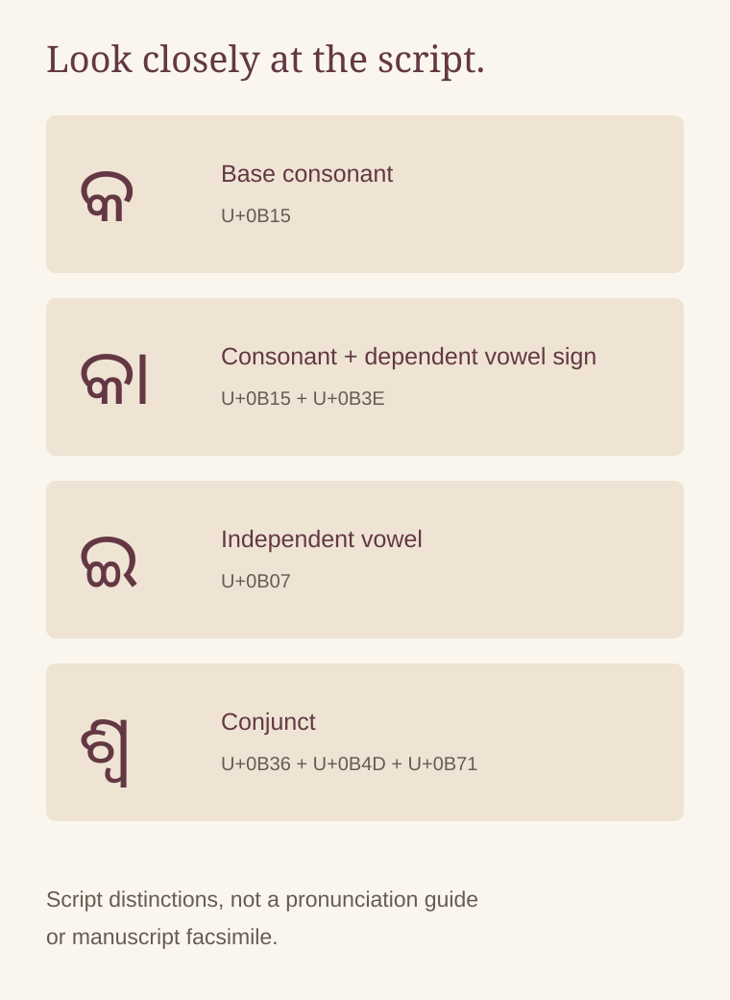

# Reading Abana Rasataranga: letters, vowels and poetic constraint

By Ahimanikya Satapathy

A constraint in poetry can begin with the shape of writing. The Odia Wikisource introduction to Upendra Bhanja’s *Abana Rasataranga* describes avoiding attached vowel signs, exemplified by forms such as କା and କି. That is an editorial explanation to investigate, not a reason to describe the poem as having “no vowels.”[^abana-work][^odb-abana]

*Original reading aid prepared for Project Odisha, 2026. These examples distinguish features of Odia writing; they are not a manuscript facsimile or a pronunciation guide.*[^unicode-odia]

## Begin with the visible line

The first chhanda opens:

**“ଜୟ ଭକତବତ୍ସଳ ଜଗତ ଇଶ୍ୱର”**

In this transcribed line, no dependent vowel sign is attached to a consonant. Yet **ଇ**, an independent vowel letter, is present, and the line contains conjunct consonants. The observation is about this line’s written form.[^abana-opening]

A reader can check the distinction without first making a claim about every page of the work. Look at the individual letters, then at the ways they combine. What appears to be a simple absence becomes a more precise question about which resources of the script remain available.

## A vowel sign is not every vowel

In Odia writing, a consonant letter can carry an inherent vowel. A dependent sign changes the vowel associated with a consonant; an independent vowel is written as a letter in its own right. The Unicode Standard distinguishes these forms and explains the virama’s role in suppressing an inherent vowel and forming conjuncts.[^unicode-odia]

The diagram separates **କ** from **କା**, while **ଇ** illustrates an independent vowel and **ଶ୍ୱ** a conjunct. These categories should not be collapsed into the English phrase “without vowels.” A restriction on attached signs concerns orthography—the way language is written. It does not mean that a reader produces consonant sounds alone.

A conjunct joins consonants; a vowel sign changes the vowel. The diagram helps distinguish those features.

## What a printed page changes

The digital versions raise a question that a printed page helps us examine. Wikisource and OVA both include **ହୋଇଥିବାର** in the first chhanda’s seventh stanza; it contains attached vowel signs.[^abana-opening][^ova-bhanja]

A printed edition revised by **Sridhar Rao** gives different wording in stanza 7 and does not contain that word. Its verse sits above a dividing rule; explanatory prose appears below. Other checked spellings also differ:[^abana-print-rao]

| Location | Wikisource reading | Printed reading |
| --- | --- | --- |
| First chhanda, stanza 15 | ଜଟା | ଜଟ |
| Third chhanda, stanza 21 | କନ୍ୟା | କନ୍ୟ |

The digital forms have an attached ā sign; the printed forms do not.[^abana-opening][^abana-third]

These differences matter when explaining the constraint. Ordinary spelling cannot simply be substituted into a constrained poem without changing the feature under discussion. Nor should a digital reading be silently altered: a comparison should preserve both versions and identify their sources.

The printed comparison establishes these local differences, not how they arose or which reading is earliest. Verse, prose explanations, raga names and headings must also be distinguished before testing a rule about the poem.

A visual screening of the running verse across all twelve chhandas in this printed witness found **no clear dependent-vowel-sign exception**. That finding is consistent with the stated restriction. Worn letterforms limit certainty: this is a reading of one printed witness, not a character-perfect transcription or proof about every edition.[^abana-print-rao]

## Reading a constraint as a choice

Try a small exercise with a familiar sentence: choose a writing restriction, then notice which words you can no longer use. What must you rephrase? What happens to tone or clarity? This is an invitation to experience the pressure of a constraint, not a reconstruction of Bhanja’s compositional process.

Return afterwards to the original Odia. An English paraphrase can explain an idea while losing the visual condition under which it is expressed. Our [alankara article](alankara-and-bhanja.md) follows repeated initials and comparison; here, the first task is to distinguish the letters and signs precisely. Both approaches reward a close look before a large claim.

## Footnotes & Sources

[^abana-work]: [*Abana Rasataranga*, Odia Wikisource](https://or.wikisource.org/wiki/ଅବନା_ରସତରଙ୍ଗ), introductory note, revision 57615, inspected 23 October 2026. The definition is modern editorial commentary without an identified printed witness on this page; it is not quoted as Bhanja’s own explanation.
[^abana-opening]: Upendra Bhanja, [*Abana Rasataranga*, first chhanda](https://or.wikisource.org/wiki/ଅବନା_ରସତରଙ୍ଗ/ଜୟ_ଭକତବତ୍ସଳ_ଜଗତ_ଇଶ୍ଵର), stanza 1 opening and stanzas 7 and 15, digital transcription inspected 23 October 2026. Script observations are confined to the displayed text; no manuscript collation or whole-work verification is claimed.
[^unicode-odia]: Unicode Consortium, [*The Unicode Standard*, version 16.0, chapter 12](https://www.unicode.org/versions/Unicode16.0.0/core-spec/chapter-12/), sections 12.1 on Indic writing and 12.5, “Oriya (Odia),” especially vowel letters and rendering behaviour. Used to explain writing categories, not as a literary authority on Bhanja’s constraint.
[^ova-bhanja]: Odia Virtual Academy, [*Abana Rasataranga* digital reader](https://ova.gov.in/en/ReadEbooks?bid=NXPqPwFdaJc%3D), first chhanda, stanza 7, inspected 23 October 2026. The reader was recovered after the earlier book-record timeout. Digital text, not an inspected printed scan; edition and textual independence unresolved.
[^odb-abana]: Soumya Biswajit / Odissi & Beyond, [Abana post](https://www.instagram.com/odissiandbeyond/reel/DPjXaspE0H2/), caption screened in the 23 October 2026 survey. Credit for the research lead; the full video has not been analysed.

[^abana-print-rao]: Upendra Bhanja, [*Abana Rasataranga*, printed scan](https://drive.google.com/file/d/1jidGiqo3RIqitDN8-mylQRu1cGyVt0l_/view), title page and printed pp.2, 4 and 30 (PDF pp.1, 3, 5 and 31). Title credits revision to Sridhar Rao; publication date unconfirmed. Linked by Odia Bibhaba catalogue record 13526; scan watermarked “Digitized by PPRACHIN, SOA.” Verse visually screened across PDF pp.2–112; PDF p.113 is an advertisement. Headings, raga names, annotation numbers, prose commentary and completion labels excluded. Selected differences checked at higher resolution; not a character-perfect transcription or multi-edition collation.

[^abana-third]: [*Abana Rasataranga*, third chhanda](https://or.wikisource.org/wiki/ଅବନା_ରସତରଙ୍ଗ/ଅଜନନ୍ଦନ_ନନ୍ଦନ_ଭ୍ରମଣବନ), Odia Wikisource, stanza 21, revision 57616. Digital କନ୍ୟା compared with printed କନ୍ୟ on printed p.30 / PDF p.31 of the Sridhar Rao-revised witness.

## Further reading

- [Alankara and Bhanja](alankara-and-bhanja.md)
- [Bhanita and poet signatures](bhanita-and-poet-signatures.md)
- [Poetic craft research guide](poetic-craft-research-guide.md)

**[Suggest an update](https://projectodisha.org/contribute/?page=kb%2Fresearch%2Fculture%2Fabana-rasataranga.md):** identify the edition, page and exact Odia reading. GitHub submissions are public; omit private contact details and consent documents.
