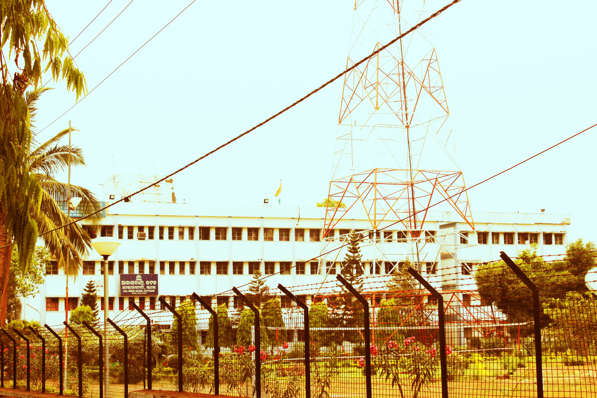

# ଆକାଶବାଣୀ କଟକ | AIR Cuttack: where stories found another voice

By Ahimanikya Satapathy

A radio play gives the listener no stage to look at. A voice must establish who has entered; a pause can change the meaning of a reply. Music can carry a transition that a film might show through an image. The listener supplies a room, a face, a distance. This makes radio an art of collaboration between people making sound and people imagining what it means.

AIR Cuttack belongs within the history of Odia storytelling for that reason. Its importance reaches beyond the installation of a transmitter. It offered another place for writers, actors and musicians to work, and another form in which a story could meet its audience.

## 1948: a new institution in a city of stories

All India Radio’s Cuttack station opened in **1948**. The district administration’s history places its early establishment in the old Madhupur building.[^district] Radio enthusiast Jose Jacob’s account of an engineer-guided visit dates the inauguration to **28 January 1948**: a temporary studio at Madhapur House and a small transmitter at Killa Fort.[^visit]

**ସୀତା ବିବାହ (Sita Bibah)** appeared in 1936, before AIR Cuttack. The [cinema history](odia-cinema.md) follows its earlier stage connections.[^cinema]

What followed was an overlapping history. A writer could work for theatre and broadcasting, then contribute dialogue to a film. A literary work could become a musical play. These movements are more revealing than a simple sequence in which one medium replaces another.

*All India Radio, Cuttack, photographed on 27 March 2013. Photo: Kamalakanta777, [Wikimedia Commons](https://commons.wikimedia.org/wiki/File:Akashvani_cuttack.JPG), [CC BY-SA 3.0](https://creativecommons.org/licenses/by-sa/3.0/).*

## Gopal Chhotray: the writer between the media

[Gopal Chhotray](../people/gopal-chhotray.md) connects this history with theatre and cinema. The Library of Congress recognises his contribution to reviving Gitinatya, the verse-based musical-play tradition.[^loc]

His connection with cinema can be made precise. The Gour–Parbati film archive credits him with dialogue for **ଶ୍ରୀଜଗନ୍ନାଥ (Sri Jagannath, 1950)**. The same record names C.R. Mitra for direction and screenplay.[^jagannath]

For a dramatist, dialogue is more than information. It must reveal a relationship, sustain an exchange and give an actor something to do with a line. The same writer’s presence in different media gives us a way to investigate how those skills travelled.

## A short story becomes a musical play

Odia Bibhaba’s Chhotray collection identifies **ଶ୍ରୀମତୀ ସମାର୍ଜନୀ (Srimati Samarjani)** as an opera adapted from Fakir Mohan Senapati’s short story *Patent Medicine*.[^bibhaba]

Adaptation changes the storyteller’s tools. Prose can describe a thought directly; a musical play distributes meaning between spoken exchange, singing and a performer’s delivery. Chhotray’s adaptation offers a place to listen for that change.

[Pala](/sounds-of-odisha/pala/), [Daskathia](/sounds-of-odisha/daskathia/) and [Prahallad Nataka](prahallad-nataka.md) have their own performance arrangements and histories. They offer further ways to listen for the relationship between narration, song and an audience.

## From stage response to studio recording

Lyricist Devdas Chhotray gives a performer’s view of the difference. In an interview conducted by Shyamanuja Das in 2018, he contrasts studio singing with a stage performance shaped by immediate audience response. Devdas recalls that his first recorded ghazal was composed and sung by Akshaya Mohanty for AIR Cuttack, and explains that such songs were placed under the programme category *adhunika*.[^devdas]

That recollection makes the institution visible as a working environment: a lyricist, a composer-singer, a recording and a programming category.

A stage performer can notice a response and extend a phrase. A recording fixes a particular performance for another listening situation. That difference helps explain why the same song or dramatic passage can acquire another rhythm when it moves between media.

## Who had the opportunity to be heard?

The history also needs the experiences of women performers. In an interview with David Dennen and Amir Kumar Jeetendra Nayak, Shyamamani Devi recalled opposition from relatives to a girl singing publicly, alongside encouragement within her family. She remembered becoming an Akashvani child artist in 1950; the cited recollection does not identify a station, so it belongs here as a wider broadcasting connection.[^shyamamani]

Her account gives a personal scale to the question of opportunity. An institution’s existence and a performer’s ability to enter it are different things. Her recollection brings the negotiations and determination of a working singer into a history often told through buildings and equipment.

## Making room for musicians

Programme leadership could help creative work find a home. In a 2020 retrospective, **Shyamanuja Das** credits station director **P.V. Krishnamoorthy** with encouraging lighter music and convening informal exchanges among musicians and lyricists at AIR Cuttack. Das draws on published recollections and artists’ accounts. The contribution was to make space for collaboration; the singers, composers and writers remained its creators.[^pvk]

## The work behind the voice

Jacob’s 2008 visit account describes specialised rooms in the studio complex opened in 1977: spaces for talks, drama, music, dubbing and playback. He observed computers alongside reel-to-reel tapes. His account also recalls transmission disruption during the 1999 cyclone and the effort to restore service.[^visit]

These are dated observations, but they help recover a less visible part of cultural history. A broadcast depends on technical work as well as a script or singer. Recording, editing, scheduling and transmission determine whether a performance can reach a listener at all. Preserving that history means remembering engineers and programme staff alongside the names printed on books and records.

## Listening now, preserving what remains

The listening continues. Akashvani’s official Cuttack page provides dated Odia news bulletins online.[^news]

The [Gopal Chhotray profile](../people/gopal-chhotray.md) offers a route into the writer’s work, with links for reading and listening. A specific work can be a starting point for following the people and performances around the station.

## Watch and explore

- **Literary audio catalogue: [Gopal Chhotray at the Library of Congress](https://www.loc.gov/acq/overseas-offices/delhi/salrp/chhotray.html).** Author readings, not original AIR drama broadcasts.
- **News audio listings: [Akashvani Cuttack bulletins](https://newsonair.gov.in/bulletins-city/cuttack/).** Browse dated bulletins; not a complete historical radio archive.

## Footnotes & Sources

[^district]: Cuttack district administration, [History](https://cuttack.odisha.gov.in/en/about-district/history), paragraph on 1948 and the old Madhupur building. Retrospective institutional chronology.
[^visit]: Jose Jacob, [“A visit to AIR Cuttack & others”](https://www.qsl.net/vu2jos/art/cuttack.pdf), February–March 2008 visit account, pp.1–2. Engineer-guided observations and historical recollections; equipment descriptions are dated, not a current service inventory.
[^cinema]: Kapilas Bhuyan, [PIB/IFFI cinema retrospective](https://www.pib.gov.in/newsite/erelcontent.aspx?lang=2&reg=48&relid=67399), 22 November 2010, first-feature chronology.
[^loc]: [Gopal Chhotray profile](https://www.loc.gov/acq/overseas-offices/delhi/salrp/chhotray.html), Library of Congress.
[^jagannath]: Gour–Parbati archive, [Sri Jagannath (1950)](https://www.gourparbati.com/movie_sri_jagannath.php), dialogue versus screenplay credits. Odia spelling is supplied for the film title; the source uses Roman script.
[^bibhaba]: [Gopal Chhotray collection](https://odiabibhaba.in/en/compilations/gopal-chhotray-e/), Odia Bibhaba.
[^devdas]: Shyamanuja Das, [“In Conversation with Odia Lyricist Devdas Chhotray”](https://www.sahapedia.org/conversation-odia-lyricist-devdas-chhotray), Sahapedia, interview conducted September 2018, Parts II–III. Personal recollection of studio practice and his first recorded ghazal, not a claim to the first-ever Odia ghazal.
[^shyamamani]: David Dennen and Amir Kumar Jeetendra Nayak, [“Shyamamani Devi on Odissi Music and Her Life as a Singer”](https://www.yumpu.com/en/document/view/16460695/shyamamani-devi-on-odissi-music-and-her-life-as-a-oaid-home), mirrored interview, opening section. Original interview date unverified; the cited passage names Akashvani but does not specify its station. It is used as wider broadcasting context, not proof of a Cuttack appointment.
[^news]: Akashvani News, [Cuttack bulletins](https://newsonair.gov.in/bulletins-city/cuttack/), inspected 25 October 2026. Dated listings establish online availability; no listening figures or full audio-archive survey claimed.

[^pvk]: Shyamanuja Das, [PV Krishnamoorthy and modern Odia songs](https://odishabytes.com/pv-krishnamoorthy-the-unsung-force-behind-modern-odia-songs/), OdishaBytes, 16 October 2020. Attributed retrospective, not a personnel record; sole-founder and comparative greatness claims are not adopted.

## Further reading

- [Odia television and the stories that came home](odia-television.md)
- [The Odia OTT journey and the search for an audience](odia-ott.md)

- [Odia cinema: the world in our own voice](odia-cinema.md)
- [Prahallad Nataka](prahallad-nataka.md)
- [Gopal Chhotray: Words Made for Voices](../people/gopal-chhotray.md)

**[Suggest an update](https://projectodisha.org/contribute/?page=kb%2Fresearch%2Fculture%2Fair-cuttack.md):** share a precise programme credit, dated schedule or archive reference. GitHub submissions are public; omit private contact details and consent documents.
