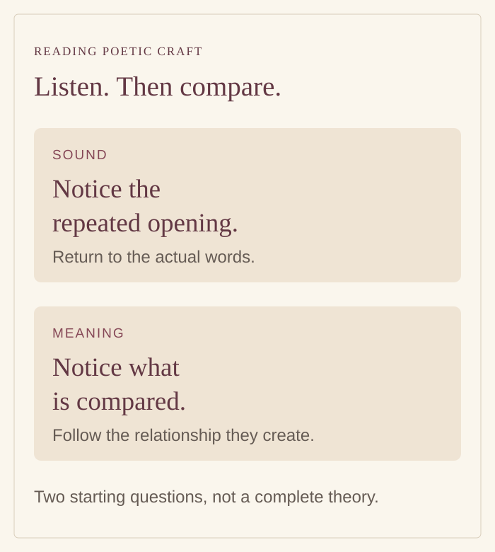

# How sound and comparison shape Bhanja’s poetry

By Ahimanikya Satapathy

A repeated sound and a vivid comparison can both hold our attention, but they ask us to notice different things. One returns to the ear. The other brings two experiences into relation. Reading a short passage closely can make that distinction more useful than memorising a long list of literary terms.[^odb-alankara]

*Original explanatory diagram prepared for Project Odisha, 2026. Sound pattern and comparison are two approaches to the passage below; the graphic is not a manuscript reproduction or a complete classification of alankaras.*

## Two ways a poem makes its effect

**Alankara** names a field of poetic embellishment and figures of expression. In her introduction to Dandin’s *Kavyadarsha*, Bhandaram Vani distinguishes figures working through sound from those working through sense. Her account of **upama**, or simile, explains the relationship of likeness between the subject and what it is compared with.[^vani-kavyadarsha]

These are useful starting distinctions, not two sealed compartments. A passage can make its comparison through carefully patterned language. We can ask about the sound without forgetting what the words mean, and ask about the meaning without treating the choice of words as incidental.

## The consonant that keeps returning

Look at the opening of the eighteenth chhanda of Upendra Bhanja’s *Baidehisha Bilasa*. In the consulted Odia transcription, the first two lines begin **ବନ୍ୟା** and **ବିଟପ**. Both start with the consonant **ବ**, although their vowel signs and subsequent sounds differ. The recurring initial continues through the passage.[^bhanja-chhanda18]

The local observation belongs to a larger design. In the publicly accessible extract of her 2026 review, Ishita Banerjee identifies the work’s repeated **ba** verse openings.[^banerjee-bhanja2026] It is more precise to notice the recurring consonant than to say that every word starts with an identical spoken syllable. A page’s line wrapping can also change with an edition or screen size; it should not be mistaken for the poem’s formal units.

Try reading a few openings aloud before reading the whole passage. Then return to the sentences. Does the pattern remain conspicuous, or does the action draw your attention away from it? This is a listening experiment, not a claim that every reader must hear the same effect. The constraint gives us something specific to investigate in the poet’s choices.

## A comparison makes happiness tangible

Later in the same chhanda, stanza 36 contains **“ଦରିଦ୍ର ଧନ ଲଭିଲା ପରି”**—approximately, “like a poor person finding wealth.” The passage concerns reunion involving Rama, Bharata and their assembled family and company. The comparison gives that happiness an imaginable counterpart: the change experienced by someone who gains what they lacked.[^bhanja-chhanda18]

The word **ପରି**, “like,” makes the relationship visible. Calling this a simile is useful because it tells us what to examine: the experience being described, the experience brought alongside it, and the quality they share. Here, the force lies in the joy of gaining something deeply valued.

The comparison does more than provide an alternative word for “happy.” It invites the reader to understand a feeling through a situation. Return to the surrounding stanza rather than extracting the phrase as a definition valid everywhere. A comparison takes its force from the scene in which it appears.

## When a poet names his own devices

In *Subhadra Parinaya*, Bhanja gives readers another way into poetic craft: the poem itself names devices. In the Odia Virtual Academy’s digital text, the first chhanda moves from an appeal to attentive listeners in stanza 15 to a sequence of technical terms in stanzas 16–18. Among them are **ଶ୍ଲେଷ** (*shlesha*) and **ଯମକ** (*yamaka*) in stanza 16, and **ଅନୁପ୍ରାସ** (*anuprasa*) in stanza 17.[^bhanja-subhadra-ova]

A **1939 fourth edition** confirms the device list and shows why edition comparison matters. Its stanza 16 prints **ରୂପକ** (*rupaka*), where the OVA transcription reads **ରୂପ**. The printed reading supplies the fuller technical term; the difference should be recorded rather than silently harmonised.[^subhadra-print1939]

This supports a useful distinction: naming a device within a poem is different from a later reader assigning it a label. The digital text also places separate labels between some stanzas. Their editorial history is not supplied, so they should not automatically be treated as Bhanja’s own headings.

Read the named terms as an invitation to investigate. Where does the poem fulfil what it announces? Answering that requires following the words into a particular example, rather than treating the list as a complete explanation of how each device works.

## Repetition is not one single device

An initial-letter pattern should not automatically be called **yamaka**. Vani’s account of Dandin’s third chapter describes yamaka through the repetition of groups of sounds and discusses their positions within verse. That is a more specific question than whether a consonant keeps returning at the beginnings of lines.[^vani-kavyadarsha]

For this passage, the modest description is the stronger one: a recurring initial consonant and a comparison. More intricate classifications require closer work with the exact wording and a stated account of poetics. Naming a device should help explain a passage, not substitute for understanding it.

The [Abana Rasataranga reading](abana-rasataranga.md) examines a different constraint: attached vowel signs. Its digital and printed readings differ at a checked passage. Abana should not be used as a loose label for any poem with unusual lettering or repetition.

## Read, listen, then return to the words

A short English gloss can explain the comparison, but it cannot reproduce the Odia sound pattern. Keep the original wording beside an explanation when discussing how the poem works. If a singer’s rendition helps reveal a phrase, preserve the singer’s credit and the particular recording; do not assume that the printed page determines every musical decision.

The [article on bhanita](bhanita-and-poet-signatures.md) follows another detail inside a lyric: the moment when the poet’s name appears. Together, the two readings offer a practical beginning. Notice how a line starts, what it asks you to imagine, and whose voice enters it. Each observation gives you a reason to return to the poem with a more precise question.

## Footnotes & Sources

[^odb-alankara]: Soumya Biswajit / Odissi & Beyond, [alankara post](https://www.instagram.com/odissiandbeyond/reel/DZjYUmwT-Ec/), caption inspected in the 23 October 2026 archive survey. Caption rechecked for this follow-up: it locates the discussion in the first chhanda and says the devices are named in the text. OVA stanzas 15–18 corroborate that premise; the full video’s explanations have not been analysed here.
[^bhanja-chhanda18]: Upendra Bhanja, [*Baidehisha Bilasa*, eighteenth chhanda](https://or.wikisource.org/wiki/ବୈଦେହୀଶ_ବିଳାସ/ବନ୍ୟା_ଶିଖରିର_ତହିଁ_ବିପ୍ରଲବ୍ଧା_ପ୍ରାୟ_ହୋଇ), Odia Wikisource, revision 43835; stanzas 1 and 36, inspected 23 October 2026. This is a digital transcription, not a critical edition collated against manuscripts in this study. Brief literal gloss by Project Odisha, not a translation of the complete stanza.
[^banerjee-bhanja2026]: Ishita Banerjee, [review of *Baidehisha Bilasa: The Amorous Plays of Sita’s Husband*](https://academic.oup.com/jhs/advance-article-abstract/doi/10.1093/jhs/hiag022/8864960), *Journal of Hindu Studies*, 5 October 2026, DOI 10.1093/jhs/hiag022, public extract, second paragraph. Only the accessible extract was inspected; the full review is restricted.
[^vani-kavyadarsha]: Bhandaram Vani, [“Kavyadarsha,” *Indian Literary Criticism and Theory*](https://ebooks.inflibnet.ac.in/engp11/chapter/kavyadarsha/), INFLIBNET, sections “Alamkaras” and “Sabdalamkaras, Prahelikas and Dosas,” discussing Dandin II.14 and III.1. Teaching account inspected 23 October 2026; not a claim that every school classifies all devices identically.

[^bhanja-subhadra-ova]: Upendra Bhanja, [*Subhadra Parinaya*](https://ova.gov.in/en/ReadEbooks?bid=ToEVr+zu+mg%3D), Odia Virtual Academy digital text, first chhanda, stanzas 15–18. Inspected 23 October 2026. Underlying print edition unidentified; no manuscript collation or specialist translation review claimed.

[^subhadra-print1939]: Upendra Bhanja, [*Subhadra Parinaya*, fourth edition, 1939](https://drive.google.com/file/d/1p9JC9tprZu_hp55TGzysKjGNVOOi6TTp/view), printed p.2 (PDF p.7), first chhanda, stanzas 16–18; title page PDF p.2. Odia Bibhaba catalogue record 580 lists Sheikh Nazir Muhammad as editor. Title imprint: S. S. Book-Stall, Cuttack; publication leaf also names Radhamohan Pustakalaya. Selected pages visually inspected; not a full critical collation.

## Further reading

- [Bhanita and literary signatures](bhanita-and-poet-signatures.md)
- [Champu and the sakhi](champu-and-sakhi.md)
- [Poetic craft: open research questions](poetic-craft-research-guide.md)

**[Suggest an update](https://projectodisha.org/contribute/?page=kb%2Fresearch%2Fculture%2Falankara-and-bhanja.md):** identify the passage, edition and interpretation. GitHub submissions are public; omit private contact details and consent documents.
