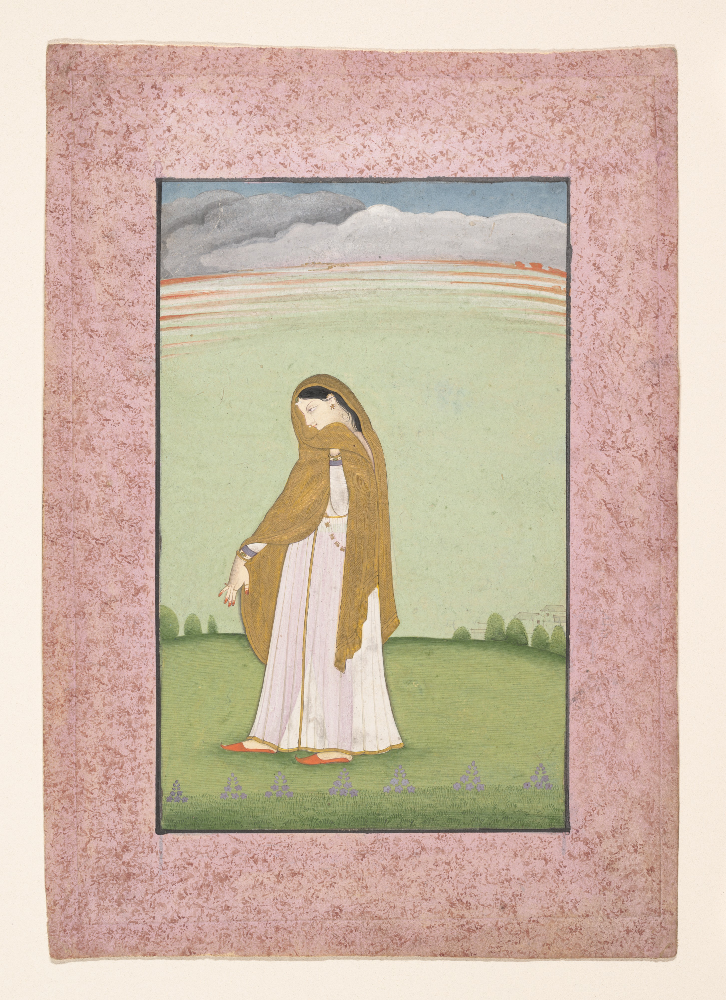

# Ashta Nayika: eight situations, many ways to tell a love story

By Ahimanikya Satapathy

*Abhisarika Nayika, a Heroine Longing for Her Lover, Kangra, c.1790–1800. The Metropolitan Museum of Art, Rogers Fund, 1918, 18.134.3; public domain. This North Indian painting illustrates the wider nayika tradition, not an Odissi costume or choreographic prescription. [Museum record](https://www.metmuseum.org/art/collection/search/37992).*

Waiting for someone can mean many things. There is the pleasure of preparing for an arrival, the uncertainty of a delay, and the hurt of an appointment deliberately broken. To call all three “a woman waiting” misses the difference that gives each situation its dramatic force.

**Ashta Nayika** offers a vocabulary for making such distinctions. The *Natyashastra*, chapter XXIV, describes eight conditions of a heroine in relation to her beloved.[^natyashastra-ch24-ghosh] Read them as dramatic situations rather than permanent personality types. A useful question is “What has happened between these people?” A label such as “the jealous woman” tells us much less about the scene and risks turning a moment into a judgment about a person.

## The eight situations

The table gives short reading glosses for verses 212–219 of the consulted translation. Spellings vary across publications and teaching lineages.[^natyashastra-ch24-ghosh]

| Name | Situation | Verse |
| --- | --- | --- |
| **Vasakasajja** | Joyfully adorns herself for an expected union. | 212 |
| **Virahotkanthita** | Distressed while her beloved is delayed by other engagements. | 213 |
| **Svadhinabhartrika** | Enjoys her beloved’s devoted presence beside her. | 214 |
| **Kalahantarita** | Longs for a beloved who left after a quarrel or jealousy. | 215 |
| **Khandita** | Angered because attachment to another woman kept her beloved away. | 216 |
| **Vipralabdha** | Deceived when her beloved fails to keep an agreed meeting. | 217 |
| **Proshitabhartrika** | Separated while her beloved is away on duties. | 218 |
| **Abhisarika** | Goes out to meet her beloved, impelled by desire. | 219 |

These compact definitions are an entrance to a work, not a substitute for its words. The lyric, introduction and choreography should decide how we understand a particular performance. If we arrive determined to identify a category immediately, we may stop attending to what the dancer is actually showing us.

## A situation is not the whole character

The eight situations belong to a wider vocabulary for constructing a dramatic character. Chapter XXXIV of the *Natyashastra* also distinguishes heroines by social or divine role: a goddess, queen, woman of high family or courtesan. It discusses qualities such as composure, playfulness, dignity and reserve.[^natyashastra-ch34-ghosh]

These classifications ask different questions. A character’s position in the dramatic world does not tell us whether she is preparing for a meeting or confronting betrayal. The same scene can involve a social role, a temperament and a changing relationship. Keeping these levels separate helps prevent the eight situations from becoming a complete account of a character—or a set of judgments about women today. The categories belong to historical conventions of drama.

## A documented place in Odissi learning

This vocabulary has a specific Odissi teaching context. REVA University’s 2019–2021 Master of Performing Arts handbook includes an Odissi practical course, **Nayika Avastha Bheda**, code M19PA3054. Its curriculum names all eight and links practical study of their situations with expressive technique and the realisation of rasa. This establishes one documented syllabus, not a universal curriculum followed by every Odissi teacher.[^reva-mpa2019-odissi-nayika]

It also suggests a useful approach for a learner: practise distinguishing the circumstances before deciding how to represent them. Ask a teacher what changes when the expected arrival becomes an unexplained absence. Ask which passage of the poem supplies that change. A careful explanation should connect interpretation with the work being performed, rather than presenting eight facial expressions to memorise.

For a viewer, the same approach can make a programme more approachable. Read the translated lyric if it is provided. Identify the speaker and the person addressed. Leave room for an interpretation to develop over several lines instead of trying to decode every movement as an isolated sign.

## From a category to a credited performance

The Joyce Theater’s programme for Nrityagram Dance Ensemble’s *Khaṅkhaṇā* lists **Khandita — Love Betrayed**, danced by **Pavithra Reddy**, in Program B. This is a concrete performance credit attached to a named presentation. The programme was inspected; the performance itself was not watched for this article.[^joyce-nrityagram-khankhana2026]

Srjan’s repertoire description places Odissi abhinaya in both Jayadeva’s Sanskrit *Gita Govinda* and Odia lyric traditions.[^srjan-odissi-repertoire] There is no need to invent a neat chart assigning one song to each nayika. A particular song-to-situation connection needs a cited text, programme or teacher’s explanation. Nor does the existence of this framework mean that every Odissi abhinaya must be organised around these eight situations.

Soumya Biswajit’s Odissi & Beyond series shows why those qualifications matter. The caption to its Kalahantarita episode explicitly corrects the selected song’s situation to **Khandita**, distinguishing it from the following ashtapadi.[^ig-DPEGDGcEwM4] Its Vasakasajja caption qualifies a selected stanza rather than assigning the entire song to that situation;[^ig-DO7uGGuiOmc] the Svadhinabhartrika caption identifies the final *Gita Govinda* ashtapadi as its example.[^ig-DPBtrgGk-2N] These are the creator’s own explanations, checked in the original captions, not an independent analysis of the complete performances. Preserving the correction makes the series more useful: the relevant unit may be a stanza, and a teaching example can require revision.

## One Radha, changing circumstances

The distinction becomes especially clear in Jayadeva’s *Gita Govinda*. In the Sanskrit text published by IGNCA, the closing stanza of song 17, in canto VIII, explicitly identifies the lament of a **khandita** young woman. Canto IX then introduces Radha as **kalahantarita**, with her companion speaking to her. These are textual anchors for the difference Soumya identifies in his correction: a song about the wound of betrayal cannot simply be relabelled as the aftermath of a quarrel.[^gitagovinda-ignca-sanskrit]

The difference matters dramatically. In the first situation, attention falls on what the beloved has done. In the next, the story turns towards the estrangement and the possibility of reconciliation. This does not make Radha two different women. It asks us to follow a relationship through a sequence of events. The companion’s intervention matters because she can address an impasse that the lovers themselves have not resolved.

By canto XII, the poem presents a very different exchange: after union, Radha asks Krishna to attend to her adornment, and he responds. Read beside the earlier rebuke, this passage makes the change in their relationship concrete. The same poem can move through hurt, persuasion and renewed intimacy; a single emotional label cannot describe the whole work.[^gitagovinda-ignca-sanskrit]

These examples also distinguish **Ashta Nayika**, the eight situations, from **ashtapadi**, a term used for the poem’s songs. The similar opening syllables do not establish a one-to-one correspondence. Soumya’s series draws on particular songs and stanzas; it is a path into the repertoire, not a claim that every song belongs permanently in one of eight boxes.

## What a painting can tell us

The illustrated Abhisarika is almost alone in the landscape. Her shawl frames her face; a flexed hand extends beyond its folds. The Met’s account draws attention to precisely that relationship between clothing, gaze and hand.[^met-abhisarika-181343] A painting can make longing legible through a still arrangement, while a sung or danced interpretation unfolds over time. Comparing the two invites attention to different artistic means without assuming that a painter’s hand position is a codified Odissi gesture.

Nor are these eight situations eight separate rasas. **Nayika** identifies a dramatic heroine; **nayika-bheda** is the broader discussion of her classifications; the eight situations describe her relationship at a particular moment. **Rasa** concerns the audience’s aesthetic experience. The [companion article on abhinaya](odissi-abhinaya.md) follows that distinction further.

## A way to watch without reducing the character

Begin with the relationship. Who is expected, remembered, confronted or sought? Then follow what changes. A pause might invite you to reconsider an earlier action; a return to a phrase might make the same words feel different. Treat these as questions for looking and listening, not as universal instructions for how a dancer must perform.

Try keeping two kinds of notes. In the first, record what you can point to: the programme’s title, the translated line, a repeated movement or a shift in direction. In the second, write your interpretation. “I understood this as hesitation” is a more useful starting point for discussion than declaring that one gesture always means hesitation. A conversation with the artist may deepen or correct that reading.

The historical framework speaks through gendered relationships and conventions. We can study its artistic value while asking how a particular production handles agency, desire, dignity and the heroine’s point of view. That inquiry should begin with the work and its makers; it should not turn the category into a rule for evaluating women’s conduct outside performance.

Keep the framework’s scope visible, too. Prahallad Nataka, Pala, Daskathia and other traditions deserve descriptions based on their own texts and practitioners. Shared expressive vocabulary does not establish that the eight nayikas organise their repertoires. The value of learning the names is to become more attentive to a story, and more precise about the questions we bring to it.

## Follow Soumya’s eight-part series

Follow the original episodes for Soumya’s terminology, examples and qualifications:

| Situation | Original episode |
| --- | --- |
| Vasakasajja | [Preparing for the meeting](https://www.instagram.com/odissiandbeyond/reel/DO7uGGuiOmc/) |
| Virahotkanthita | [Waiting and yearning](https://www.instagram.com/odissiandbeyond/reel/DO_IbE3E2-2/) |
| Svadhinabhartrika | [The beloved’s devoted presence](https://www.instagram.com/odissiandbeyond/reel/DPBtrgGk-2N/) |
| Kalahantarita | [Quarrel and estrangement—with the creator’s song correction](https://www.instagram.com/odissiandbeyond/reel/DPEGDGcEwM4/) |
| Khandita | [Betrayal and rebuke](https://www.instagram.com/odissiandbeyond/reel/DPGvb1_k7EC/) |
| Vipralabdha | [The unkept rendezvous](https://www.instagram.com/odissiandbeyond/reel/DPJXCKTk-9L/) |
| Proshitabhartrika | [The beloved away on a journey](https://www.instagram.com/odissiandbeyond/reel/DPMIi1Nk5by/) |
| Abhisarika | [Going to meet the beloved](https://www.instagram.com/odissiandbeyond/reel/DPOYedYk_Z5/) |

## Footnotes & Sources

[^natyashastra-ch24-ghosh]: [*Natyashastra*, chapter XXIV, “Harmonious Representation”](https://www.wisdomlib.org/hinduism/book/the-natyashastra/d/doc210156.html), Manomohan Ghosh’s English translation, hosted by Wisdomlib, verses 210–219. Source-specific glosses, not a survey of later classifications. Text inspected 23 October 2026.
[^reva-mpa2019-odissi-nayika]: [REVA University, Master of Performing Arts Handbook 2019–2021](https://www.reva.edu.in/naac2023/Extended_Profile/3.1/Handbook/MPA_Handbook_2019.pdf), printed/PDF p.68, course M19PA3054. Historical syllabus; no claim about current admissions or all Odissi pedagogy.
[^joyce-nrityagram-khankhana2026]: [The Joyce Theater, Nrityagram Dance Ensemble: *Khaṅkhaṇā*](https://www.joyce.org/performances/nrityagram-dance-ensemble-clk1), repertoire table, Program B column: Khandita / Love Betrayed / Dancer: Pavithra Reddy (web text lines 295–296 in the inspected capture). Programme credit inspected 23 October 2026; no viewing or critical assessment of the choreography is claimed.
[^srjan-odissi-repertoire]: [Srjan, Odissi Repertoire](https://www.srjan.com/odissirepertoire.php), Abhinaya section, inspected 23 October 2026. Institution’s account of repertoire; it supplies no complete eight-type song mapping.

[^ig-DPEGDGcEwM4]: Soumya Biswajit / Odissi & Beyond, [Kalahantarita episode and song correction](https://www.instagram.com/odissiandbeyond/reel/DPEGDGcEwM4/). Original caption inspected through the signed-in browser on 23 October 2026; no complete performance or lyric transcription. [Inspection record](../sources/odissiandbeyond-research-map.md).
[^ig-DO7uGGuiOmc]: Soumya Biswajit / Odissi & Beyond, [Vasakasajja stanza qualification](https://www.instagram.com/odissiandbeyond/reel/DO7uGGuiOmc/). Original caption inspected 23 October 2026; source-specific qualification, not a complete performance analysis.
[^ig-DPBtrgGk-2N]: Soumya Biswajit / Odissi & Beyond, [Svadhinabhartrika example](https://www.instagram.com/odissiandbeyond/reel/DPBtrgGk-2N/). Original caption inspected 23 October 2026; the creator’s association is preserved without independently mapping the complete song or choreography.

## Further reading

- [Odissi abhinaya: following a lyric into performance](odissi-abhinaya.md)
- [Odissi](odissi.md)
- [Odisha’s theatre traditions](odisha-theatre-traditions.md)

**[Suggest an update](https://projectodisha.org/contribute/?page=kb%2Fresearch%2Fculture%2Fashta-nayika.md):** send a precise passage, text edition or credited programme. A teacher’s explanation should retain the teacher’s name, the work discussed and permission to quote. GitHub submissions are public; omit private contact details and consent documents.

[^gitagovinda-ignca-sanskrit]: Jayadeva, [*Gita Govinda*, Sanskrit text published by IGNCA](https://ignca.gov.in/sanskrit/gita_govinda.pdf): VIII.9 and opening IX.1, PDF p.19; XII.16–25, PDF pp.27–28. Passage numbering belongs to this file; other editions may number differently. Narrative paraphrase, not a quotation from a modern English translation.
[^met-abhisarika-181343]: [The Metropolitan Museum of Art, *Abhisarika Nayika, a Heroine Longing for Her Lover*](https://www.metmuseum.org/art/collection/search/37992), 18.134.3. Museum description and public-domain image metadata checked 23 October 2026.

[^natyashastra-ch34-ghosh]: [*Natyashastra*, chapter XXXIV, Types of Characters](https://www.wisdomlib.org/hinduism/book/the-natyashastra/d/doc210233.html), Manomohan Ghosh translation, verses 25–28, inspected 23 October 2026. Historical classification of dramatic roles and qualities, distinct from the eight situations in chapter XXIV.
