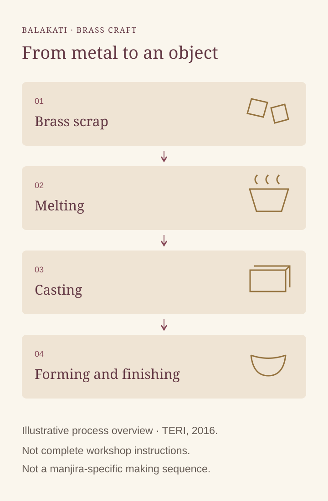

# Balakati metalcraft: the work behind the ringing

By Ahimanikya Satapathy

Follow a pair of manjira from player to maker. Balakati, near Bhubaneswar, offers a documented starting point for exploring the craft behind metal objects.[^teri-balakati2016][^odb-manjira]

*Original explanatory diagram prepared for Project Odisha, 2026, following TERI’s 2016 account of brass production. It is a process overview, not a workshop instruction sheet or a documented manjira-making sequence.*[^teri-balakati2016]

## Start with a named workshop

The NID documentation *Metal Crafts — Balakati, Orissa*, by Bibhudutta Baral, Divyadarshan C. S. and Amulya S., identifies **Sridhar Sahu** as a brass and bell-metal artisan. It records learning from his father, the participation of his wife and sons, and work with other skilled makers. Products reached the market through a dealer.[^nid-balakati]

This account makes the household visible within the workshop. It also leaves an uneven record: the named artisan’s wife participates, but her name is not supplied. A fuller account would preserve her own name, work and testimony rather than treating “family help” as a sufficient credit.

## Metal passes through several kinds of work

TERI’s **2016** cluster report covers Balakati and nearby **Bainchua, Hirapur and Rathijema**. It describes brass scrap being melted, cast into moulds, then formed and finished into products such as plates, cups and temple bells.[^teri-balakati2016]

Casting supplies material for further shaping. Finishing includes mounting an article on a rotating shaft, aligning it and polishing it. A cast form still requires skilled work.[^teri-balakati2016]

The report concerns brass production. Its sequence should not be assigned automatically to every bell-metal object, every workshop or every musical instrument. An object’s name does not tell us its alloy or the complete path by which it was made.

## Where manjira enters the story

A separate NID resource, *Bell Metal Design of Orissa*, places **manjira** within Odisha’s metalcraft products and describes paired, cupped discs joined by strings. It discusses them alongside gongs and bells, while associating the craft with Kansari metalworkers.[^ghanta-dsource]

This connects instrument and craft, but does not establish that Sridhar Sahu made the manjira in the original post. Nor does it document his method of choosing, matching or tuning a pair. Those are questions for an identified maker and an actual instrument.

Set a pair beside a bell and a gong, with their owners’ permission, and the comparison becomes more precise. Ask what each object is called locally, which parts were cast or hammered, and what a player listens for when choosing it. The answers would connect the material record with musical judgement.

## The workshop also depends on orders

TERI describes middlemen supplying brass raw material and paying artisans for conversion into finished goods. That payment had to cover labour, energy and other costs. Production depended on orders, with some units operating intermittently.[^teri-balakati2016]

These are observations from 2016, not current wages or a present-day census. They nevertheless show why a craft story needs more than admiration for handwork. Who supplies the material, who sets the order and who sells the finished object are part of the maker’s working life.

A visit or interview could follow those relationships without assuming they remain unchanged: how does an order arrive today, what work stays within the household, and which skills require another artisan? The most useful continuation would let makers describe both the object and the conditions under which they make it.

## Follow the sound back to its maker

Our [ghanta and ghanti article](ghanta-ghanti.md) follows ringing into ritual and group performance. Balakati adds a workshop perspective. Keep the maker’s credit beside the player’s, and keep the photographed object beside any explanation of its making. That is how a familiar sound can lead to a more particular account of skill.

## Footnotes & Sources

[^teri-balakati2016]: TERI, [*Cluster Profile Report — Balakati brass industries*](https://sameeeksha.org/pdf/clusterprofile/balakati-brass-Odisha.pdf), 2016, project 2014IE15; printed pp.1–3 (PDF pages 7–9), location, orders and production process. Text inspected 23 October 2026. Dated workshop observations are not current employment, income or business estimates. The report’s differing unit totals are not reproduced.
[^nid-balakati]: Bibhudutta Baral, Divyadarshan C. S. and Amulya S., NID Bengaluru, [*Metal Crafts — Balakati, Orissa*](https://www.dsource.in/sites/default/files/resource/metal-crafts-balakati-orissa/downloads/file/metal-crafts-balakati-orissa.pdf), D’source, PDF p.2, named artisan and household/workshop account. Read 23 October 2026; fieldwork date is not established. Its origin chronology and Puri district label are not adopted here.
[^ghanta-dsource]: Bibhudutta Baral and Antony William, [*Bell Metal Design of Orissa*](https://www.dsource.in/resource/bell-metal-design-orissa/introduction), NID Bengaluru, D’source, Introduction, manjira product description. Read 23 October 2026. This is wider craft context, not documentation of the particular instrument in the social post.
[^odb-manjira]: Soumya Biswajit / Odissi & Beyond, [manjira and Balakati post](https://www.instagram.com/odissiandbeyond/reel/DOOA2aRiOOX/), caption inspected in the 23 October 2026 archive survey. Credit for the research lead; workshop identity and audiovisual process analysis remain unverified.

## Further reading

- [Ghanta and ghanti](ghanta-ghanti.md)
- [Mardala](mardala.md)
- [Sakhi Nata and Sakhi Pila](sakhi-nata-and-sakhi-pila.md)
- [Sounds of Odisha](sounds-of-odisha.md)

**[Suggest an update](https://projectodisha.org/contribute/?page=kb%2Fresearch%2Fculture%2Fbalakati-metalcraft.md):** identify the maker, object, process or source passage. GitHub submissions are public; omit private contact details and consent documents.
