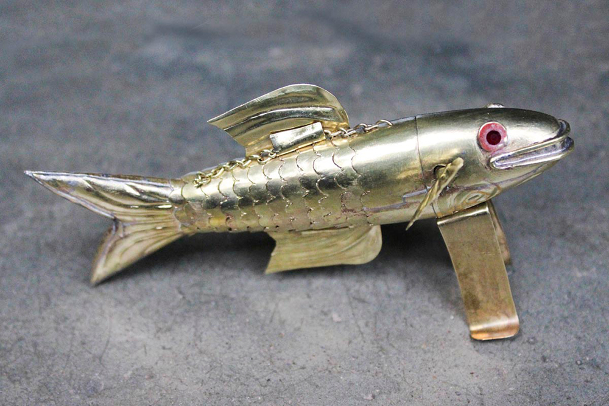

A brass fish can move because its body is assembled in parts. In Santosh Kumar Jha’s 2016 study of Bellaguntha’s craft, the head and tail are relatively rigid, while the abdomen consists of joined rings with room to move.[^1]

A flexible brass fish from the NID documentation of the Ganjam craft.[^2]

## Making room for movement

NID’s account describes brass sheet measured and cut into strips, their edges shaped into waves, and the pieces curved into successively smaller rings. Pierced holes receive brass wire that joins the parts.[^2]

Jha explains the importance of the fit: each ring sits partly inside its neighbour, with clearance that allows movement. His account follows the shaping, checking, piercing and wire-knotting that bring those separate parts together.[^1] The outline of a fish depends on repeated pieces, but so does its flexibility. A join has to hold while leaving room for the next part to move.

## A maker’s learning history

The National Institute of Fashion Technology’s profile of Pradeep Kumar Moharana identifies him as a flexible brass-fish artisan from Belasundha, Ganjam. It records his training during 1983–85 and a Certificate of Commendation at the 2023 Fine Arts Festival in Bhubaneswar.[^3]

## Learning together

In a report published on 8 December 2024, Sisir Panigrahy describes Sushant Kumar Sahu training at least twenty-five women from Palaksandha village. They were organised as the Jay Ganesh Pitala Macha women’s self-help group. The report identifies Namita Behera as its president and names trainees Mamata Kumari Moharana, Subasini Swain and Bindu Pradhan.[^4]

The trainees described the work as demanding concentration.[^4] The finished fish makes that demand easy to understand: each part must fit the next, and the joined body must still move.

## Footnotes & Sources

[^1]: Santosh Kumar Jha, [“Craft Documentation of Flexible Brass Craft of Bellaguntha, Ganjam, Odisha, India”](https://www.chitrolekha.com/V6/n3/05_Bellaguntha-brass-craft.pdf), *Chitrolekha*, 22 October 2016, pp. 44, 54–55.

[^2]: Bibhudutta Baral and Bhargava A. J., [*Flexible Brass Fish Craft — Ganjam, Orissa*](https://www.dsource.in/sites/default/files/resource/flexible-brass-fish-craft-ganjam-orissa/downloads/file/flexible-brass-fish-craft-ganjam-orissa.pdf), NID, Bengaluru, undated, pp. 11, 19. [Photograph](https://www.dsource.in/resource/flexible-brass-fish-craft-ganjam-orissa/products): [photography team](https://www.dsource.in/resource/flexible-brass-fish-craft-ganjam-orissa/credits) Hariharasudan T., Bhargava A. J. and Visvesh M. R.; D’source/NID. [CC BY-NC-SA 4.0](https://creativecommons.org/licenses/by-nc-sa/4.0/). Original image unchanged.

[^3]: National Institute of Fashion Technology, [“Pradeep Kumar Moharana — Meet the Artisan”](https://nift.ac.in/chhaap2026/PradeepMaharana.html), CHHAAP NIFT@Sabarmati, The Artisan section; page updated 16 September 2026.

[^4]: Sisir Panigrahy, [“Brass fish art of Ganjam’s Belaguntha finds new lifeline”](https://www.newindianexpress.com/states/odisha/2024/Dec/08/brass-fish-art-of-ganjams-belaguntha-finds-new-lifeline), *The New Indian Express*, 8 December 2024, training report and named participants.
