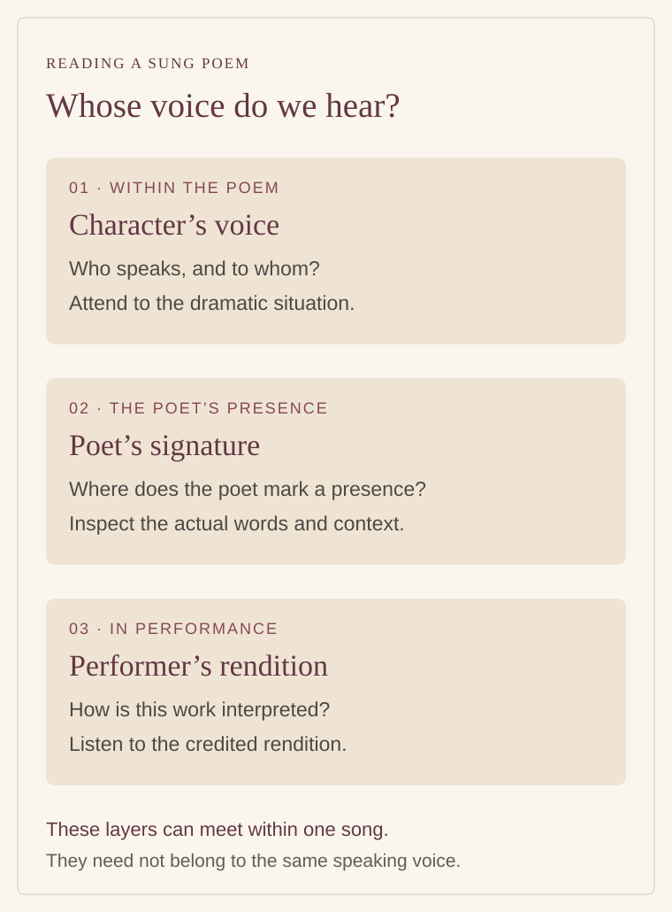

# When the poet enters the song: bhanita and literary signatures

By Ahimanikya Satapathy

A song can hold more than one voice. Someone within it speaks to a beloved or a friend. A poet gives that speech its words. A singer brings those words into the room. Near the end, a name may enter the lyric itself, inviting us to hear the poet as well as the character.[^odb-bhanita]

*Original explanatory diagram prepared for Project Odisha, 2026. These are different roles to recognise while reading and listening, not a prescribed sequence for every song.*

## What a bhanita helps us hear

In his Sahitya Akademi study of Vidyapati, **Ramanath Jha** uses *bhanita* for the poet’s name in a song’s closing couplet. His discussion concerns the transmission of Vidyapati’s songs, rather than a rule governing all Indian poetry.[^bhanita-jha-vidyapati] “Poet’s signature” is a useful starting description: a name has become part of the verbal work, instead of appearing only above it as a byline.

That distinction matters to listening. A printed author credit can be read before the poem begins. A signature within the poem arrives at a particular moment. Ask what it does there. Does it follow a character’s complaint? Does it comment on the situation? Does the singer give the name a noticeable emphasis? The answer belongs to the text and rendition being considered.

## An Odia example: Ramani Ratana

Utkal Sangeet’s transcription of **Ramani Ratana** attributes the song to **Upendra Bhanja** and identifies its work as *Lavanyanidhi*. Its opening places a woman addressing a cloud about her absent beloved. In the fourth and final stanza appears the phrase **“ଭଣେ ଉପଇନ୍ଦ୍ର”**—approximately, “Upendra says.” The spelling here follows the posted transcription.[^bhanita-ramani-ratana]

The small phrase changes what a reader needs to distinguish. The character’s longing and the poet’s named presence belong to the same composition, but they are not the same speaker. Nor does a poet’s use of a character’s voice turn the scene into a report of the poet’s private life.

Return to the beginning after noticing the name. Who addresses the cloud? Whose absence gives the speech its urgency? Then return to the close and consider how the named poet frames the completed utterance. This is a useful exercise even before attempting a detailed literary interpretation of the whole song.

The transcription is an accessible witness, not a critical edition collated here against manuscripts. It establishes the wording presented on that page. It does not establish that every singer preserves identical words or that the musical setting has remained unchanged through time.[^bhanita-ramani-ratana]

## A name can enter before the close

A closing signature is one possibility, not a universal position for a poet’s name. The first chhanda of *Subhadra Parinaya*, in the Odia Virtual Academy’s digital text, offers a useful comparison. **Stanza 10** names **ଉପଇନ୍ଦ୍ର ଭଞ୍ଜ** and announces the telling of Subhadra’s story in song. The name returns in **stanza 66**, the chhanda’s last stanza, within a prayer asking that the poet’s distress be removed.[^bhanja-subhadra-ova]

The same two placements can also be checked in a **1939 fourth edition**: stanza 10 on printed page 1 and stanza 66 on printed page 6. This supplies a printed witness alongside the digital text.[^subhadra-print1939]

The two appearances have different work to do: one introduces an undertaking; the other places the named poet within a devotional appeal. They occur within a single chhanda, not simply at opposite ends of the whole work. This is an example of named self-reference, rather than a reason to impose one definition of *bhanita* on every occurrence of a name.

Notice both position and purpose. Finding the name is the beginning of the reading; the surrounding sentence tells us why it matters there.

## A signature is evidence, not a final verdict

Jha’s account also explains a difficulty. In the Vidyapati corpus, he reports signatures being added, altered or omitted during transmission and collection. A famous name inside a song therefore cannot, by itself, settle authorship.[^bhanita-jha-vidyapati]

That evidence comes from a different literary setting. It does not prove that the Bhanja example above is misattributed. It gives us a better question to ask of any attribution: what supports the name besides its occurrence in one version?

An editor can compare the signature with a dated edition, manuscript, scholarly catalogue or another independently documented version. A difference should be preserved long enough to understand it. Silently replacing one name or spelling with another makes the record look tidier while removing the very evidence that needs explanation.

## Keep the singer in the record too

A poet’s signature does not replace the credits of a performance. The words, musical setting, teaching lineage and particular rendition involve different kinds of work. If a recording identifies them, keep those names with it. If it does not, leave the missing credit open rather than assigning every contribution to the name heard in the final stanza.

One accessible upload of *Ramani Ratana* makes these distinctions concrete. The channel **odia melody** credits **Annapurna Acharya** as singer, **Bhikari Charan Bala** for music and **Upendra Bhanja** for lyrics. Its title labels the recording **1977**, while the page gives an upload date of **25 February 2014**. Those dates describe different events; the earlier date is the uploader’s attribution, not an inspected recording-session document.[^ramani-annapurna-upload]

For a useful listening note, record the song’s opening words, the edition or transcription consulted, the signature’s actual wording, and the credited singer. Add a timestamp if the signature can be heard in a recording. These few details make it possible for another reader to find the same passage and compare the evidence.

This connects with the [Champu and sakhi article](champu-and-sakhi.md), where identifying the person speaking changes our understanding of a dialogue, and with [Odissi abhinaya](odissi-abhinaya.md), where the poem becomes a performance. The signature adds another question to those readings: when the poet’s name enters, what new relationship between words, maker and listener becomes audible?

## Footnotes & Sources

[^odb-bhanita]: Soumya Biswajit / Odissi & Beyond, [poet-signature post](https://www.instagram.com/odissiandbeyond/reel/DY7Ka5_Tib1/), caption inspected in the 23 October 2026 archive survey. Caption and selected on-screen subtitles inspected. At approximately 1:03, the displayed Odia line matches Subhadra Parinaya’s first chhanda, stanza 10, identifying the quoted passage. Stanza 66 was checked separately in OVA. This is a visual excerpt match, not a complete audio or performance analysis.
[^bhanita-jha-vidyapati]: Ramanath Jha, [*Vidyapati*](https://sahitya-akademi.gov.in/pdf/Vidyapati.pdf), Sahitya Akademi, first published 1972; 2017 reprint, printed p.39 / PDF p.41, discussion of signature and textual attribution. The passage was checked directly; its observations are scoped to the Vidyapati corpus.
[^bhanita-ramani-ratana]: [Utkal Sangeet, “Ramani Ratana”](https://utkalsangeet.wordpress.com/2015/07/05/ramani-ratana/), posted 5 July 2015, updated 17 March 2016; attribution table and stanzas 1 and 4, inspected 23 October 2026. Brief literal gloss by Project Odisha, not a translation of the complete lyric. Recordings listed on the page were not audited for this article.

[^bhanja-subhadra-ova]: Upendra Bhanja, [*Subhadra Parinaya*](https://ova.gov.in/en/ReadEbooks?bid=ToEVr+zu+mg%3D), Odia Virtual Academy digital text, first chhanda, stanzas 10 and 66; inspected 23 October 2026. Print edition unidentified; no manuscript collation.

[^ramani-annapurna-upload]: odia melody, [“Ramani Ratana Meghaku…”, sung by Annapurna Acharya](https://www.youtube.com/watch?v=H0_wPW5fCyE), title and expanded description inspected in Chrome, 23 October 2026. Linked from Utkal Sangeet’s recording list. Credits and recording year are uploader-supplied; no complete listening analysis or archival master verification is claimed.

[^subhadra-print1939]: Upendra Bhanja, [*Subhadra Parinaya*, fourth edition, 1939](https://drive.google.com/file/d/1p9JC9tprZu_hp55TGzysKjGNVOOi6TTp/view), printed pp.1 and 6 (PDF pp.6 and 11), first chhanda, stanzas 10 and 66; title page PDF p.2. Odia Bibhaba catalogue record 580 lists Sheikh Nazir Muhammad as editor. Title imprint: S. S. Book-Stall, Cuttack; publication leaf also names Radhamohan Pustakalaya. Selected pages visually inspected; not a full critical collation.

## Further reading

- [How sound and comparison shape Bhanja’s poetry](alankara-and-bhanja.md)

- [Champu and the sakhi](champu-and-sakhi.md)
- [Odissi abhinaya](odissi-abhinaya.md)
- [Poetic craft: further research questions](poetic-craft-research-guide.md)

**[Suggest an update](https://projectodisha.org/contribute/?page=kb%2Fresearch%2Fculture%2Fbhanita-and-poet-signatures.md):** identify the song, edition, signature and credited rendition. GitHub submissions are public; omit private contact details and consent documents.
