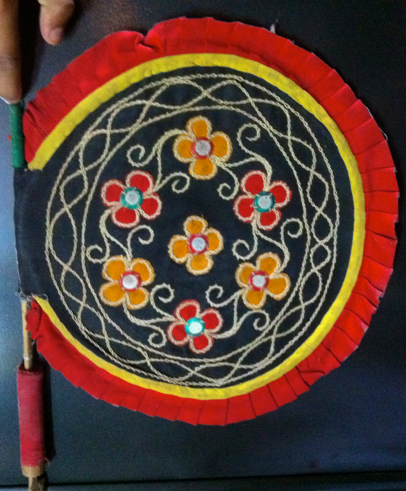

With a hand fan, a breeze is something you make. In Odisha, the binchana takes different forms. Subhashish Panigrahi’s photograph shows one decorated cloth example, with flowers, reflective centres and a bright border.[^1]

A decorated Binchana photographed in Odisha.[^1]

## Leaf and bamboo

Palm leaf offers another starting point. Sudam C. Sahu and Ankita Das’s 2024 study of plant-based artifacts draws on interviews with Odisha artisans during 2019–21. Its supplementary table records tala leaves, from *Borassus flabellifer*, among the materials used for hand fans, with Cuttack and Puri listed as locations.[^2]

In Purnachandrapur, Baripada, bamboo artisans made binchana alongside baskets. A 2 November 2017 report lists their products, distinguishing the hand fan from the kula used for winnowing.[^3]

Palm-leaf fans still had rural buyers when Shantilata Behera of Patana spoke to a reporter in 2018. The Jagatsinghpur account describes rising raw-material costs and demand for fans during power cuts.[^3] The difficulty lay partly in obtaining the leaves from which useful objects could be made.

## Cloth and occasion

A separate museum example gives a fan another setting. The Virtual Museum of Images and Sounds catalogues an Alata in the Kala Bhoomi Odisha Crafts Museum collection, on loan from SIDAC Show House. Its description places the object within appliqué work, where cloth designs are stitched to a base cloth that may be mounted on a frame. The entry associates alata with fanning kings and deities.[^4]

Panigrahi’s photographed cloth fan is a separate example; its maker and intended occasion are not identified.[^1]

Leaf, bamboo and stitched cloth give the hand fan different surfaces and forms. Looking closely at a binchana means noticing the choices that let an object move air—and sometimes carry a pattern or serve an occasion as well.

## Footnotes & Sources

[^1]: Subhashish Panigrahi, [“Binchana from Odisha”](https://commons.wikimedia.org/wiki/File:Binchana_from_Odisha.jpg), photograph dated 15 July 2013, Wikimedia Commons. [CC BY-SA 3.0](https://creativecommons.org/licenses/by-sa/3.0/). Web version resized and compressed.

[^2]: Sudam C. Sahu and Ankita Das, [“Traditional plant-based artifacts of Odisha”](https://nopr.niscpr.res.in/bitstream/123456789/63243/4/IJTK%20Vol.23%281%29%2056-66.pdf), *Indian Journal of Traditional Knowledge* 23(1), January 2024, pp. 56, 58; [supplementary table S1](https://or.niscpr.res.in/index.php/IJTK/article/download/8146/2453/29687), row 9.

[^3]: *The New Indian Express*, [“Artisans struggling to keep bamboo craft alive”](https://www.newindianexpress.com/odisha/2017/Nov/02/artisans-struggling-to-keep-bamboo-craft-alive-1689764.html), 2 November 2017, opening product list; [“Depleting palm tree cover makes life tough for artisans”](https://www.newindianexpress.com/odisha/2018/Aug/09/depleting-palm-tree-cover-makes-life-tough-for-artisans-1855302.html), 9 August 2018, Jagatsinghpur report and Shantilata Behera’s testimony.

[^4]: Virtual Museum of Images and Sounds, [“Alata (Hand Fan)”](https://vmis.in/archive-categories/collection-gallery-parent?count=24&id=1625&maxrange=0&minrange=0&page=69&siteid=0&sort=ArchiveCategorys.cl_ArchiveCategoryName), Kala Bhoomi collection, object 127444; documentation dated 2019–20.
