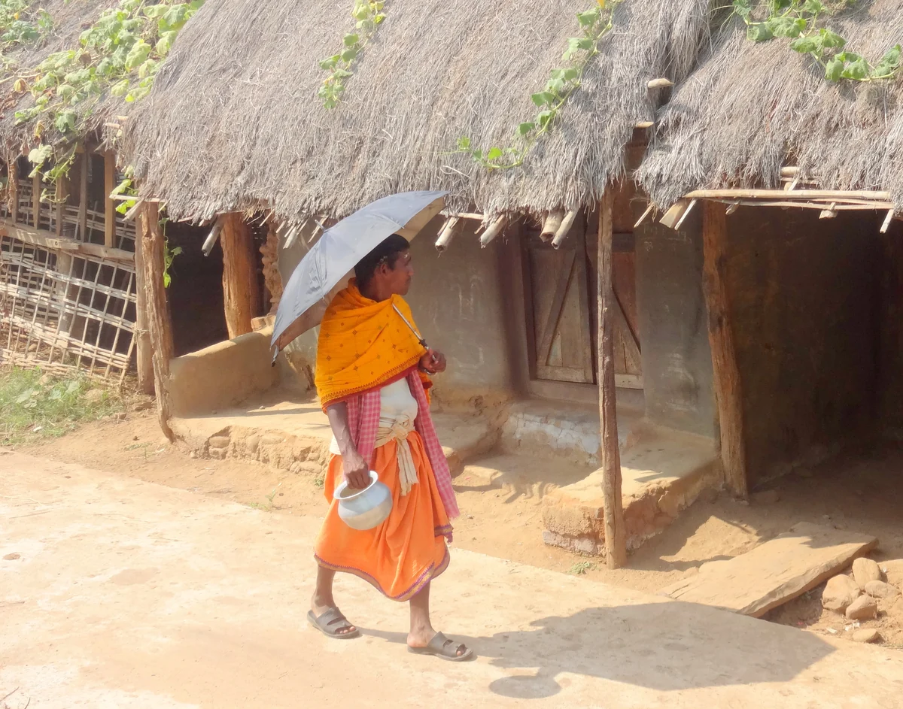

# Chakulia Panda: Verse at the Doorstep

By Ahimanikya Satapathy

Chakulia Panda songs bring poetry into an encounter between a travelling singer and a household. Deogarh district’s cultural account remembers Chakulia Pandas moving from door to door, telling stories from the Puranas through music.[^1] The name also appears in Odia folktales. Listening to the performer and reading the story character are different ways into this tradition.

*A Chakulia Panda in Odisha, photographed in 2015 by Aditya Mahar. Full-frame photograph, resized and compressed.[^5]*

## Advice carried in verse

In his 2022 study of Odia oral narratives, Pratap Kumar Dash describes a strolling singer beginning with invocations to Jagannath and Ganesh. He identifies the songs as *Lokahitabani* and discusses their moral and spiritual advice: care within families, opposition to dowry abuse, and consistency between words and conduct. His examples also include Gandhi and the three monkeys.[^2]

These themes place household behaviour beside religious teaching. The subject of a song can be a listener’s treatment of another person, as well as a sacred story. Dash’s account offers examples to listen for, rather than a fixed programme that every singer must follow.

## The performer and the tale

A Chakulia Panda is the father in the Alana story retold by Shrutilipi, where daughters, food and an observance shape the action.[^3] This is a character within a moral narrative. His actions cannot serve as a biography of a singer or a description of everyone associated with the name.

For the singer, the words, pacing and choices in a particular performance deserve attention in their own right.

## A new message for the form

AIIMS Bhubaneswar’s 2023–24 annual report records the development of an Odia Chakulia Panda folk song for public awareness of cleanliness, dated 2 October 2023.[^4] It is a specific example of the form being used for a contemporary public message. The report does not measure how listeners responded.

For someone documenting a performance today, the useful questions are close to the singer: what is this song called, where was it learned, and which lines have changed? Keeping the performer’s name and account beside a recording would let later listeners follow those choices, as well as the tune.

## Footnotes & Sources

[^1]: Deogarh district, [“Culture”](https://deogarh.odisha.gov.in/en/tourism/culture), account of musical storytelling by Chakulia Pandas. Indexed text consulted; the district page was unavailable at review.

[^2]: Pratap Kumar Dash, [“Socio-cultural and Literary Potential of the Traditional Odia Oral Narratives”](https://www.internationaljournalssrg.org/IJHSS/2022/Volume9-Issue5/IJHSS-V9I5P106.pdf), 2022, p. 40, section 3.1.

[^3]: Shrutilipi, [“ଅଲଣା ଓଷା କଥା”](https://shrutilipi.in/read_story.php?chapter_id=245), opening narrative. A ritual tale, not a historical account.

[^4]: AIIMS Bhubaneswar, [*Annual Report 2023–24*](https://aiimsbhubaneswar.nic.in/wp-content/uploads/2025/06/Annual-Report-23-24-1.pdf), p. 145 (PDF p. 155), item 14.

[^5]: Aditya Mahar, [“Chakulia panda walking at a village area in Odisha”](https://commons.wikimedia.org/wiki/File:Chakulia_panda_walking_at_a_village_area_in_Odisha.JPG), 15 November 2015, own work, [CC BY-SA 4.0](https://creativecommons.org/licenses/by-sa/4.0/). Resized and compressed without cropping, under the same licence; the creator does not identify the person or exact village.

## Further reading

[Pala: poetry with people around it](https://projectodisha.org/sounds-of-odisha/pala/)

[Daskathia](https://projectodisha.org/sounds-of-odisha/daskathia/)

[Odia literature](https://projectodisha.org/literature/)
