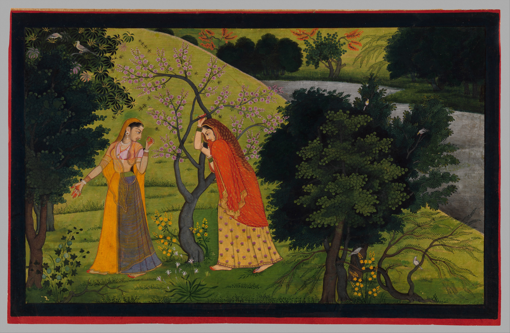

# Champu and the sakhi: the friend who moves the story

By Ahimanikya Satapathy

*Radha with Her Confidant, Pining for Krishna, from the Second or Tehri Garhwal Gita Govinda, c.1775–80. The Metropolitan Museum of Art, Gift of Steven Kossak, The Kronos Collections, 2020, 2020.383; public domain. This later Pahari interpretation of Jayadeva’s poem is not an illustration of Kishorachandrananda Champu. [Museum record](https://www.metmuseum.org/art/collection/search/662782).*

A love story can appear to have only two essential people. Yet a third person often makes the conversation possible. Someone listens to the complaint, carries news, interprets another person’s behaviour or urges a meeting. In Radha–Krishna literature, the **sakhi**, a female friend or confidante, can occupy that active position. Understanding her requires more than translating the word as “friend”: we need to ask what she does in the particular passage.

## A composition that must also be heard

**Champu** combines prose and verse. Kavisurya Baladeva Rath’s *Kishorachandrananda Champu* also belongs to a sung tradition. Kalicharan Pattanaik’s account in the 1958 journal volume describes Sanskrit prose, a Radha–Krishna subject and songs moving through initial letters from ka to ksha, with verse organised through raga and tala.[^champu-pattanayak1958]

The alphabet is therefore a compositional structure as well as an ordering device. A listener encounters successive songs; a reader can also follow the pattern of their beginnings. Neither observation by itself explains the musical setting. A letter does not prescribe a melody, and a title does not tell us how one teacher or singer interprets a passage.

Pattanaik’s account adds another layer: he recalls collecting Champus in 1932 and arranging them for dramatic staging.[^champu-pattanayak1958] That testimony reminds us to distinguish a literary work from a later presentation of it. A sung passage, a printed text, a staged adaptation and a dance interpretation may share material while asking different things of a performer and audience.

## Listen for the reply

Bigyani Das’s educational account of the work offers a useful entry into its dialogue. In the opening ka song, Radha addresses Lalita; the kha song gives Lalita’s response; the ga song returns to Radha. The account also names Krishna, Madhumangala and companions among the work’s characters.[^champu-das2011]

That exchange changes the task of listening. A question may invite reassurance, tease the person addressed or conceal an uncertainty. A reply can answer its literal wording while redirecting its emotional meaning. These are possibilities to investigate in the actual text, not translations of the three songs. Before describing what a passage means, establish who is speaking and to whom.

In his discussion of Lalita, Soumya Biswajit identifies the speaker rather than treating the description of Krishna as an anonymous devotional utterance. His suggestion that the poet’s devotion enters Lalita’s description is an interpretation worth considering alongside the character’s immediate purpose.[^odb-lalita-krishna] The character’s voice and the poet’s artistic choices can be heard together without becoming the same thing.

Lalita should not, however, be made the automatic name of every sakhi in every Radha–Krishna text. A role and a named character are different kinds of information. Each work must tell us whom we are hearing.

## The confidante in the Gita Govinda

Jayadeva’s *Gita Govinda* provides a related but separate literary world. At the opening of canto IX in IGNCA’s Sanskrit text, the narration places Radha in the situation of kalahantarita and introduces her companion speaking to her. The friend participates in the movement of the story at a moment of estrangement.[^gitagovinda-ignca-sanskrit] The [Ashta Nayika article](ashta-nayika.md) follows the adjacent passages that make this shift especially clear.

The painting above offers another interpretation of companionship. Radha leans against a flowering tree while her sakhi stands nearby. The Met describes the friend as listening or singing.[^met-sakhi-2020383] The image leaves room for attention to both figures: the distressed person and the person who remains with her. It also reminds us that a literary relationship can be reconsidered by artists in another place and century.

For performance, a useful question follows. When a singer or dancer turns from Radha’s address to a companion’s reply, how does the audience recognise the change? The answer belongs to the particular rendition—its phrasing, introduction, movement and musical decisions. The question brings the sakhi into focus as a participant, rather than scenery surrounding the lovers.

## Persuasion changes the scene

A specific visual interpretation makes the sakhi’s work easier to recognise. LACMA’s *Confidante Persuading Radha as Krishna Flutes*, a Kangra folio of about 1820 attributed to Purkhu, places the friend’s persuasion beside Krishna’s waiting. The museum identifies the passage as *Gita Govinda* 11:20:2: the confidante urges Radha towards reconciliation. The folio carries text on its reverse, giving the image a connection to a particular passage rather than merely to the lovers in general.[^sakhi-lacma-M71497]

Cleveland’s related *Sakhi persuades Radha to meet Krishna*, dated about 1820–25 and attributed to Purkhu, offers another device. Its curatorial description identifies Krishna twice within the same painting, preparing a bed of leaves in one place and looking towards Radha in another. The confidante encourages Radha to approach him.[^sakhi-cleveland1989334] Repetition within a picture can thus hold different actions together; in a performance, those actions would unfold through time.

These examples suggest a more precise question than “Is the friend present?” Ask what she is trying to change. Listening, carrying a message and persuading someone to act are different contributions to a scene. Return to Lalita’s exchanges in the Champu with that distinction in mind, while keeping the two works separate. The museum folios interpret the *Gita Govinda*; they do not illustrate Baladeva Rath’s Champu.

## A work carried through several media

The Odissi Research Centre reports producing three cassette volumes of the Champu songs and a notation publication with two cassettes called *Champu-Sarani*. Its account describes a deliberate effort to preserve and bring consistency to singing.[^champu-orc-rti] Such a project makes questions of transmission visible: which version was recorded, what the notation preserves, and what still depends on hearing a teacher.

Digital access adds another route. A Centre for Internet and Society interview with **Prateek Pattanaik** documents his work bringing the Champu to Odia Wikisource. The [digital text](https://or.wikisource.org/wiki/କିଶୋରଚନ୍ଦ୍ରାନନ୍ଦ_ଚମ୍ପୂ) offers a contents list of the songs and their opening words, giving a reader a practical starting point for locating a passage.[^champu-cis-digitisation]

The alphabetic design still requires attention to the edition. Wikisource’s editorial note explains the placement of **sa before ṣa** in terms of the emotional sequence. That is a useful qualification to a simple claim of alphabetical order; it should be checked against a printed witness before being treated as a rule shared by every edition.[^champu-wikisource]

Soumya Biswajit’s [book announcement](https://www.instagram.com/odissiandbeyond/reel/DTvQV3hE0Rg/) describes *Kishorachandrananda Champu: A Complete Study in Multiple Mediums* as bringing together audio and pattachitra paintings associated with the songs.[^odb-champu-multimedia] That description belongs to the author; the book itself has not been reviewed here. It nevertheless points towards a productive form of study: read a passage, identify its speaker, listen to a credited rendition, then ask what an illustration chooses to make visible.

The media will not necessarily say the same thing in the same way. A recording unfolds through time. Notation selects what can be represented on the page. A painting holds an arrangement of people, gestures and surroundings in view. Comparing them works best when each retains its own maker’s credit and its connection to a specific passage.

The sakhi gives this enquiry a particularly good starting point. Follow her question, her reply and her presence. What does she know that another character does not? What does she persuade someone to do? What can the story say because she is there?

## Footnotes & Sources

[^odb-lalita-krishna]: Soumya Biswajit / Odissi & Beyond, [Lalita describing Krishna](https://www.instagram.com/odissiandbeyond/reel/DNmriztTVTG/). Original caption inspected in the signed-in archive survey, 23 October 2026; attributed interpretation, not a complete lyric transcription.
[^champu-pattanayak1958]: Kalicharan Pattanaik, [“Odissi Music,” Journal of the Music Academy Madras, XXIX (1958; published 1959)](https://musicacademymadras.in/catalogue/files/journals/Vol.29_1958.pdf), printed p.87, Champu section. Historical testimony; spelling variants retained in the research dossier.
[^champu-das2011]: Bigyani Das, [Project Champu, Chhanda and Odissi, Utkarsa, 14 June 2011](https://archive.odishasociety.org/media/newsletters/UtkarsaJune2011.pdf), pp.44–48, especially 45–46. Secondary guide to characters and opening exchanges. Its internally inconsistent 1876 composition date is not used.
[^gitagovinda-ignca-sanskrit]: Jayadeva, [Gita Govinda, IGNCA Sanskrit text](https://ignca.gov.in/sanskrit/gita_govinda.pdf), IX.1, PDF p.19; numbering specific to this file.
[^met-sakhi-2020383]: [The Metropolitan Museum of Art, 2020.383](https://www.metmuseum.org/art/collection/search/662782), object description and public-domain image record, inspected 23 October 2026.
[^champu-orc-rti]: [Odissi Research Centre institutional disclosure](https://rtiodisha.gov.in/Pages/getDisclouser/office_id:271/section_id:2), Champu publication paragraph. Historical institutional activity, not confirmation of current stock or access to recordings.
[^odb-champu-multimedia]: Soumya Biswajit / Odissi & Beyond, [book and multimedia announcement](https://www.instagram.com/odissiandbeyond/reel/DTvQV3hE0Rg/), original caption inspected 23 October 2026. No endorsement or full review of the book is implied.

## Further reading

- [Bhanita: when the poet enters the song](bhanita-and-poet-signatures.md)

- [Ashta Nayika: eight situations](ashta-nayika.md)
- [Odissi abhinaya](odissi-abhinaya.md)
- [Champu and sakhi research dossier](../sources/champu-and-sakhi-research.md)
- [Soumya Biswajit / Odissi & Beyond](https://www.instagram.com/odissiandbeyond/)

**[Suggest an update](https://projectodisha.org/contribute/?page=kb%2Fresearch%2Fculture%2Fchampu-and-sakhi.md):** share an identified edition, passage or credited recording that helps clarify the speaker or interpretation. GitHub submissions are public; omit private contact details and consent documents.

[^sakhi-lacma-M71497]: [LACMA, M.71.49.7](https://collections.lacma.org/object/28880), object record and curatorial notes, checked 23 October 2026. Passage numbering 11:20:2 follows that record; no modern translation is reproduced.
[^sakhi-cleveland1989334]: [Cleveland Museum of Art, 1989.334](https://www.clevelandart.org/art/1989.334), object description, checked 23 October 2026. The account of repeated figures follows the museum’s interpretation.

[^champu-cis-digitisation]: [Centre for Internet and Society, interview with Prateek Pattanaik](https://cis-india.org/openness/blog-old/kisorachandrananachampu-on-odia-wikisource), introduction and digitisation account, inspected 23 October 2026. The account establishes his contribution; it does not certify every transcription.
[^champu-wikisource]: [Odia Wikisource, Kishorachandrananda Champu](https://or.wikisource.org/wiki/କିଶୋରଚନ୍ଦ୍ରାନନ୍ଦ_ଚମ୍ପୂ), contents and editorial note after the song list, inspected 23 October 2026. The note’s explanation is attributed to this digital edition; the underlying scanned edition has not been collated here.
