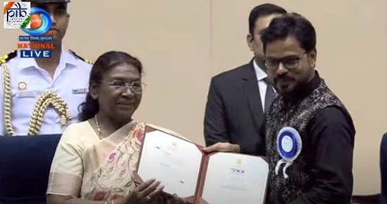

# The people behind DAMaN

By Ahimanikya Satapathy

Producer Deependra Samal encouraged Vishal Mourya and Debi Prasad Lenka to make something distinctive. Mourya recalled that invitation while describing the beginnings of *ଦମନ (DAMaN)* in a documentary assignment in Malkangiri.[^making]

The three brought different working lives to that decision. Following them together lets us see a film taking shape through backing, preparation and the exchange of ideas.

## Vishal Mourya

*Vishal Mourya. Photo: [Shreya Mourya](https://commons.wikimedia.org/wiki/File:Vishal_Mourya_Film_Maker.jpg).*

Mourya’s route began outside film. Originally from Gwalior, he studied engineering and worked as a software developer in Pune before leaving for filmmaking. A course led towards work in Mumbai television. On a Zoom project in 2010, he met Lenka, who was working as an editor.[^journey]

They began making things together. Mourya recalled financial difficulties and a YouTube channel whose earnings helped fund their Hindi film *B for Bundelkhand*.[^journey] NFDC’s 2017 Film Bazaar catalogue lists both as writers and directors, and as producers alongside Vivek Maurya. Its story follows a farmer and his son facing drought and a strained relationship.[^bundelkhand] Their subsequent Odia work included *ବିଜୁ ବାବୁ (Biju Babu)*.[^mentis]

Mourya described a partnership in which either director could question an idea. They discussed shots together and worked through roughly ten drafts of *DAMaN* before shooting.[^journey] The collaboration left room for a story to change before the camera began recording it.

## Debi Prasad Lenka

*Debi Prasad Lenka at the 70th National Film Awards ceremony; broadcast frame. Photo: [PIB / DD National broadcast frame, via Cinema Express (8 October 2024)](https://www.cinemaexpress.com/tamil/photos/2024/Oct/08/70th-national-film-awards-mani-ratnam-rishab-shetty-nithya-menen-and-others-receive-awards).*

Lenka’s path connects Cuttack, film training, editing and television. His professional biography describes a three-year filmmaking course and work as an assistant director and editor in Odisha and Mumbai. A 2022 *Sunday Post* profile identifies him as an alumnus of the Biju Patnaik Film and Television Institute of Odisha.[^background][^training]

His work extended beyond feature films to documentaries, corporate and government productions, and a commercial for the 2018 Men’s Hockey World Cup.[^catalogue] Mentis Films identifies both Lenka and Mourya as founders.[^mentis]

For *DAMaN*, Lenka recalled a fifteen-day workshop before filming. Preparation helped the team revise dialogue and translate passages spoken by tribal characters.[^workshop] He also edited the film.[^catalogue] His contribution runs through several stages of storytelling: words prepared for performance, voices testing them, and performances brought together in the edit.

## Deependra Samal

Samal produced *DAMaN* under JP Motion Pictures; the CBFC’s certification record names him alongside the company.[^certificate] The directors described his involvement in the conversation around the film, crediting him with constructive feedback and an understanding of its needs.[^workshop]

His encouragement met a story the directors wanted to tell. That connection matters to anyone hoping to make a film: an idea needs people willing to discuss it, support its development and make production possible.

Samal’s production work also extends to *ପରବ (Parab)*. Colourist Sriprasad Sahoo’s project announcement names him as producer, Chinmay Das as director and Anu Choudhury as co-producer under JP Motion Pictures.[^parab]

## A shared work reaches its audience

Beyond these three working lives is a larger ensemble. The [DAMaN film chapter](daman.md) follows its actors, music, local casting networks and healthcare context.

*DAMaN* received Best Odia Film at the 70th National Film Awards for films of 2022. The official announcement names JP Motion Pictures as producer and Mourya and Lenka as directors.[^award]

The honour makes the film visible. The working lives behind it give that recognition a human scale: a meeting on a television project, repeated drafts, preparation with actors and a producer willing to stay in the conversation. For another group of filmmakers, those are places where a new story might begin.

## Footnotes & Sources

[^making]: [Cinema Express, interview with Vishal Mourya](https://www.cinemaexpress.com/international/interviews/2022/Dec/07/daman-director-vishal-maurya-success-of-my-film-could-be-a-ray-of-hope-for-odia-filmmakers-37464.html), 7 December 2022.
[^journey]: Anish Mohanty, [interview with Vishal Mourya](https://planetbollywood.com/wp/interviews/i-am-hoping-the-hindi-version-of-daman-gets-a-lot-of-love-from-the-audience-vishal-mourya/), Planet Bollywood, ahead of the February 2023 Hindi release.
[^bundelkhand]: [NFDC Film Bazaar 2017 Viewing Room catalogue](https://filmbazaarindia.com/media/2548/viewing-room-catalogue_s.pdf), p. 78. Market entry, not an award or release record.
[^mentis]: [Mentis Films, About Us](https://mentisfilms.com/aboutus.php), filmmaker profiles and film list.
[^background]: [BookMyShow, Debi Prasad Lenka](https://in.bookmyshow.com/person/debi-prasad-lenka/2021303), professional biography.
[^training]: [Sunday Post, “My Sunday”](https://odishapostepaper.com/uploads/epaper/2022-12/639484d5e6380.pdf), Debi Prasad Lenka profile, edition labelled 4–10 December 2022.
[^catalogue]: [70th National Film Awards catalogue](https://nfaindia.org/images/pdf/70th%20National%20Film%20Award%20Catalogue.pdf), pp. 082–083.
[^workshop]: [The Federal, interview with Lenka and Mourya](https://thefederal.com/entertainment/its-not-just-kantara-odia-film-daman-is-making-waves-nationwide-meet-the-directors), December 2022.
[^certificate]: [CBFC, feature films certified in 2022](https://cbfcindia.gov.in/cbfcAdmin/assets/pdf/CC_Issued_2022.pdf), Odia table, DAMAN row 78, certified 21 October 2022.
[^parab]: [Sriprasad Sahoo, Parab production credits](https://www.linkedin.com/posts/sriprasad-sahoo-4b191a183_teaser-filmmaking-featurefilm-activity-7258783065345253376-e7k3), colourist’s project announcement.
[^award]: [PIB, 70th National Film Awards results](https://www.pib.gov.in/Pressreleaseshare.aspx?PRID=2045960&lang=2&reg=48), 16 August 2024, Best Odia Film.

## Further reading

- [DAMaN: the road from Malkangiri to national recognition](daman.md)
- [Odia television and the stories that came home](../odia-television.md)
- [What Makes the Next Film Possible](cinema-economics.md)
- [Beyond One Successful Film: Building Odia Cinema Together](cinema-futures.md)
