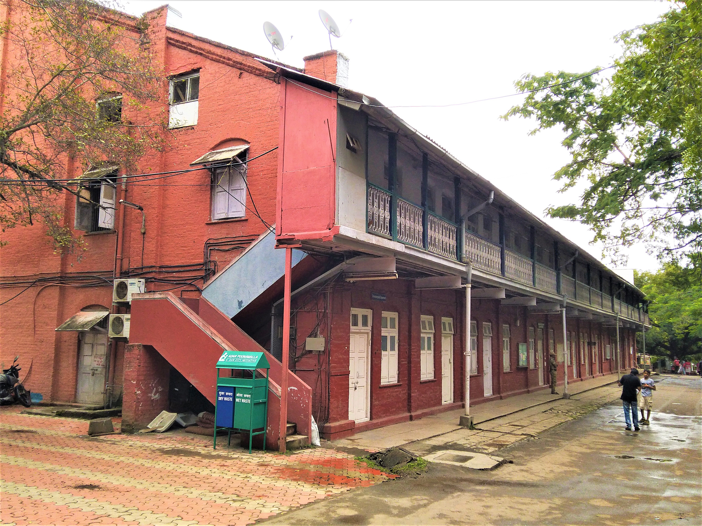

# Manmohan Mahapatra: households under pressure

By Ahimanikya Satapathy

In *କ୍ଳାନ୍ତ ଅପରାହ୍ନ (Klanta Aparanha)*, retired Adikanda lives with his mother and daughter Niru. Niru teaches alongside Sandhya and Veena, with whom she exchanges news and hopes. An anticipated marriage proposal draws the family into financial pressure: Adikanda mortgages land to raise money for the dowry.[^panorama]

The premise brings a social expectation into one household. Marriage becomes a question of property and security as well as affection. In his account of Odisha’s new-wave cinema, critic Ashok Palit discusses Mahapatra’s films through changing rural society and tensions within families.[^palit]

## Working with the filmmaker

Colleagues’ recollections add another view of his practice. In Bijay Mandal’s 2020 retrospective, actor Jayaswami described his help in developing her work while keeping actors within their characters. Susant Mani recalled subtitling and mentorship; Pradeep Mohanty remembered borrowing Mahapatra’s 35mm camera rather than hiring one from Madras.[^colleagues]

## The journey from training to recognition

The 1985 Indian Panorama catalogue identifies Mahapatra as a graduate of Utkal University who completed film-direction studies at FTII in 1975. It dates the making of *ଶୀତରାତି (Seeta Raati)* to 1976 and its national recognition to 1982.[^panorama]

The 29th National Film Awards catalogue lists *Seeta Raati* as Best Oriya Film in the awards for 1981.[^award]

*Prabhat Studio Complex at FTII, Pune, photographed in 2018. Photo: DesiBoy101, [Wikimedia Commons](https://commons.wikimedia.org/wiki/File:Prabhat_Studio_Complex,_FTII_Pune.jpg), [CC BY-SA 4.0](https://creativecommons.org/licenses/by-sa/4.0/).*

## Read the collaborators, too

For *Klanta Aparanha*, the Panorama catalogue names Nandalal Mahapatra for the story, Ranajit Ray for cinematography, Satyendra Mohanty for editing and Shantanu Mahapatra for music.[^panorama]

The story, images, editing and music carry separate credits. They offer a route into how this particular production was made.

## A practice carried by people

An actor’s guidance, a subtitled film and a borrowed camera offer different views of the same working life. These recollections invite us to follow the people around Mahapatra as closely as the awards attached to his films. [Maya Miriga](maya-miriga.md) continues the viewing journey into another filmmaker’s household story, with its own collaborators and choices.

## Watch and explore

Catalogue links checked on 26 October 2026.

- **Official catalogue: [ଶୀତରାତି (Seeta Raati)](https://nfaindia.org/images/pdf/29th%20National%20Film%20Award%20Catalogue.pdf).** National Film Awards catalogue, page 53; not streaming.
- **Official catalogue: [କ୍ଳାନ୍ତ ଅପରାହ୍ନ (Klanta Aparanha)](https://dff.nic.in/images/Documents/139_IPCatalogue1985.pdf).** Indian Panorama 1985. No authorised full-film route was established in this check.

## Footnotes & Sources

[^palit]: Ashok Palit, [“The New Wave Cinema of Odisha”](https://fipresci-india.org/wp-content/uploads/2025/01/11.-Article-Ashok-Palit-New-Wave-Cinema-of-Odisha.pdf), E-CineIndia, October–December 2024, pp. 3–4. Palit’s critical reading.
[^panorama]: Directorate of Film Festivals, [Indian Panorama 1985 catalogue](https://dff.nic.in/images/Documents/139_IPCatalogue1985.pdf), Klanta Aparanha entry and director biography. Indexed synopsis and credits. The production date is not an established release date.
[^award]: [29th National Film Awards catalogue](https://nfaindia.org/images/pdf/29th%20National%20Film%20Award%20Catalogue.pdf), Best Oriya Film, films of 1981; award recognition in 1982.

[^colleagues]: [Exit of a cinematic giant](https://www.orissapost.com/exit-of-a-cinematic-giant/). Bijay Mandal, OrissaPOST, 28 January 2020; named colleagues’ recollections.

## Further reading

- [Odia cinema: the world in our own voice](../odia-cinema.md)
- [Maya Miriga: a family, a fragile film, a second life](maya-miriga.md)

