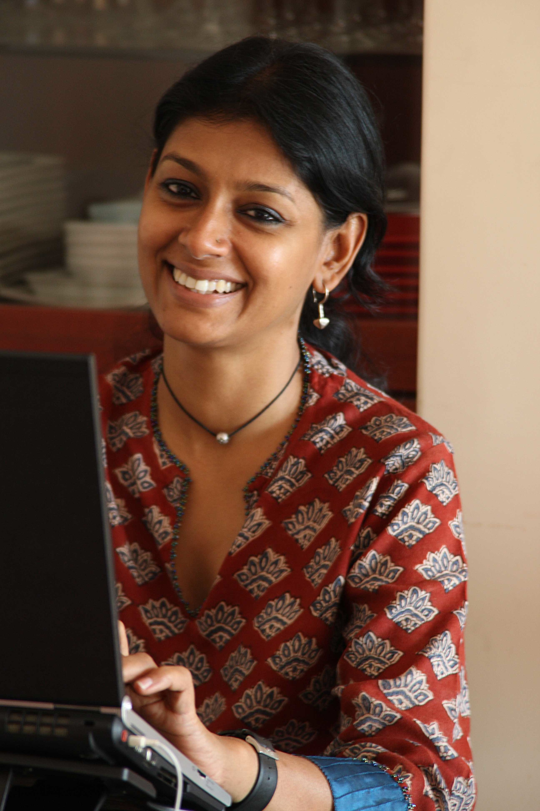

# Nandita Das: roots, routes and the stories between

By Ahimanikya Satapathy

For Nandita Das, the journey to Baripada was part of childhood. In a 2013 essay, she recalled summer visits to her father’s family home and the anticipation of arriving. She was born in Bombay and grew up in Delhi; her father, artist Jatin Das, connected her to Odisha.[^roots]

*Nandita Das, 2008. Image credited on [Wikimedia Commons](https://commons.wikimedia.org/wiki/File:NanditaDas2008.jpg) to user Nanditadas, [CC BY-SA 3.0](https://creativecommons.org/licenses/by-sa/3.0/).*

## Acting in Odia: Biswaprakash

Her connection to Odia cinema also includes acting in the language. She appears in *ବିଶ୍ୱପ୍ରକାଶ (Biswaprakash / The Young Rebel)*, Susant Misra’s 1999 film. Her official acting filmography lists the work, and the national-awards catalogue names her in its cast.[^biswaprakash]

The film received Best Feature Film in Oriya recognition for 1999 at the 47th National Film Awards. The film honour went to its producer and director.[^biswaprakash]

Odisha was part of her acting life as well as her family memory.

## Cannes: serving on a jury, bringing a film

Cannes records Das as a member of its feature-film jury in 2005 and its Cinéfondation and short-film jury in 2013. It also lists *ମଣ୍ଟୋ (Manto)*, which she directed and wrote, in the 2018 Un Certain Regard selection.[^cannes]

## Manto: a writer between two cities

*Manto* follows the writer Saadat Hasan Manto through Partition and the move from Bombay to Lahore. Cannes’ synopsis describes a life unsettled by separation, difficulty publishing and obscenity trials. Das wrote and directed the film.[^manto]

A writer’s freedom is at stake in *Manto*. In *ଜ୍ୱିଗାଟୋ (Zwigato)*, the pressures gather around earning a living.

## Bhubaneswar, seen through working lives

With *Zwigato*, Odisha becomes the setting of a film she directs. The official synopsis places a delivery rider and his family in Bhubaneswar, where changing employment shapes both his work and his wife’s search for opportunities. The film’s official page lists Hindi and Odia as its languages.[^zwigato]

In her director’s note, Das describes the challenge of making ratings, incentives and algorithmic work legible through human lives. The same page records festival premieres at Toronto, Busan and Kerala in 2022.[^zwigato]

Baripada belongs to her family memory; *Biswaprakash* to her acting work in Odia; *Zwigato* to her work in Odisha as a director. *Manto* extends that working life to another writer and another set of places.

## Watch and explore

Links checked on 26 October 2026. Playback was not tested; territory, account and payment conditions can change.

- **Paid provider listing: [ବିଶ୍ୱପ୍ରକାଶ (Biswaprakash) on Prime Video](https://www.primevideo.com/detail/Biswaprakash/0MJBHD5LPJL1VXW6T9MESR5IJM).** Check current availability and account terms; regional responses differed during verification.
- **Provider catalogue: [ମଣ୍ଟୋ (Manto) on Netflix](https://www.netflix.com/title/81039383).** The 2018 Nandita Das film. Unavailable in the returned locale during verification; this is not a current-playback assurance.
- **Paid provider listing: [ଜ୍ୱିଗାଟୋ (Zwigato) on Prime Video](https://www.primevideo.com/-/fil/detail/0SNEIZTRDXW0YU3QX1RFKCVFAD?tr=fm).** Check local availability; indexed regional listings differed.
- **Filmmaker’s page and trailer: [ଜ୍ୱିଗାଟୋ (Zwigato)](https://nanditadas.com/nandita-das-initiatives/zwigato-copy2/).** Official film page with a trailer link, not a full-film stream.

## Footnotes & Sources

[^roots]: Nandita Das, [“I am still searching for a place to call home”](https://openthemagazine.com/art-culture/i-am-still-searching-for-a-place-to-call-home/), Open, 8 August 2013. Personal essay.
[^cannes]: Festival de Cannes, [Nandita Das](https://www.festival-cannes.com/en/p/nandita-das/), jury attendance and Manto selection.
[^zwigato]: Nandita Das Initiatives, [Zwigato: story and director’s note](https://nanditadas.com/nandita-das-initiatives/zwigato-copy2/), 2022 festival premieres, not theatrical release dates.

[^manto]: Festival de Cannes, [Manto: official synopsis and credits](https://www.festival-cannes.com/en/f/manto/), 2018.

[^biswaprakash]: Nandita Das, [Acting](https://nanditadas.com/acting/), “Biswaprakash – The Young Rebel”; Directorate of Film Festivals, [47th National Film Awards catalogue](https://dff.nic.in/images/Documents/70_47thNfacatalogue.pdf), Biswaprakash cast entry and Best Feature Film in Oriya citation, printed p. 72. Film award for 1999.

## Further reading

- [Manto: official synopsis and credits](https://www.festival-cannes.com/en/f/manto/)
- [Zwigato: story and director’s note](https://nanditadas.com/nandita-das-initiatives/zwigato-copy2/)
- [Odia cinema: the world in our own voice](../odia-cinema.md)

