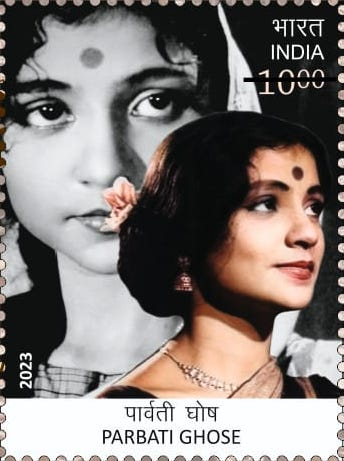
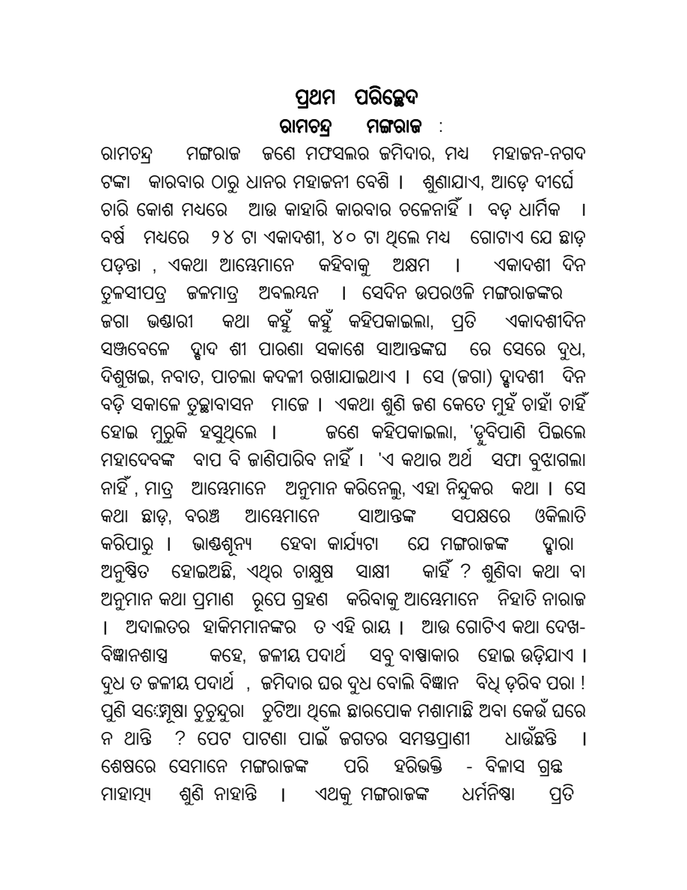

# Parbati Ghose: the woman behind the credits

By Ahimanikya Satapathy

One name in the credits invites a second look: **Shrabani**.

In the published credits for *ଛ’ ମାଣ ଆଠ ଗୁଣ୍ଠ (Chha Mana Atha Guntha)*, Parbati Ghose appears as producer, director and performer. The screenplay and dialogue are credited to Shrabani, identified there as Parbati Ghose. The archive dates this adaptation of Fakir Mohan Senapati’s novel to 1986.[^adaptation]

Parbati was both shaping the adaptation and performing within it. Writing, producing and acting met in the same working life.

*Parbati Ghose on India Post’s 2023 commemorative stamp. India Post, Government of India, via [Wikimedia Commons](https://commons.wikimedia.org/wiki/File:Parbati_Ghose_2023_stamp_of_India.jpg), [Government Open Data License–India](https://data.gov.in/sites/default/files/Gazette_Notification_OGDL.pdf).*

## Chapala before Parbati

Born in Cuttack in 1942, Parbati was also known as **Chapala** and **Chandana**. Her archive biography describes a childhood connected to books and performance: her father Basudev Naik worked at ManMohan Press, and her mother Sebati encouraged the children’s education and cultural interests. It records dance training and childhood participation in All India Radio.[^life]

Publishing, listening and performance were part of the world in which Chapala grew up. Her later career would bring those arts together through the responsibilities of making a film.

## A career built through collaboration

The Gour–Parbati archive records her as co-producer with Gour Prasad Ghose on *ଲକ୍ଷ୍ମୀ (Laxmi)*, *କା (Kaa)* and *ସ୍ତ୍ରୀ (Stree)*. It also identifies “Siddharth,” the directing credit associated with *Kaa* and *Stree*, as a collaboration involving Ram Chandra Thakur, Gour and Parbati.[^filmography]

Her producing, directing and writing credits sit alongside the work of these collaborators. [Gour Prasad Ghose’s profile](../../people/gour-prasad-ghose.md) follows his theatre and production career, while the [shared archive](https://www.gourparbati.com/) lets readers explore both lives.

## Land, power and a literary inheritance

The novel at the centre of Parbati’s adaptation concerns Mangaraj, a moneylender who exploits the colonial legal order to acquire other people’s property. Among those he ruins are the weaver couple Bhagia and Saria. Peter Samuels explains how the story turns the workings of law and rural power into satire.[^novel]

The weavers’ place in this literary world gives a reader a starting point for the adaptation: whose speech, livelihood and loss must find a form on screen?

## When a novel becomes a film

*Opening chapter of Fakir Mohan Senapati’s Chha Mana Atha Guntha, from the digitised text. Digitisation: Srujanika and NIT Rourkela; [Wikimedia Commons](https://commons.wikimedia.org/wiki/File:Chha_mana_atha_guntha.pdf), [CC0](https://creativecommons.org/publicdomain/zero/1.0/). Full page rendered from PDF page 4.*

In the adaptation, Parbati played Saria, Bijay Mohanty played Bhagia and Sarat Pujari played Mangaraj. The archive names Ashok Swain for camera, Tapas Mukherjee for editing and Prafulla Kar for music.[^adaptation]

Parbati’s Saria belongs to that ensemble: a weaver from the novel given a voice and presence alongside Bhagia and Mangaraj.

## Beyond the feature film

The archive also follows Parbati through television, radio drama, literacy work and films for public institutions. Its biography credits her with *Salabeg* for Films Division. It also identifies *Pratibha* as a television adaptation of Harekrushna Mahtab’s novel. These extend the literary connection beyond her better-known Fakir Mohan adaptation.[^life]

Television and public programmes were also part of her working life. The archive records her death on **12 February 2018**.[^life]

## The work within the recognition

The archive records national recognition for *Laxmi*, *Kaa* and *Stree* as film honours.[^awards]

Shrabani’s screenplay and Parbati’s Saria bring us back to the same woman: writing the adaptation and taking her place among its performers.

## Watch and explore

Archive and song links checked on 26 October 2026; clip playback untested.

- **Film information: [ଛ’ ମାଣ ଆଠ ଗୁଣ୍ଠ (Chha Mana Atha Guntha)](https://www.gourparbati.com/movie_chha_mana_atha_guntha.php).** Gour–Parbati archive: credits and production context, not a player.
- **Film information: [ଲକ୍ଷ୍ମୀ (Laxmi)](https://www.gourparbati.com/movie_laxmi.php).** Gour–Parbati archive.
- **Film information: [କା (Kaa)](https://www.gourparbati.com/movie_kaa.php).** Gour–Parbati archive.
- **Film information: [ସ୍ତ୍ରୀ (Stree)](https://www.gourparbati.com/movie_stree.php).** Gour–Parbati archive. An authorised full-film route was not established in this check.
- **Song clip: [ସ୍ତ୍ରୀ (Stree) - Kali Juga](https://www.youtube.com/watch?v=OlNg8Y-g3Qk).** GPG Productions, the channel linked by the Gour–Parbati archive; a song excerpt, not the full film.

## Footnotes & Sources

[^life]: Gour–Parbati archive, [Parbati Ghose](https://www.gourparbati.com/parbati_ghose.php), retrospective biography. Used for family context, radio and later work. Claimed social impact, superlatives and disputed debut-year chronology are not repeated.

[^adaptation]: Gour–Parbati archive, [Chha Mana Atha Guntha (1986)](https://www.gourparbati.com/movie_chha_mana_atha_guntha.php), production, screenplay, cast and technical credits.
[^filmography]: Gour–Parbati archive, [Filmography](https://www.gourparbati.com/filmography.php), entries for Laxmi, Kaa and Stree.
[^awards]: Gour–Parbati archive, [Awards](https://www.gourparbati.com/award.php). Used for the films’ recognition, not an individual acting-award claim.

[^novel]: Peter Samuels, [“Teaching about the Colonial India State and Society with Six Acres and a Third”](https://www.educationaboutasia.org/article/id/1629/), Education About Asia, 10 June 2020. Used for the novel’s conflict; no claim of scene-by-scene fidelity in the film adaptation.

## Further reading

- [Gour Prasad Ghose: from the stage to making films](../../people/gour-prasad-ghose.md)
- [AIR Cuttack: where stories found another voice](../air-cuttack.md)

- [Odia cinema: the world in our own voice](../odia-cinema.md)
- [Maya Miriga: a family, a fragile film, a second life](maya-miriga.md)

