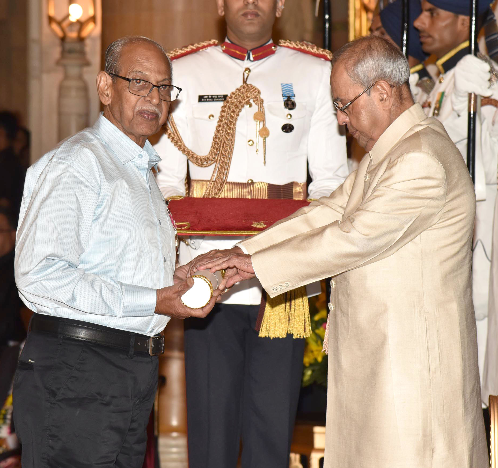

# Sadhu Meher: an actor beyond one language

By Ahimanikya Satapathy

Kishtaya comes back to the village with money he has earned. Seeking work from Surya, the landlord’s son, he is beaten; his wife Lakshmi intervenes. The National Film Awards catalogue describes this painful return in *ଅଙ୍କୁର (Ankur)*, the Hindi film for which **Sadhu Meher** received Best Actor for 1974.[^award]

The same catalogue records Meher’s Odisha background and training at the Film and Television Institute of India.[^award] His career would carry him from this performance into choosing and directing actors in Odia films.

## Kishtaya: the man who comes back

Meher plays Kishtaya, a poor potter and husband of Lakshmi, played by Shabana Azmi. Anant Nag plays Surya.[^roles] Kishtaya had left following public humiliation. On returning, he accepts his wife’s approaching motherhood, before the encounter with Surya turns violent.[^award]

The conflict puts employment, dependence and the landlord’s power inside a marriage. Kishtaya’s return is therefore more than a change in the household: it brings a vulnerable worker back within reach of the person who can decide whether he earns. This is the role behind the award, and a concrete starting point for understanding the actor’s place in Indian cinema.

*Sadhu Meher receiving the Padma Shri from President Pranab Mukherjee on 13 April 2017. Photo: President’s Secretariat, Government of India, via [Wikimedia Commons](https://commons.wikimedia.org/wiki/File:The_President,_Shri_Pranab_Mukherjee_presenting_the_Padma_Shri_Award_to_Shri_Sadhu_Meher,_at_the_Civil_Investiture_Ceremony,_at_Rashtrapati_Bhavan,_in_New_Delhi_on_April_13,_2017.jpg); [Government Open Data License–India](https://data.gov.in/sites/default/files/Gazette_Notification_OGDL.pdf).*

## The actor was also a director

Kapilas Bhuyan’s 2010 retrospective credits Meher’s *ଅଭିମାନ (Abhiman)* (1977) with helping revive cinema attendance.[^abhiman]

Uttam Mohanty recalled meeting Meher, who photographed him and cast him in *Abhiman*. In the 2018 interview, Mohanty described obtaining his family’s permission and completing the shoot in 35 days.[^uttam-making] The recollection supplies an actor’s account of entering a production Meher directed.

The official 60th National Film Awards catalogue later listed him as chair of its South I feature-film jury panel. Its biography recorded six directed feature films by that point, alongside work in acting and television.[^jury]

*Ankur* and *Abhiman* offer two entrances into that career: the role of Kishtaya, and an Odia film he directed. Following both keeps his work behind the camera beside the performance for which he received national recognition.

## Watch and explore

Listings checked on 26 October 2026.

- **Full-film listing: [ଅଙ୍କୁର (Ankur) on Shemaroo’s YouTube channel](https://www.youtube.com/watch?v=zlURxHM0cm4).** Official-channel upload identified in the indexed listing; playback and regional access untested.
- **Film information: [ଅଭିମାନ (Abhiman) in an IFFI retrospective](https://www.pib.gov.in/newsite/erelcontent.aspx?lang=2&reg=48&relid=67399).** Historical account of the Odia film, not a stream.

## Footnotes & Sources

[^award]: Directorate of Film Festivals, [22nd National Film Awards catalogue](https://www.dff.nic.in/images/Documents/94_22ndNfacatalogue.pdf), Best Actor citation and Sadhu Meher biography. Indexed catalogue text.
[^abhiman]: Kapilas Bhuyan, [“75 Years of Odiya Film Making: A Flashback”](https://www.pib.gov.in/newsite/erelcontent.aspx?lang=2&reg=48&relid=67399), PIB/IFFI, 22 November 2010. Audience-response claim attributed to the author.
[^jury]: [60th National Film Awards catalogue](https://nfaindia.org/images/pdf/60th%20National%20Film%20Award%20Catalogue.pdf), printed p. 043, South I jury biography; contemporary career count, not a lifetime census.

[^roles]: ShemarooMe, [Ankur: The Seedling](https://www.shemaroome.com/short-films/ankur-the-seedling), official cast-role synopsis. The plot account above follows published synopses, not a fresh full-film viewing.

[^uttam-making]: [Actor, Heartthrob, Superstar](https://www.mycitylinks.in/actor-heartthrob-superstar). Jyoti Prakash Sahoo, MyCityLinks, 15 July 2018; Uttam Mohanty’s recollection.

## Further reading

- [Odia cinema: the world in our own voice](../odia-cinema.md)
- [Parbati Ghose: the woman behind the credits](parbati-ghose.md)

