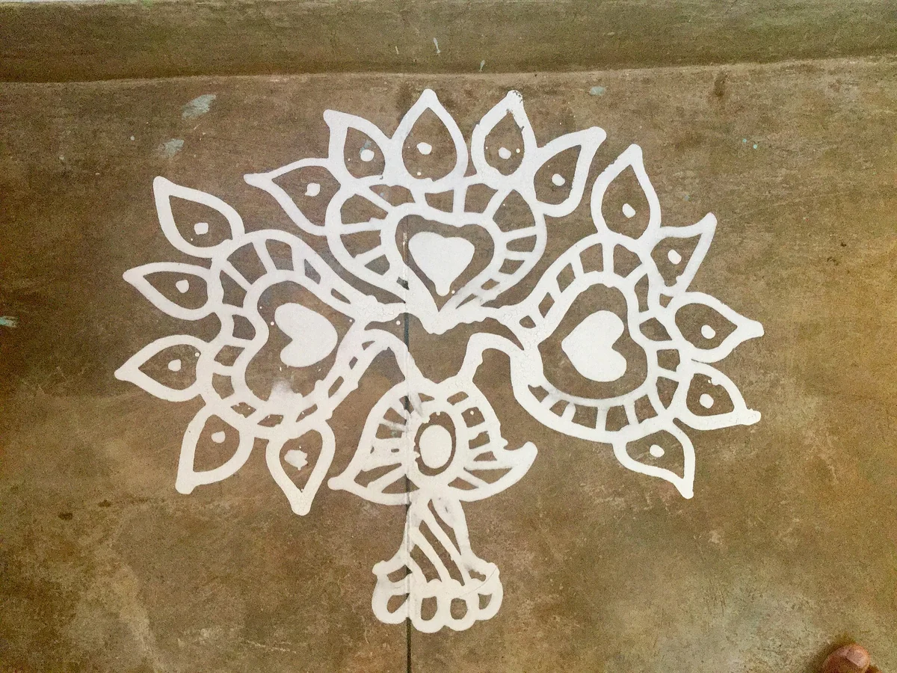

A line of Jhoti Chita begins with rice paste. Known as *pithau*, the white paste can be drawn with the fingers or carried by a small piece of cloth tied to a twig. Odisha’s household drawing tradition brings this simple material to walls and floors, thresholds and grain bins, and even earthen pots used at weddings.[^1]

Rice-paste jhoti photographed during Lakshmi Puja, 24 November 2016.[^2]

## Cloth, paste and a moving hand

Chintamani Biswal and Jagannath Dash describe one way of working with dilute rice paste. A small piece of cloth is held at the middle finger; when it dries, it is dipped again. They also describe cloth tied to a stick. In either method, the cloth carries the paste while the hand guides the mark.[^3]

This gives us something specific to look for in a demonstration. Beyond the completed motif, watch the replenishing of the cloth and the movement that follows it. The tool is modest, but it makes the drawing a sequence of actions rather than a shape that appears all at once.

## Drawing on household surfaces

Odisha’s tourism account associates Jhoti with Lakshmi worship in Margasira. The listed surfaces bring the design into household movement: at entrances, beside stored grain and on objects prepared for ceremonies.[^1]

Rice paste also helps distinguish Jhoti from *muruja*. The same account describes muruja as drawing with coloured powders, released between the thumb and forefinger. Both make patterns on a surface, but following the material reveals a different action of the hand.[^1]

## Learning within a family

In December 2023, a Jhoti competition at Raghurajpur brought the practice into a public gathering. Reporting on the event, Minati Singha recorded participant Rukmini Mohapatra’s account of learning through mothers, aunts and grandmothers.[^4]

Mohapatra’s account gives the subject a named practitioner. It also suggests a useful way to approach a finished drawing: ask who taught its maker. The visible lines belong to one work, while the learning may connect several people.

## Footnotes & Sources

[^1]: Government of Odisha, [“Jhoti, Chita, Muruja”](https://odisha.gov.in/en/odisha-tourism/jhoti-chita-muruja), Jhoti paragraphs 1, 3–4 and Muruja paragraphs 1–2. Material, tools, surfaces and named observance; surface comparisons are the author’s reading.

[^2]: Photograph: Prateek Pattanaik, [“Gurubara Jhoti,” Wikimedia Commons](https://commons.wikimedia.org/wiki/File:Gurubara_Jhoti.jpg), [CC BY-SA 4.0](https://creativecommons.org/licenses/by-sa/4.0/). Full frame, resized and compressed from the official Commons preview. The drawing’s maker is not separately identified.

[^3]: Chintamani Biswal and Jagannath Dash, [“Socio-Cultural Context and Aesthetic Values of ‘Jhoti’,” *Man in Society*, vol. 27 (2020)](https://utkaluniversity.ac.in/wp-content/uploads/2023/08/Man-in-Society-Anthropology.pdf), pp. 113–120, especially printed p. 117 (PDF p. 118), for the cloth and stick methods.

[^4]: Minati Singha, [“Raghurajpur women showcase special specimens of everyday art form ‘jhoti’,” *The Times of India*, 21 December 2023](https://timesofindia.indiatimes.com/city/bhubaneswar/raghurajpur-women-showcase-jhoti-art-form-in-mural-painting-competition/articleshow/106169354.cms). Mohapatra’s reported account of learning; a dated event, not a survey of every household.
