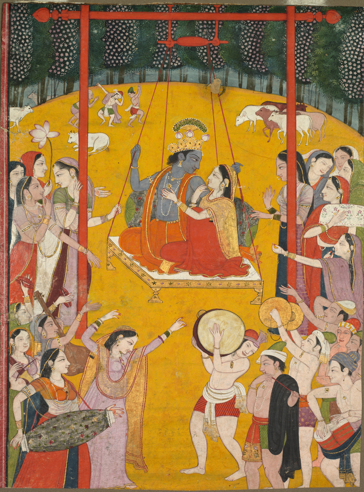

# Jhulana in Odisha: the swing, the song and the season

By Ahimanikya Satapathy

A swing can bring together worship, poetry and music. In Odisha, Jhulana has particular calendars and settings: a temple observance in Puri, seasonal celebrations at mathas in Paralakhemundi, and songs that invite a listener to imagine a divine couple in a grove. Following those details reveals several related traditions rather than one uniform festival.[^barik-festivals][^misro-dash][^odb-jhulana]

*Hindola Raga, Pahari kingdoms, northern India, c.1790–1800. This painting offers a comparison with wider Radha–Krishna swing imagery; it depicts a spring setting, not an Odisha Jhulana ceremony. Cleveland Museum of Art, 1975.9, Edward L. Whittemore Fund. CC0.*[^cma-hindola]

## Puri and the temple swing

Sarmistha Barik’s account of festivals at Shri Jagannath Temple describes Jhulana Yatra over seven days, from **Srabana Sukla Dasami through Pratipada**. The images placed on the decorated swing are **Madanamohana**, the representative image of Jagannath, with **Lakshmi and Bishwadhatri**.[^barik-festivals]

Those names give the observance its particular temple setting. Although Radha and Krishna appear frequently in swing imagery and song, substituting them for the images named in this account would erase a local distinction. The lunar dates also belong to this description of Puri; they are not a single calendar for every Jhulana celebration.

## Two seasons in Paralakhemundi

R. C. Misro and S. K. Dash describe **Malli Jhulana** and **Malati Jhulana** in their study of cultural life in Paralakhemundi. Their account names the **Bada Radha Krushna Matha** and **Sana Radha Krushna Matha** and gives two different seasonal periods.[^misro-dash]

**Malli Jhulana** runs from Chaitra’s tenth day to the full moon. **Malati Jhulana** runs from Sravana’s tenth day to the full moon. The account places both celebrations in the discussion of the two mathas; it does not assign one celebration exclusively to each institution.

The authors also describe Radha dressed as Krishna on the final day of Malati Jhulana. They connect this practice with a devotional story in which she adopts his appearance to meet him. This is a reported local interpretation, worth preserving alongside the calendar rather than turning it into an explanation of every swing festival.[^misro-dash]

Puri and Paralakhemundi thus offer different answers to basic questions: which images are worshipped, where the swing is installed, and when the celebration takes place. The shared swing does not make those answers interchangeable.

## A song with a named singer

Jhulana also has a place in documented Odissi repertoire. In *The Odissi Project*, musician and archivist **Prateek Pattanaik** lists a song recorded with **Chandramani Lenka of Puri**: *Jhulibe Ta Aja Kunje Barajaraja*. The catalogue calls it traditional, identifies **Raga Kamodi** and **Tala Adatali**, and explicitly labels it a Jhulana Jatra song.[^odissi-project]

This gives us a concrete musical connection: a title, a singer and a catalogue description. It also shows why the occasion and the tala should be recorded separately. A Jhulana song need not use a rhythmic cycle called Jhula. Here the catalogue names Adatali; it does not establish a rule for every song associated with the festival.

## Look towards the swing in the grove

Another lyric brings the swing into a scene addressed to a friend. The Odissi Music transcription attributes *Ana Lo Mitani Kunje Jhulana Doliku* to **Baikunthanath Brahmachari**. Its opening is:

**“ଅନାଲୋ ମିତଣି କୁଞ୍ଜେ ଝୁଲଣ ଦୋଳିକୁ”**

Approximately: “Look, friend, at the swing in the grove.”[^ana-lo-mitani]

The invitation directs our attention. Someone is being asked to look, and the listener can follow that gaze into the scene. In the final stanza, Rai is held close on a flower swing, and the name Baikuntha enters in devotion to the divine feet.[^ana-lo-mitani]

This is a useful place to connect Jhulana with [bhanita, the poet’s signature within a song](bhanita-and-poet-signatures.md). The lyric offers both a scene to contemplate and a named devotional voice. Its words do not, by themselves, establish that this particular song was performed at either of the Paralakhemundi mathas or during the temple observance described above.

## What a painting can show

The painting reproduced here, *Hindola Raga*, belongs to the Pahari kingdoms of northern India and dates to around 1790–1800. The Cleveland Museum of Art describes Radha and Krishna on a swing with companions making music and dancing, in a celebration of spring.[^cma-hindola]

It lets us compare how a swing gathers people and music into a visual scene. The lyric asks a friend to look; the painting gives the viewer an arrangement to examine. They share imagery, but the painting is neither an illustration commissioned for this Odia lyric nor a record of an Odisha festival. Its title also cannot tell us which raga an Odissi singer used.

Read the song, the festival account and the painting with their own names attached. The connections become more interesting when the local calendar, the singer and the place of the image remain visible.

## Footnotes & Sources

[^barik-festivals]: Sarmistha Barik, [“Festivals in Shri Jagannath Temple”](https://magazines.odisha.gov.in/Orissareview/june_july-2007/engpdf/Pages18-24.pdf), *Orissa Review*, June–July 2007, pp.18–24, especially p.22, “Jhulana Yatra.” Relevant paragraph inspected through the government PDF’s indexed text on 23 October 2026; direct PDF retrieval timed out. This is the published account’s calendar, not a current event schedule.
[^misro-dash]: R. C. Misro and S. K. Dash, [“Some Aspects of Cultural Life in Paralakhemundi Zamindari: A Study”](https://magazines.odisha.gov.in/Journal/journalvol3/pdf/15-27.pdf), *Orissa Historical Research Journal*, XLVII, no.3 (2004), pp.15–27, especially p.18. Relevant paragraph inspected in indexed primary text; direct article PDF returned a server error. The [issue contents and imprint](https://magazines.odisha.gov.in/Journal/journalvol3/pdf/content.pdf) confirm the year, title and pagination; contents spells the first author’s surname “Mishro,” while the indexed article byline uses “Misro.”
[^odb-jhulana]: Soumya Biswajit / Odissi & Beyond, [Jhulana, song and painting](https://www.instagram.com/odissiandbeyond/reel/Dciw7uUzIFR/), caption inspected in the 23 October 2026 archive survey. Credit for the research lead; full audiovisual analysis is not claimed.
[^cma-hindola]: Cleveland Museum of Art, [*Hindola Raga*, 1975.9](https://www.clevelandart.org/art/1975.9), c.1790–1800, northern India, Pahari kingdoms; gum tempera and gold on paper. Object description and [open-access policy](https://www.clevelandart.org/open-access) inspected 23 October 2026. Image released under CC0.
[^odissi-project]: Prateek Pattanaik, [*The Odissi Project*](https://pattaprateek.com/the-odissi-project/), section 2, “Chandramani Lenka, Puri,” “Songs recorded,” item 6. Catalogue inspected 23 October 2026; the recording was not auditioned for this article.
[^ana-lo-mitani]: [“Ana Lo Mitani Kunje Jhulana Doliku”](https://odissimusic.co.in/index.php/song/ana-lo-mitani-kunje-jhulana-doliku/), *Odissi Music*, attributed there to Baikunthanath Brahmachari; refrain and stanza 3. Digital transcription inspected 23 October 2026; no historical edition or locality of ritual performance is identified on the page. Brief English gloss by Project Odisha.

## Further reading

- [Bhanita and literary signatures](bhanita-and-poet-signatures.md)
- [Champu and the sakhi](champu-and-sakhi.md)
- [Jhulana and Sakhi Pila research guide](jhulana-and-sakhi-pila-research-guide.md)

**[Suggest an update](https://projectodisha.org/contribute/?page=kb%2Fresearch%2Fculture%2Fjhulana-in-odisha.md):** identify the locality, song or source passage. GitHub submissions are public; omit private contact details and consent documents.
