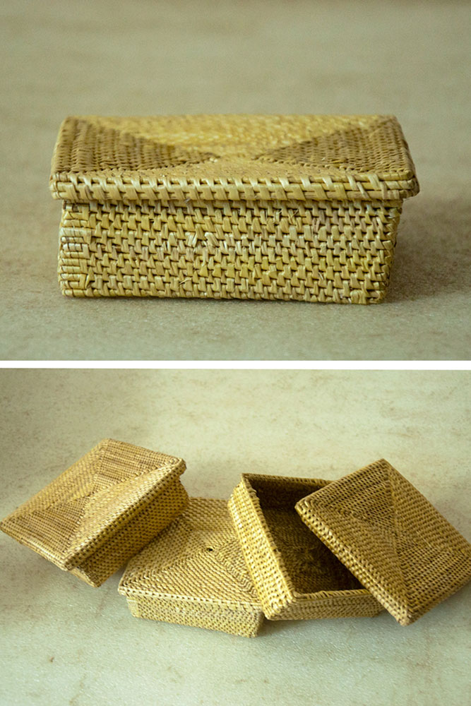

Golden grass takes its name from the lustre of the dried material. Odisha’s Directorate of Handicrafts calls it *kaincha* and describes how the dried grass is split and woven into useful objects. Its examples range from mats and coasters to baskets, boxes and hats.[^1]

That range offers a way to look beyond colour. A mat makes a surface; a basket encloses a space; a box adds a lid. Each asks something different of the material. Looking at what an object is meant to hold or cover helps us notice its shape.[^1]

Golden-grass boxes in D’source’s documentation of the Puri craft.[^2]

## Starting with a small circle

D’source’s study of work in Gop, Puri, follows a round container taking shape. The photographs show blade preparation, a small circular start drawn tight, and a pointed iron tool opening gaps in the growing work. A finished container has a separate round lid.[^3]

The rectangular boxes pictured above belong to the study’s product collection. Their shapes differ from the round process example: a reminder to look closely at individual objects rather than assume one form explains them all.[^2]

## A named group of makers

The Department of Mission Shakti’s 2021–2022 report brings another place into view. Its Kendrapara account identifies Mahabir SHG at Jhajanga and lists baskets, bags, flower vases, jewellery boxes, lamps and mats among the group’s products.[^4]

The list places storage alongside display and furnishing. It also gives the craft a named group and locality, making the makers more visible than a general label such as “handicraft” can. This is a dated account of the group’s work; the Puri photographs illustrate a separate body of documentation.[^4]

## Footnotes & Sources

[^1]: Directorate of Handicrafts, Government of Odisha, [“Golden Grass”](https://crafts.odisha.gov.in/?crafts=golden-grass), undated craft entry. Name, dried appearance and object range; form comparisons are the author’s reading.

[^2]: Photographs: Harsha Kulkarni and Harsha Kumar N. L., D’source/NID Bengaluru, [“Products,” *Golden Grass Craft—Puri, Orissa*](https://www.dsource.in/resource/golden-grass-craft-puri-orissa/products). [CC BY-NC-SA 4.0](https://creativecommons.org/licenses/by-nc-sa/4.0/). Original two-view image unchanged.

[^3]: Bibhudutta Baral, Divyadarshan C. S. and Aakash Sharma, [*Golden Grass Craft—Puri, Orissa*](https://www.dsource.in/sites/default/files/resource/golden-grass-craft-puri-orissa/downloads/file/golden-grass-craft-puri-orissa.pdf), NID Bengaluru/D’source, pp. 13–15, process photographs.

[^4]: Department of Mission Shakti, Government of Odisha, [*Annual Activity Report 2021–2022*](https://missionshakti.odisha.gov.in/sites/default/files/2022-12/Mission%20Shakti%20Activity%20Report%202021-22_compressed.pdf), p. 58, Kendrapara. The department’s reported example; not a current production survey.
