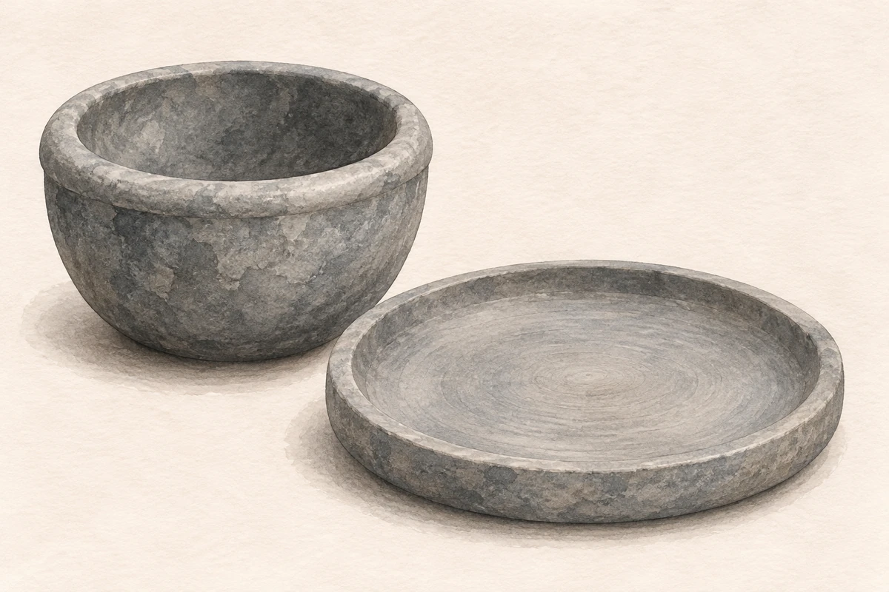

# Nilagiri’s Stone Utensils: A Craft for the Table

By Ahimanikya Satapathy

A plate, a bowl, a drinking vessel: Odisha’s stonework has a domestic scale. Nilagiri, in Balasore district, is associated with stone utensils. The state’s Directorate of Handicrafts identifies it as a stone-carving centre alongside Soro and Baulagadia; a 2022 planning document explicitly names Nilagiri’s carving and utensils together.[^1]

*An interpretation of stone vessel forms, not a photograph of a particular maker’s work.*[^2]

Utkalika’s account of Odisha stonecraft describes utensils made by turning and polishing on a *kunda*, or lathe. Its examples include plates, bowls, cups with saucers and tumblers. In the same account, a figure takes shape through an outline marked on a stone block, followed by the removal of unwanted material with a chisel. These are different ways of approaching a form: the round vessel and the carved figure ask us to look for different kinds of work.[^3]

Utkalika describes stonework across Odisha. The local association is separately documented: writing in *Odisha Review* in November 2023, Chittaranjan Mishra identifies Nilagiri with stone utensils. His surrounding discussion includes domestic stone tools from other parts of the state, a reminder that a shared material can serve several purposes and belong to distinct local practices.[^4]

A useful way to look at a stone bowl is to follow its profile: the rim, the curve into the hollow and the base that supports it.

## Further reading

[Balakati metalcraft](https://projectodisha.org/crafts/balakati-metalcraft/) · [Listening to Craft](https://projectodisha.org/stories/craft-listening/)

## Footnotes & Sources

[^1]: Directorate of Handicrafts, Odisha, [*List of Identified Craft Clusters*](https://crafts.odisha.gov.in/wp-content/uploads/2022/12/List-of-identified-craft-clusters.pdf), Balasore entry; [*Expression of Interest*, 2022](https://crafts.odisha.gov.in/wp-content/uploads/2022/08/Expression-of-Interest.pdf), proposed craft-registration scope. The latter records a proposal, not a completed registration.

[^2]: Illustration: Project Odisha. Original interpretive artwork accompanying this article; it does not reproduce an identified utensil or document a Nilagiri workshop.

[^3]: Utkalika, [“Stone Carving”](https://utkalikaodisha.com/stone-carving/), paragraphs on figure carving and stoneware utensils. The account covers Odisha broadly.

[^4]: Chittaranjan Mishra, “Folk and Tribal Elements in Indian Art,” *Odisha Review*, November 2023, p.30 ([issue PDF](https://ova.gov.in/ovauploads/IandPRDeptRepository/01012024125310_-0-November-OR-2023.pdf), PDF p.48).
