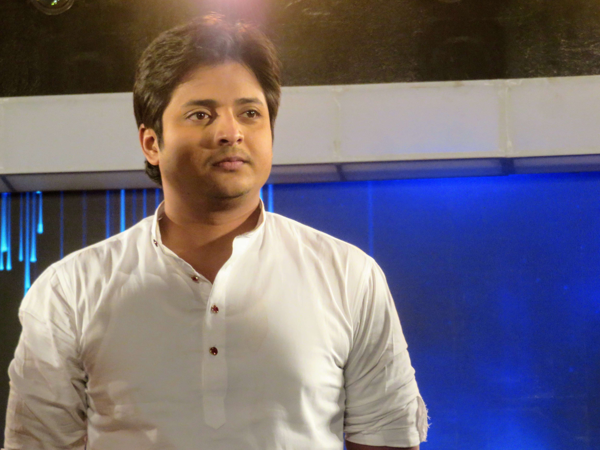

# Odia cinema: the world in our own voice

By Ahimanikya Satapathy

On 27 June 2024, *ମାୟା ମିରିଗ (Maya Miriga)* returned to a screen in Bologna, restored after its negative was found badly damaged.[^restoration]

There is something unsettling about that journey. A film can travel across the world, enter festival history, and still come close to disappearing.

Nirad Mohapatra’s film asks what family gives its members—and what it withholds. His programme note holds warmth alongside daughters-in-law’s desire for freedom.[^restoration]

The restored film’s Bologna screening brings this household story into the history of how Odia films circulate and survive.

This account follows selected connections between performance, literature, filmmaking and audiences. Surviving credits, archives and published testimony shape the examples available here; they do not define a complete canon. The companion essays follow particular films and people in more detail.

## Before the camera: Natak, Rasa and Gitinatya

*Sita Bibah* had a life before the camera. A later report by Minati Singha identifies a play by Kamapal Mishra as the basis of *Sita Bibah*.[^first-play] Piyush Roy’s research describes Goswami’s touring rasalila group and his work training performers. In an interview recorded by Roy, film historian Surya Deo characterises the first film as primarily *gitinatya*, or musical drama.[^stage-roots]

This gives the connection a human shape. Goswami brought experience of performing, singing and organising a troupe to filmmaking. A familiar story could now be carried by recorded voices and moving images. The stage connection lies in particular people and a dramatic text, as well as in the place of song within the film.

Gitinatya joins dramatic storytelling with music and verse. Theatre scholar Alok Baral places Kalicharan Pattanaik among its practitioners.[^gitinatya] Kalicharan also wrote lyrics for *Lalita*, according to Bhuyan’s retrospective.[^foundation] His work connects musical theatre with the second Odia feature through an identifiable contribution.

The wider performance world deserves its own attention. Our guides to [Prahallad Nataka](prahallad-nataka.md), [Pala](pala.md), [Daskathia](daskathia.md) and [Odisha’s theatre traditions](odisha-theatre-traditions.md) explore different ways of singing, narrating and enacting a story. They provide context for thinking about cinema’s neighbours. A direct production link from each of these forms to *Sita Bibah* has not been established; the evidence is stronger for Goswami’s own Rasa and theatre background.

## The first Odia film: Sita Bibah, 1936

Odia cinema’s first feature was *ସୀତା ବିବାହ (Sita Bibah)*, made by Mohan Sundar Deb Goswami. Film writer Kapilas Bhuyan’s IFFI retrospective records its formal opening in Puri on **28 April 1936**, after a Calcutta screening the previous month. The next Odia feature, *ଲଳିତା (Lalita)*, arrived in **1949**.[^foundation]

Thirteen years is a striking interval. A first film establishes possibility; it does not by itself establish a continuing industry. The familiar anniversary date deserves to be remembered alongside the difficulty of making the next film.

Music was present from the beginning. Bhuyan records fourteen songs in *Sita Bibah*, sung by its actors, and a move to background singing in *Lalita*. Later films drew on Odia literature, including *ଅମଡ଼ା ବାଟ (Amada Bata)*, *ମଲାଜହ୍ନ (Malajanha)* and *ମାଟିର ମଣିଷ (Matira Manisha)*.[^foundation]

The screen offered another life to words and voices already circulating through the culture. To understand that foundation, we need to follow writers and composers as closely as directors. A film’s opening credits can be a small map of the arts meeting one another.

## Radio drama: another home for the storyteller

Radio enters this account later. AIR Cuttack began in **1948**, twelve years after the first Odia feature. The Odia Bibhaba archive records Gopal Chhotray’s association with the station from its beginning.[^radio-archive] Its writers joined a film culture already underway.

Chhotray is a concrete link between the media. The Library of Congress documents his work in Gitinatya, his long association with AIR Cuttack, and his writing of plays, operas and screenplays.[^chhotray-loc] The Gour–Parbati archive credits him specifically with **dialogue for *ଶ୍ରୀଜଗନ୍ନାଥ (Sri Jagannath)* (1950)**, while assigning direction and screenplay to C.R. Mitra.[^jagannath-dialogue]

His career helps us follow the writer between a stage, a microphone and a film production. Radio drama asks listeners to imagine a scene through voices and sound; cinema supplies moving images as well. Chhotray’s credited dialogue supplies one specific connection between those working worlds.

**Continue this history:** [ଆକାଶବାଣୀ କଟକ — AIR Cuttack: where stories found another voice](air-cuttack.md).

## The people who built more than a screen career

Parbati Ghose belongs near the centre of this history. The Gour–Parbati filmography records her as a co-producer with Gour Prasad Ghose on *ଲକ୍ଷ୍ମୀ (Laxmi)*, *କା (Kaa)* and *ସ୍ତ୍ରୀ (Stree)*. It also credits her within the directing partnership used on *Kaa* and *Stree*. Her work crossed the boundaries between performing, organising a production and deciding what would reach the screen.[^gour-parbati]

The archive dates her *ଛ’ ମାଣ ଆଠ ଗୁଣ୍ଠ (Chha Mana Atha Guntha)* adaptation to 1986. Its credits name **Nagen Barik** for sound and **Asim Basu and Sarat Sahoo** for art, and acknowledge Olosingh’s villagers and host **Kalyani Patnaik**.[^parbati-film] The [Parbati Ghose companion](cinema-series/parbati-ghose.md) follows her producing, writing, directing and acting work.

## The places and teams that sustain production

Institutions mattered too. The Odisha Film Development Corporation was incorporated on **22 April 1976**. Its stated remit included support for film production, cinema houses, studio services and film culture. These are the less visible foundations: access to equipment, places to finish a film, and places where audiences can watch it.[^ofdc]

The *Chha Mana Atha Guntha* archive names **Kalinga Studio** and **Prasad Film Laboratory** among its credits, while stating that the shoot took place entirely in Olosingh. The credits do not specify which services those facilities supplied.[^parbati-film]

Private facilities form another part of this infrastructure. India Cine Hub lists Mute Entertainment’s Mute Studio in Bhubaneswar under post-production companies, advertising editing, visual effects and chroma services.[^private-facility]

Technology also appears in performers’ memories. Uttam Mohanty contrasted reflector-lit shoots earlier in his career with later low-light work, in a 2018 interview.[^uttam-technology]

Public infrastructure has its own chain of responsibility. **Naveen Patnaik** laid the rebuilding foundation stone for Kalinga Studio on **25 March 2021**; the Industries Department assigned implementation to **IDCO** and existing-building renovation to the **R&B Department**.[^builders-state] **Mohan Charan Majhi** inaugurated the redeveloped studio and its cinema archive and museum on **5 October 2026**. The recorded events concern redevelopment; they do not establish its commercial outcomes.[^builders-opening]

A film culture needs places to learn and people willing to organise a screening. **Nirad Mohapatra’s** memorial biography records his teaching at FTII and his work with **Cinexstasy**, a Bhubaneswar film society active from 1974 to 1983. Screenings and film-appreciation courses were another part of his contribution, beyond directing *Maya Miriga*.[^builders-society]

## Maya Miriga and other films in circulation

*Maya Miriga* received Second Best Feature Film at the 31st National Film Awards, for films of 1983; festival records commonly date it to 1984.[^maya-national] In 1984 it was selected for Cannes Critics’ Week and shared Mannheim’s Grand Prize in the Third World competition, distinct from that festival’s overall Grand Prize.[^maya-cannes][^maya-mannheim] The [Maya Miriga companion](cinema-series/maya-miriga.md) follows both its family story and its restoration.

Manmohan Mahapatra offers another essential route into this period. *ଶୀତରାତି (Seeta Raati)* received the Best Oriya Film honour at the 29th National Film Awards, for the 1981 award year. The festival catalogue for 1985 also records screenings in Paris and Montreal.[^seeta]

In his account of Odisha’s New Wave, critic Ashok Palit describes the social worlds of Mahapatra’s films: a rural community facing upheaval in *ନୀରବ ଝଡ଼ (Niraba Jhada)*, and a family negotiating social change in *ନିଷିଦ୍ଧ ସ୍ଵପ୍ନ (Nisiddha Swapna)*. His survey places Mahapatra and Nirad Mohapatra among the filmmakers who developed a sustained interest in cinema as an art of close observation.[^new-wave]

These films explored households and communities under pressure. National awards and international screenings form another part of their histories; they do not explain by themselves how audiences responded.

## Bhukha, and the importance of hearing western Odisha

*Sabyasachi Mohapatra at the Odisha State Film Awards, Bhubaneswar, 2014. Photograph: Subhashish Panigrahi; existing crop by MKar, via [Wikimedia Commons](https://commons.wikimedia.org/wiki/File:Sabyasachi_Mohapatra.jpg), [CC BY-SA 4.0](https://creativecommons.org/licenses/by-sa/4.0/). No additional crop.*

Sabyasachi Mohapatra’s *ଭୂଖା (Bhukha)* (**1989**) makes the map of cinema in Odisha more expansive. It is a **Sambalpuri-language film**. Palit reads its conflict through the pressures between inherited ways of life and modernity.[^new-wave]

The story grew from a Sambalpuri play by Manglu Charan Biswal. It follows bajnia folk drummers whose livelihoods are threatened by changing musical practices. The stakes are both cultural and material: what happens to the people who carry a tradition when their work is no longer wanted?[^bhukha-play]

Naming the language matters. The cinema of a state can contain several cultural centres, accents and storytelling traditions. Sambalpuri cinema deserves to be heard in its own voice within this larger history.

The official 70th National Film Awards catalogue credits *Bhukha* with an **International Jury Award at Gijón**, Spain. The biography does not specify the year of that prize, so the film’s 1989 date should not automatically be attached to the award.[^bhukha]

Mohapatra’s later work offers further, separately documented milestones. *ଶଳାବୁଢ଼ା (Sala Budha)* was selected for Indian Panorama in 2013. *ଆଦିମ ବିଚାର (Aadim Vichar)* received the Best Odiya Film award at the 62nd National Film Awards, for 2014, announced in 2015.[^sala][^aadim]

Scholar Amrit Amlan Pattanaik approaches these Sambalpuri films through western Odisha’s cultural and literary worlds, asking how they widen the ways Odisha appears on screen. His study’s published abstract offers a valuable starting question for a deeper article: what becomes visible when we stop treating a region as if it has only one centre?[^sambalpuri-study]

## Children, imagination and the screen

Children belong in this history as viewers with imaginative lives of their own. Live-action films made for children, local animation and films offered in an Odia-language version open different routes to those viewers.

Sadhu Meher’s ବାବୁଲା (Babula) provides a concrete starting point for the first history. A Lok Sabha answer of 7 December 1987 lists it among the Children’s Film Society of India’s productions for 1985–86, identifying it as an Oriya feature. A contemporary 1986 catalogue from Berlin’s Arsenal describes Meher’s CFSI-supported film through a lonely boy’s dreams of outer space. This places institutional support and a child’s imagination within the same account. [^children-babula-parliament][^children-babula-arsenal]

[A. K. Bir](../people/ak-bir.md)’s [ଲାବଣ୍ୟ ପ୍ରୀତି (Lavanya Preeti)](cinema-series/lavanya-preeti.md) received Best Children’s Film for 1993. Its dedicated page follows young characters into the imaginative world of an inherited story.[^children-lavanya-nfa]

The history of what children can hear in Odia is wider than the history of original Odia production. ରିଟର୍ଣ୍ଣ ଅଫ୍ ହନୁମାନ (Return of Hanuman) demonstrates why records must be read carefully. CBFC’s 2022 list records an Odia video version certified on 11 February 2022, naming Shemaroo Entertainment. Airtel Xstream’s official catalogue describes the Anurag Kashyap film as a 2007 title available in Odia and places it under animation and children’s entertainment. The later certificate records a language version; it should not turn the film into a new Odia production of 2022. The provider listing supplies a route to check availability, not a guarantee of playback in every location. [^children-hanuman-cbfc][^children-hanuman-provider]

## Actors whose journeys crossed languages

For performers, the path beyond Odisha sometimes ran through films made in other languages.

**Sadhu Meher** received the National Film Award for Best Actor for his performance in Shyam Benegal’s Hindi film *ଅଙ୍କୁର (Ankur)*, honoured at the 22nd awards for 1974. The official catalogue records his upbringing in Odisha and his training at the Film and Television Institute in Pune. This is a major achievement by an actor from Odisha, within the history of Hindi cinema.[^sadhu]

**Nandita Das** carries a different connection. In her own essay about belonging, she recalls her father’s Baripada roots and her childhood visits. She was born in Bombay and grew up in Delhi. Her Odisha relationship is one of family and experience, rather than an Odisha birthplace.[^nandita-roots]

Her connection also includes acting in Odia: she appeared in Susant Misra’s **ବିଶ୍ୱପ୍ରକାଶ (Biswaprakash / The Young Rebel, 1999)**, listed in her official filmography. The [Nandita Das article](cinema-series/nandita-das.md#acting-in-odia-biswaprakash) explores that credit alongside her wider career.[^nandita-acting]

Cannes records her membership of its feature-film jury in **2005** and its Cinéfondation and short-film jury in **2013**. Her film *ମଣ୍ଟୋ (Manto)* was selected for Un Certain Regard in **2018**. These occasions mark both jury service and film selection across her career in acting and directing.[^nandita-cannes]

The home audience must remain in this story too. Akashvani’s account of **Uttam Mohanty** records an extensive Odia career alongside work in Bengali cinema and the Hindi film *ନୟା ଜହର (Naya Zahar)*. His example opens another chapter: the relationship between popular actors, recurring collaborators and audiences who return to watch them.[^uttam]

Songs offer another way into that relationship. In her account of composer **Prafulla Kar**, journalist Minati Singha recalls the success of his music for *ମମତା (Mamata)*. A film can continue to live through the songs its listeners carry away; composers and playback singers belong within this history of recognition too.[^music]

A festival history and a history of popular affection answer different questions. We need both to understand what a film culture means to the people who sustain it.

## New films, familiar pressures: 2022–2025

Recent national recognition provides further starting points. Anupam Patnaik’s *ପ୍ରତୀକ୍ଷା (Pratikshya)* received Best Odia Film at the **69th National Film Awards**, announced in 2023 for the 2021 award year. *ଦମନ (Daman)*, directed by Vishal Mourya and Debi Prasad Lenka, received Best Odia Film at the **70th awards**, announced in 2024 for 2022.[^pratikshya][^daman]

*Babushaan Mohanty in 2018, before his starring role in Daman. Event photograph by Jnanaranjan Sahu, via [Wikimedia Commons](https://commons.wikimedia.org/wiki/File:Babusan_Mohanty.jpg), [CC BY-SA 4.0](https://creativecommons.org/licenses/by-sa/4.0/). Original close-up retained uncropped and without AI modification; this is not a film still.*

The [Pratikshya companion](cinema-series/pratikshya.md) follows its connection with [Gourahari Das](../people/gourahari-das.md) and Dipanwit Dashmohapatra’s first leading role.[^pratikshya-actor]

**Babushaan Mohanty** offers another route into the period through [*ଦମନ (DAMaN)*](cinema-series/daman.md). Our companion article follows the film’s making, its fictional doctor and the wider healthcare work behind its subject. These films invite us to follow performers and collaborators as well as prizes: who receives a substantial role, whose writing reaches the screen, and which stories find a larger audience?

The range also includes **କର୍ମ (Karma, 2024)**. Anupam Patnaik directed **Anubhav Mohanty** as investigator Amar Patnaik in a murder-case thriller. The filmmaker behind *Pratikshya* was working with a different star and dramatic form; contemporary Odia cinema cannot be reduced to a single kind of revival.[^karma-contemporary]

## Recent releases and the work of reaching audiences

A film culture also depends on tickets sold and the chance to finance the next production. In 2025, **ବୋଉ ବୁଟୁ ଭୂତ (Bou Buttu Bhuta)** supplied a conspicuous commercial story. Directed by **Jagdish Mishra**, the horror-comedy brought **Aparajita Mohanty, Babushaan Mohanty and Archita Sahu** together in leading roles. On 24 September 2025, *The New Indian Express* reported box-office revenue of nearly **₹21 crore**, against a reported budget of **₹2–3 crore**. These are reported figures, not audited accounts or a calculation of producer profit.[^bou-commercial]

The same report described Dharma Productions as being **in the process of acquiring remake rights**. That was a commercial development reported at the time, not evidence of a completed remake. It suggests another way an Odia story can travel: through interest in adapting it for other audiences.[^bou-commercial]

Commercial momentum has a setting as well as a number. During Raja in June 2025, *The New Indian Express* reported packed shows for *Bou Buttu Bhuta* and **ଅନନ୍ତା (Ananta)**. The latter starred **Sabyasachi Mishra** and was directed by **Sabyasachi Mohapatra**, drawing on Fakir Mohan Senapati’s *Randi Pua Ananta*. Literature and popular exhibition were meeting again.[^raja-audiences]

Yet distributor **Prashant B**, quoted in that report, said a shortage of cinema halls left some areas unreached. The point matters: a successful run in available theatres does not mean everyone has access to the film. The commercial story includes the work of exhibitors and distributors, ticket affordability, and the distance between a willing viewer and a screen.[^raja-audiences]

These recent films extend several parts of the history at once: literary adaptation, substantial acting roles, genre entertainment and the search for a sustainable audience. A national award, a busy screening and a remake negotiation each tell us something different. Taken together, they give a fuller picture of the work still being made.

## Audiences and income beyond Odisha

There is evidence of commercial exhibition outside the state. *The New Indian Express* reported on 13 November 2022 that *DAMaN* had opened on 4 November in **51 theatres in Odisha and 15 theatres across nine other cities**: Bengaluru, Chennai, Mumbai, Delhi, Kolkata, Ahmedabad, Surat, Pune and Hyderabad. The report described packed houses, but supplied no separate receipts for those markets.[^daman-national-release]

Overseas announcements show another route to audiences. On 26 April 2023, *OrissaPOST* reported plans to screen **ଫାଲ୍ଗୁନ ଚୈତ୍ର (Phalguna Chaitra)** on 13 May at Hoyts Docklands in Melbourne, Hoyts Blacktown in Sydney and Event Cinemas in Brisbane. A July follow-up in *OrissaPOST* subsequently reported overseas screenings, including Australia. Neither report supplied receipts or a country-by-country earnings breakdown.[^phalgun-australia][^phalgun-followup]

Streaming can reach viewers who have no nearby Odia screening. In Lata Jha’s April 2025 report for *Mint*, **Kaushik Das**, founder of Odia platform **AAO NXT**, described overseas viewers seeking stories that reconnect them with home. [^odia-overseas-streaming]

Paid screenings, streaming and rights agreements can provide income, but these sources do not establish the share of Odia cinema’s earnings from outside the state or overseas. The [OTT companion](odia-ott.md) follows the platform and audience questions further.

## The story continues on television and online

Cinema is one part of a wider screen culture. Odia television created another rhythm of storytelling through recurring programmes and serials. Prasar Bharati dates the Odia satellite service to 1993 and its round-the-clock broadcasting to 2001.[^television-bridge]

Streaming added further routes. Tarang Plus’s 2019 launch offering combined television channels, films, jatra and original web content. An inherited catalogue and a newly commissioned series could now reach viewers through the same service, although they remained different kinds of production.[^ott-bridge]

The [Odia television history](odia-television.md) follows public broadcasting, private channels, performers and production workers. The [Odia OTT journey](odia-ott.md) examines original storytelling, platform economics and audiences beyond Odisha. Together with [AIR Cuttack](air-cuttack.md), these histories show how stories can move between forms without every new medium displacing its predecessors.

## Keeping the next chapter within reach

The Bologna screening at the beginning of this story adds another question to this contemporary energy. What can another generation actually see?

Preservation depends on teams too. **Shivendra Singh Dungarpur** describes Film Heritage Foundation’s conservators repairing *Maya Miriga*. Its restoration credits also name **L’Immagine Ritrovata, Digital Film Restore and Prasad Corporation**, in association with the filmmaker’s family, and identify NFDC–NFAI’s surviving print. A restored image carries technical labour that a director’s name alone cannot acknowledge.[^builders-preservation]

The [research register of storytelling contributors](odia-storytelling-builders.md) follows additional work in broadcasting, production and community support. It records what each person or team did and where the evidence stops. Giving credit should recover the work, not replace one star-centred history with a new list of famous names.

The next chapter of Odia cinema history belongs partly to viewers: watching beyond the famous titles, learning the names behind the credits, asking for subtitled and restored editions, and making room for films whose worlds are unfamiliar even within Odisha.

For a viewing journey, one starting point is the household in *Maya Miriga*, followed by the livelihoods in *Bhukha* and today’s family dramas, thrillers and popular releases. These are invitations to explore the films; the reading sequence continues next with AIR Cuttack. Which film would you want the next generation to be able to find?

## Watch and explore

Links checked on 26 October 2026. Playback was not tested; territory, account and payment conditions can change.

- **Full-film listing: [ଦମନ (DAMaN) on Amara Muzik Odia’s YouTube channel](https://www.youtube.com/watch?v=bX9WYaIzVa4).** Verified official-channel page; playback untested.
- **Official trailer: [ପ୍ରତୀକ୍ଷା (Pratikshya)](https://www.youtube.com/watch?v=E_p4kHzZBTM).** Amiya Patnaik Productions.
- **Official trailer: [କର୍ମ (Karma)](https://www.youtube.com/watch?v=Ai9ItdxoWz8).** Amara Muzik Odia.
- **Official trailer: [ବୋଉ ବୁଟୁ ଭୂତ (Bou Buttu Bhuta)](https://www.youtube.com/watch?v=M1JaMbSCaSs).** Sidharth Music.
- **Official trailer: [ଅନନ୍ତା (Ananta)](https://www.youtube.com/watch?v=aNGaiOD2d74).** Amara Muzik Odia.
- **Restoration clip and information: [ମାୟା ମିରିଗ (Maya Miriga)](https://filmheritagefoundation.co.in/film-heritage-foundation-restores-nirad-mohapatras-landmark-odia-film-maya-miriga1984/).** Film Heritage Foundation’s restoration page and comparison clip, not the full film.

- **Provider catalogue, Odia version:** [ରିଟର୍ଣ୍ଣ ଅଫ୍ ହନୁମାନ (Return of Hanuman)](https://www.airtelxstream.in/movies/return-of-hanuman/HOTSTAR_DTH_MOVIE_1055915). Check current access and subscription terms; playback unverified.

## Footnotes & Sources

[^karma-contemporary]: Arindam Ganguly, [“Four Odia flicks to clash at box office”](https://www.orissapost.com/four-odia-flicks-to-clash-at-box-office/), OrissaPOST, 8 October 2024. Pre-release account of Karma’s director, lead actor and investigator role; not evidence of eventual revenue.
[^pratikshya-actor]: PIB, [IFFI53 cast-and-crew account of Pratikshya](https://www.pib.gov.in/PressReleasePage.aspx?PRID=1878242), 23 November 2022. Synopsis, Gourahari Das story connection and Dipanwit’s lead-role testimony. Festival appearance is distinct from the film’s award eligibility year.
[^bou-commercial]: Express News Service, [“KJo’s Dharma Productions to remake ‘Bou Buttu Bhuta’”](https://www.newindianexpress.com/states/odisha/2025/Sep/24/kjos-dharma-productions-to-remake-bou-buttu-bhuta), 24 September 2025. Reported cast, budget, revenue and acquisition-in-progress notice. The revenue figure is not clearly specified as net/gross or by territory; no audited profitability, all-time ranking or later deal completion is asserted. The report’s unrelated Pratikshya announcement chronology is not adopted.
[^raja-audiences]: Express News Service, [“Amid cinema hall crisis, ‘Raja’ releases run to packed houses”](https://www.newindianexpress.com/cities/bhubaneswar/2025/Jun/18/amid-cinema-hall-crisis-raja-releases-run-to-packed-houses), 18 June 2025. Contemporary reporting and named distributor testimony; not an audience survey or a current statewide theatre census.

[^first-play]: Minati Singha, [“Sita Bibaha prints lost”](https://timesofindia.indiatimes.com/city/bhubaneswar/sita-bibaha-prints-lost/articleshow/8116754.cms), The Times of India, 29 April 2011, paragraph identifying Kamapal Mishra’s play. Retrospective attribution; the original play edition was not inspected. Its missing-print report is not a current preservation survey.
[^stage-roots]: Piyush Roy, [The Aesthetics of Emotional Acting](https://era.ed.ac.uk/bitstream/handle/1842/22910/Roy2017.pdf?isAllowed=y&sequence=1), University of Edinburgh PhD thesis, title page 2016, repository release 2017, printed pp.137–139 and 143–144. Goswami’s performing background and Roy’s 2014 interview with Surya Deo. The latter is an attributed historical reading, not a fresh viewing of the film.
[^gitinatya]: Alok Baral, [“Communication Through Folk Elements: A Study in Modern Odia Drama”](https://www.caluniv.ac.in/global-mdia-journal/COMMENTARY-DEC%202013/Commentary_2_Alok_Baral.pdf), Global Media Journal–Indian Edition 4(2), December 2013, p.3, “Exploring the Geetinatya Style.” Theatre scholarship; a shared practitioner does not establish adaptation of a particular musical play.
[^radio-archive]: Odia Bibhaba, [Gopal Chhotray collection](https://odiabibhaba.in/en/compilations/gopal-chhotray-e/), biographical account of AIR Cuttack’s 1948 opening and Chhotray’s association. This dates the Cuttack institution, not the beginning of all Odia broadcasting or listening elsewhere.
[^chhotray-loc]: Library of Congress, [Gopal Chhotray: South Asian Literary Recordings Project](https://www.loc.gov/acq/overseas-offices/delhi/salrp/chhotray.html), author profile and recording catalogue. Used for work across genres and AIR association; no numerical measure of influence inferred.
[^jagannath-dialogue]: Gour–Parbati archive, [Sri Jagannath (1950)](https://www.gourparbati.com/movie_sri_jagannath.php), film credits. “Dialogue” names Gopal Chhottray; “Director & Screenplay” names C.R. Mitra. Spelling follows each source.

[^restoration]: Il Cinema Ritrovato, [Māyā Miriga, 2024 programme](https://festival.ilcinemaritrovato.it/en/film/maya-miriga/), screening date, filmmaker’s note and restoration account.
[^foundation]: Kapilas Bhuyan, [“75 Years of Odiya Film Making: A Flashback”](https://www.pib.gov.in/newsite/erelcontent.aspx?lang=2&reg=48&relid=67399), IFFI retrospective hosted by PIB, 22 November 2010. Opening chronology, music and literary-adaptation paragraphs. An authored retrospective, not a surviving 1936 screening programme.
[^gour-parbati]: [Gour–Parbati filmography](https://www.gourparbati.com/filmography.php), compiled by Khirod Naik and Shekhar Barman. Entries distinguish production from directing and identify the collective directing credit “Siddharth.”
[^parbati-film]: Gour–Parbati archive, [*Chha Mana Atha Guntha* (1986)](https://www.gourparbati.com/movie_chha_mana_atha_guntha.php), story, direction, screenplay and cast credits.
[^ofdc]: Odisha Film Development Corporation, [RTI Manual 1](https://rtiodisha.gov.in/Pages/printManual/section_id:2/office_id:1345/lang), incorporation date and objectives. Institutional remit is not a claim that every service operated continuously.
[^maya-national]: Directorate of Film Festivals, [31st National Film Awards catalogue](https://www.dff.nic.in/images/Documents/86_31stNfacatalogue.pdf), Second Best Feature Film citation: films of 1983, awards in 1984. Indexed catalogue text inspected; direct PDF access was intermittent.
[^maya-cannes]: Semaine de la Critique, [*Maya Miriga*, 1984](https://www.semainedelacritique.com/en/edition/1984/movie/maya-miriga), official selection record.
[^maya-mannheim]: International Film Festival Mannheim–Heidelberg, [1984 archive](https://www.iffmh.de/festival/history/1984/index_eng.html), award list. The historical Third World competition category is reproduced to avoid conflation with the overall prize.
[^seeta]: [29th National Film Awards catalogue](https://nfaindia.org/images/pdf/29th%20National%20Film%20Award%20Catalogue.pdf), Best Oriya Film citation for 1981; and [Indian Panorama 1985 catalogue](https://dff.nic.in/images/Documents/139_IPCatalogue1985.pdf), Manmohan Mahapatra biography naming Paris and Montreal screenings. Indexed original catalogue text; exact first Panorama-selection year is not asserted.
[^new-wave]: Ashok Palit, [“The New Wave Cinema of Odisha”](https://fipresci-india.org/wp-content/uploads/2025/01/11.-Article-Ashok-Palit-New-Wave-Cinema-of-Odisha.pdf), *E-CineIndia*, October–December 2024, pp.3–4 and 6. Used for attributed critical descriptions, not as a substitute for festival award registers.
[^bhukha]: [70th National Film Awards catalogue](https://nfaindia.org/images/pdf/70th%20National%20Film%20Award%20Catalogue.pdf), printed p.036, Sabyasachi Mohapatra biography: 1989, Sambalpuri, Gijón International Jury Award. Indexed official catalogue text inspected; the original Gijón award record and exact prize year remain unverified. The research prompt included [_rohitmahanand’s Instagram reel](https://www.instagram.com/reel/DduwFPqzOqP/); it is a discovery lead, not independent award evidence.
[^bhukha-play]: Riyan Ramanath V, [“Film highlights struggle to survive in rural Odisha”](https://timesofindia.indiatimes.com/city/bhubaneswar/film-highlights-struggle-to-survive-in-rural-odisha/articleshow/17396785.cms), *The Times of India*, 28 November 2012, paragraphs on *Bhukha*’s play source and folk drummers. Used for those details only; the report’s relative-year arithmetic is inconsistent and is not adopted.
[^sala]: Directorate of Film Festivals, [Indian Panorama 2014 catalogue](https://dff.nic.in/images/Documents/20_IPCatalogue2014.pdf), printed p.031, producer biography recording *Sala Budha*’s 2013 Panorama selection.
[^aadim]: PIB, [62nd National Film Awards results](https://www.pib.gov.in/newsite/erelcontent.aspx?lang=2&reg=48&relid=117636), 24 March 2015, Best Odiya Film category for 2014. Language-category wording follows the award record.
[^sambalpuri-study]: Amrit Amlan Pattanaik, [“Reading auteurship and subregional subjectivities in the Sambalpuri cinema of Sabyasachi Mohapatra”](https://intellectdiscover.com/content/journals/10.1386/safm_00105_1), *Studies in South Asian Film & Media* 17(2), pp.153–172. Issue dated December 2025; publisher lists online publication on 27 March 2026. Abstract and bibliography inspected; the full article was not available in this pass.
[^sadhu]: Directorate of Film Festivals, [22nd National Film Awards catalogue](https://www.dff.nic.in/images/Documents/94_22ndNfacatalogue.pdf), Best Actor citation for Sadhu Meher in *Ankur*, films of 1974. Indexed original citation inspected; direct PDF retrieval timed out.
[^nandita-roots]: Nandita Das, [“I am still searching for a place to call home”](https://openthemagazine.com/art-culture/i-am-still-searching-for-a-place-to-call-home/), *Open*, 2013. Reuses the KB source identity `creators-nandita-roots`.
[^nandita-acting]: Nandita Das, [Acting](https://nanditadas.com/acting/), “Biswaprakash – The Young Rebel”: 1999, director Susant Misra, language Oriya. An acting credit, not a claim that every film in her career is Odia.

[^nandita-cannes]: Festival de Cannes, [Nandita Das](https://www.festival-cannes.com/en/p/nandita-das/), official jury and film-selection history. See also the existing KB source `creators-manto-cannes` for the film’s own credits.
[^uttam]: Akashvani, [Uttam Mohanty obituary](https://newsonair.gov.in/legendary-odia-actor-uttam-mohanty-passes-away-at-66/), 28 February 2025, cross-language film work. Career totals and disputed birth-year arithmetic are not required here.
[^pratikshya]: PIB, [69th National Film Awards results](https://www.pib.gov.in/PressReleasePage.aspx?PRID=1951758&lang=2&reg=48), 24 August 2023, Best Odia Film for 2021. The [CBFC 2021 certification list](https://cbfcindia.gov.in/cbfcAdmin/assets/pdf/Films_certified_2021.pdf), row 53, dates certification to 29 December 2021; this is separate from theatrical release.
[^daman]: PIB, [70th National Film Awards results](https://www.pib.gov.in/PressReleasePage.aspx?PRID=2045960&lang=2&reg=48), 16 August 2024, Best Odia Film for 2022. This is the Odia film *Daman*, not the unrelated Hindi film of 2001.

[^music]: Minati Singha, [“Legendary musician Prafulla Kar passes away in Bhubaneswar”](https://timesofindia.indiatimes.com/city/bhubaneswar/legendary-musician-prafulla-kar-passes-away-in-bhubaneswar/articleshow/90902752.cms), The Times of India, 18 April 2022. Used for the reported reception of his Mamata music, not an audited box-office figure.

[^current-screening]: [District, INOX SGBL Square Mall, 25 October 2026](https://www.district.in/movies/inox-sgbl-square-mall-town-hall-road-cuttack-CD1029236?fromdate=2026-10-25). Date-specific public listing inspected 25 October 2026; seats not checked.

[^daman-national-release]: [Two new films signal there’s hope for Odia movie industry](https://www.newindianexpress.com/entertainment/2022/Nov/13/two-new-films-signal-theres-hope-for-odia-movie-industry-2517844.html). The New Indian Express, 13 November 2022. Release geography and reported attendance; no market-level receipts.

[^phalgun-australia]: [Phalgun Chaitra to be premiered in Australia](https://www.orissapost.com/phalgun-chaitra-to-be-premiered-in-australia/). Post News Network, OrissaPOST, 26 April 2023. An announcement of planned screenings.

[^odia-overseas-streaming]: [Overseas markets emerge as big opportunity for local streaming platforms as diaspora seeks more regional content](https://www.livemint.com/industry/media/overseas-markets-big-opportunity-local-streaming-platforms-regional-stories-zee5-ott-diaspora-hoichoi-11743406476365.html). Lata Jha, Mint, 1 April 2025. AAO NXT founder’s account of diaspora demand; the article’s general regional-OTT percentage is not Odia-specific.

[^phalgun-followup]: [“Phalguna Chaitra returns to theatres”](https://odishapostepaper.com/uploads/epaper/2023-07/64b06e4f9229c.pdf), OrissaPOST, 14 July 2023. Indexed text of the original newspaper PDF; full PDF not inspected. The report’s multi-country screening claim is not an independently audited release or revenue total.

[^television-bridge]: Prasar Bharati, [DD Odia](https://prasarbharati.gov.in/dd-oriya/), official satellite-service history and programme catalogue. These dates do not mark the first television transmissions in Odisha.

[^ott-bridge]: Basil Kannagi Arasu, [Tarang Plus launch report](https://onlytech.com/tarang-plus-first-odia-ott-otv/), OnlyTech, 4 November 2019. Launch-era offering; historical subscription terms are not presented as current.

[^builders-society]: [Nirad Mohapatra’s memorial biography](https://niradmohapatra.com/about-me/), teaching, Cinexstasy and appreciation-course account. Retrospective biography; no audience totals adopted.

[^builders-preservation]: Film Heritage Foundation, [Maya Miriga restoration account and credits](https://filmheritagefoundation.co.in/film-heritage-foundation-restores-nirad-mohapatras-landmark-odia-film-maya-miriga1984/). Named institutions are credited collectively; individual conservators are not all identified.

[^builders-state]: Odisha Industries Department, [Activities Report 2021–22](https://industries.odisha.gov.in/sites/default/files/2023-09/Activity%20Report_2021-22_0.pdf), final two pages; [The New Indian Express, 26 March 2021](https://www.newindianexpress.com/cities/bhubaneswar/2021/Mar/26/odisha-cm-naveen-patnaik-lays-stone-for-kalinga-studio-development-2281805.html), identifies the then chief minister. Projected spending, deadlines and jobs are not treated as outcomes.

[^builders-opening]: Chief Minister’s Office, [Kalinga Studio inauguration](https://cm.odisha.gov.in/index.php/en/latest-news/cm-mohan-charan-majhi-inaugurates-world-class-kalinga-studio-cinema-archive-museum), 5 October 2026. Official event record, not an independent assessment of facility use.

[^uttam-technology]: [Actor, Heartthrob, Superstar](https://www.mycitylinks.in/actor-heartthrob-superstar). Jyoti Prakash Sahoo, MyCityLinks, 15 July 2018; Uttam Mohanty on changing shooting conditions.

[^private-facility]: [Mute Entertainment Private Limited / Mute Studio](https://indiacinehub.gov.in/index.php/location/states-union-territories/ffo-filmic-facilities/mute-entertainment-private-limited-mute), India Cine Hub. Indexed full directory record inspected; direct page unavailable. Crowd-sourced listing of advertised services, not verified current capacity, quality or a documented film client.

[^children-babula-parliament]: Lok Sabha, 7 December 1987, printed pp. 99–100, CFSI production list for financial year 1985–86. Indexed parliamentary record; financial year is not an exact theatrical release date. [Read source](https://eparlib.sansad.in/bitstream/123456789/2965152/1/lsd_08_09_07-12-1987.pdf).
[^children-babula-arsenal]: Arsenal Berlin, Kino in Indien catalogue, 1986, Odia-cinema overview. Historical catalogue synopsis; no priority claim or fresh full-film viewing. Odia title spelling also appears in [OdishaLIVE](https://odisha.live/2018/02/07/ଏମାନଙ୍କ-କ୍ୟାରିଅର୍-ଅଭିମା/). [Read source](https://www.arsenal-berlin.de/assets/Legacy/katalog_blaetter/1986_KinoInIndien_komplett.pdf).
[^children-lavanya-nfa]: [41st National Film Awards catalogue](https://nfaindia.org/images/pdf/41st%20National%20Film%20Award%20Catalogue.pdf), Best Children’s Film,1993.
[^children-hanuman-cbfc]: Central Board of Film Certification, certificates issued 2022, p.127, Return of Hanuman, 11 February 2022, certificate VIL/1/10/2022-DEL. Video certification is not the original film’s release date. [Read source](https://cbfcindia.gov.in/cbfcAdmin/assets/pdf/CC_Issued_2022.pdf).
[^children-hanuman-provider]: Airtel Xstream, Return of Hanuman catalogue listing, checked 26 October 2026. Lists 2007, Odia, animation and children’s entertainment; playback, audio, subscription and territory not tested. The displayed Odia title is an editorial transliteration of the provider’s English title; an official Odia title spelling was not verified. Listing and certification runtimes differ and are not assumed to describe the same cut. [Read source](https://www.airtelxstream.in/movies/return-of-hanuman/HOTSTAR_DTH_MOVIE_1055915).

## Further reading

- [The page behind the screen: Odia literature and cinema](cinema-series/literature-and-screen.md)
- [Nirad Mohapatra: filmmaking and film culture](../people/nirad-mohapatra.md)
- [Sabyasachi Mohapatra: regional stories and collaborators](../people/sabyasachi-mohapatra.md)
- [Aadim Vichar: whose understanding of justice?](cinema-series/aadim-vichar.md)
- [A. K. Bir: from the camera to the child’s world](../people/ak-bir.md)
- [Beyond One Successful Film: Building Odia Cinema Together](cinema-series/cinema-futures.md)

The [25 October 2026 screening snapshot](../../records/cinema-screening-snapshot-2026-10-25.json) is retained as dated research evidence, not current booking advice.[^current-screening]

### Follow the films and their makers

- [Maya Miriga: a family, a fragile film, a second life](cinema-series/maya-miriga.md)
- [Bhukha: folk performers, livelihood and distribution](cinema-series/bhukha.md)
- [Parbati Ghose: adaptation and the work behind the credits](cinema-series/parbati-ghose.md)
- [Sadhu Meher: acting and directing across languages](cinema-series/sadhu-meher.md)
- [Manmohan Mahapatra: households under pressure](cinema-series/manmohan-mahapatra.md)
- [Nandita Das: family connections and professional work](cinema-series/nandita-das.md)
- [DAMaN: filmmaking, public care and representation](cinema-series/daman.md)

### Follow the stories across media

- [AIR Cuttack: writing, performance and listening](air-cuttack.md)
- [Odia television: programmes and production workers](odia-television.md)
- [The Odia OTT journey: commissioning and access](odia-ott.md)

### Film finance and box-office success

- [What Makes the Next Film Possible: budgets, box office and support](cinema-series/cinema-economics.md)

### Additional references

- [Nandita Das: biographical reference](../people/nandita-das.md)
- [Manto: film reference](../works/manto-film.md)
- [Odia literature and literary lives](odia-literature-and-literary-lives.md)
- [Odisha’s theatre traditions](odisha-theatre-traditions.md)
- [Prahallad Nataka: musical theatre in Ganjam](prahallad-nataka.md)

**[Suggest an update](https://projectodisha.org/contribute/?page=kb%2Fresearch%2Fculture%2Fodia-cinema.md):** share a film credit, archive record or precise correction. GitHub submissions are public; omit private contact details and consent documents.
