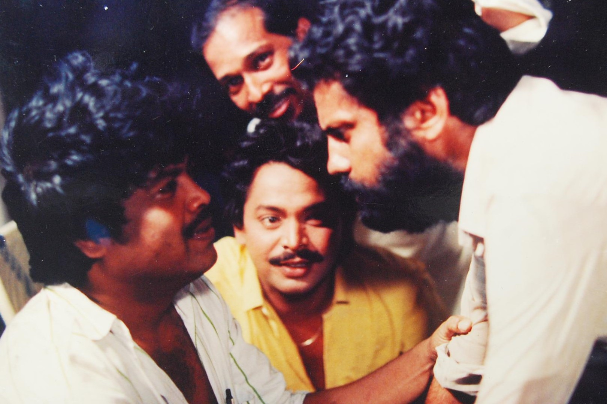

# Odia cinema: the world in our own voice

By Ahimanikya Satapathy

On 27 June 2024, *ମାୟା ମିରିଗ (Maya Miriga)* met an audience again in Bologna. Its restored images carried an Odia household story into another generation of viewing.[^restoration]

Nirad Mohapatra’s film asks what family gives its members—and what it withholds. His programme note holds warmth alongside daughters-in-law’s desire for freedom.[^restoration] Bringing that story back to the screen required people to work with a badly damaged negative. The screening was an achievement in preservation as well as an encounter with a film.

That meeting of people and work runs through this collection: a writer’s words finding actors, a performer learning another medium, a production finding its audience. We follow selected connections between language, art and the practical life of filmmaking. The companion readings offer places to pause with particular films and careers.

## Before the camera: Natak, Rasa and Gitinatya

*Sita Bibah* had a life before the camera. A later report by Minati Singha identifies a play by Kamapal Mishra as the basis of *Sita Bibah*.[^first-play] Piyush Roy’s research describes Goswami’s touring rasalila group and his work training performers. In an interview recorded by Roy, film historian Surya Deo characterises the first film as primarily *gitinatya*, or musical drama.[^stage-roots]

This gives the connection a human shape. Goswami brought experience of performing, singing and organising a troupe to filmmaking. A familiar story could now be carried by recorded voices and moving images. The stage connection lies in particular people and a dramatic text, as well as in the place of song within the film.

Gitinatya joins dramatic storytelling with music and verse. Theatre scholar Alok Baral places Kalicharan Pattanaik among its practitioners.[^gitinatya] Kalicharan also wrote lyrics for *Lalita*, according to Bhuyan’s retrospective.[^foundation] His work connects musical theatre with the second Odia feature through an identifiable contribution.

The wider performance world deserves its own attention. Our guides to [Prahallad Nataka](prahallad-nataka.md), [Pala](/sounds-of-odisha/pala/) and [Daskathia](/sounds-of-odisha/daskathia/) explore different ways of singing, narrating and enacting a story. They introduce cinema’s neighbours, while Goswami’s own Rasa and theatre background supplies the documented connection to this first production.

## The first Odia film: Sita Bibah, 1936

Odia cinema’s first feature was *ସୀତା ବିବାହ (Sita Bibah)*, made by Mohan Sundar Deb Goswami. Film writer Kapilas Bhuyan’s IFFI retrospective records its formal opening in Puri on **28 April 1936**, after a Calcutta screening the previous month. The next Odia feature, *ଲଳିତା (Lalita)*, arrived in **1949**.[^foundation]

Thirteen years is a striking interval. A first film establishes possibility; it does not by itself establish a continuing industry. The familiar anniversary date deserves to be remembered alongside the difficulty of making the next film.

Music was present from the beginning. Bhuyan records fourteen songs in *Sita Bibah*, sung by its actors, and a move to background singing in *Lalita*. Later films drew on Odia literature, including *ଅମଡ଼ା ବାଟ (Amada Bata)*, *ମଲାଜହ୍ନ (Malajanha)* and *ମାଟିର ମଣିଷ (Matira Manisha)*.[^foundation]

The screen offered another life to words and voices already circulating through the culture. To understand that foundation, we need to follow writers and composers as closely as directors. A film’s opening credits can be a small map of the arts meeting one another.

## Radio drama: another home for the storyteller

Radio enters this account later. AIR Cuttack began in **1948**, twelve years after the first Odia feature. The Odia Bibhaba archive records Gopal Chhotray’s association with the station from its beginning.[^radio-archive] Its writers joined a film culture already underway.

Chhotray is a concrete link between the media. The Library of Congress documents his work in Gitinatya, his long association with AIR Cuttack, and his writing of plays, operas and screenplays.[^chhotray-loc] The Gour–Parbati archive credits him specifically with **dialogue for *ଶ୍ରୀଜଗନ୍ନାଥ (Sri Jagannath)* (1950)**, while assigning direction and screenplay to C.R. Mitra.[^jagannath-dialogue]

His career helps us follow the writer between a stage, a microphone and a film production. Radio drama asks listeners to imagine a scene through voices and sound; cinema supplies moving images as well. Chhotray’s credited dialogue supplies one specific connection between those working worlds.

**Continue this history:** [ଆକାଶବାଣୀ କଟକ — AIR Cuttack: where stories found another voice](air-cuttack.md).

## The people who built more than a screen career

Parbati Ghose belongs near the centre of this history. The Gour–Parbati filmography records her as a co-producer with Gour Prasad Ghose on *ଲକ୍ଷ୍ମୀ (Laxmi)*, *କା (Kaa)* and *ସ୍ତ୍ରୀ (Stree)*. It also credits her within the directing partnership used on *Kaa* and *Stree*. Her work crossed the boundaries between performing, organising a production and deciding what would reach the screen.[^gour-parbati]

The archive dates her *ଛ’ ମାଣ ଆଠ ଗୁଣ୍ଠ (Chha Mana Atha Guntha)* adaptation to 1986. Its credits name **Nagen Barik** for sound and **Asim Basu and Sarat Sahoo** for art, and acknowledge Olosingh’s villagers and host **Kalyani Patnaik**.[^parbati-film] The [Parbati Ghose companion](cinema-series/parbati-ghose.md) follows her producing, writing, directing and acting work.

## The places and teams that sustain production

Institutions mattered too. The Odisha Film Development Corporation was incorporated on **22 April 1976**. Its stated remit included support for film production, cinema houses, studio services and film culture. These are the less visible foundations: access to equipment, places to finish a film, and places where audiences can watch it.[^ofdc]

The *Chha Mana Atha Guntha* archive names **Kalinga Studio** and **Prasad Film Laboratory** among its credits, while stating that the shoot took place entirely in Olosingh. The credits do not specify which services those facilities supplied.[^parbati-film]

*Pranab Das in conversation with Bijay Mohanty and Mihir Das; dated 1989 in the source record. Photo: Commons credit Director Pranab Das; uploaded by Sunny Roy. [Wikimedia Commons](https://commons.wikimedia.org/wiki/File:Pranab_Das_behind_the_scenes_in_conversation_with_Actors_Bijay_Mohanty_and_Mihir_Das.jpg), [CC BY-SA 4.0](https://creativecommons.org/licenses/by-sa/4.0/). Original photographer and film unidentified; complete source image retained.*

Private facilities form another part of this infrastructure. India Cine Hub lists Mute Entertainment’s Mute Studio in Bhubaneswar under post-production companies, advertising editing, visual effects and chroma services.[^private-facility]

Technology also appears in performers’ memories. Uttam Mohanty contrasted reflector-lit shoots earlier in his career with later low-light work, in a 2018 interview.[^uttam-technology]

Public infrastructure has its own chain of responsibility. **Naveen Patnaik** laid the rebuilding foundation stone for Kalinga Studio on **25 March 2021**; the Industries Department assigned implementation to **IDCO** and existing-building renovation to the **R&B Department**.[^builders-state] **Mohan Charan Majhi** inaugurated the redeveloped studio and its cinema archive and museum on **5 October 2026**. The recorded events concern redevelopment; they do not establish its commercial outcomes.[^builders-opening]

A film culture needs places to learn and people willing to organise a screening. **Nirad Mohapatra’s** memorial biography records his teaching at FTII and his work with **Cinexstasy**, a Bhubaneswar film society active from 1974 to 1983. Screenings and film-appreciation courses were another part of his contribution, beyond directing *Maya Miriga*.[^builders-society]

## Maya Miriga and other films in circulation

*Maya Miriga* received Second Best Feature Film at the 31st National Film Awards, for films of 1983; festival records commonly date it to 1984.[^maya-national] In 1984 it was selected for Cannes Critics’ Week and shared Mannheim’s Grand Prize in the Third World competition, distinct from that festival’s overall Grand Prize.[^maya-cannes][^maya-mannheim] The [Maya Miriga companion](cinema-series/maya-miriga.md) follows both its family story and its restoration.

Manmohan Mahapatra offers another essential route into this period. *ଶୀତରାତି (Seeta Raati)* received the Best Oriya Film honour at the 29th National Film Awards, for the 1981 award year. The festival catalogue for 1985 also records screenings in Paris and Montreal.[^seeta]

In his account of Odisha’s New Wave, critic Ashok Palit describes the social worlds of Mahapatra’s films: a rural community facing upheaval in *ନୀରବ ଝଡ଼ (Niraba Jhada)*, and a family negotiating social change in *ନିଷିଦ୍ଧ ସ୍ଵପ୍ନ (Nisiddha Swapna)*. His survey places Mahapatra and Nirad Mohapatra among the filmmakers who developed a sustained interest in cinema as an art of close observation.[^new-wave]

These films brought close observation of households and communities into national and international circulation. Their companion essays return to the particular relationships and choices within those worlds.

## Bhukha, and the importance of hearing western Odisha

Sabyasachi Mohapatra’s *ଭୂଖା (Bhukha)* (**1989**) makes the map of cinema in Odisha more expansive. It is a **Sambalpuri-language film**. Palit reads its conflict through the pressures between inherited ways of life and modernity.[^new-wave]

The story grew from a Sambalpuri play by Manglu Charan Biswal. It follows bajnia folk drummers whose livelihoods are threatened by changing musical practices. The stakes are both cultural and material: what happens to the people who carry a tradition when their work is no longer wanted?[^bhukha-play]

Naming the language matters. The cinema of a state can contain several cultural centres, accents and storytelling traditions. Sambalpuri cinema deserves to be heard in its own voice within this larger history.

The [Bhukha chapter](cinema-series/bhukha.md) follows the film’s circulation as well as the livelihoods within its story.

Mohapatra’s later work offers further, separately documented milestones. *ଶଳାବୁଢ଼ା (Sala Budha)* was selected for Indian Panorama in 2013. *ଆଦିମ ବିଚାର (Aadim Vichar)* received the Best Odiya Film award at the 62nd National Film Awards, for 2014, announced in 2015.[^sala][^aadim]

Scholar Amrit Amlan Pattanaik approaches these Sambalpuri films through western Odisha’s cultural and literary worlds, asking how they widen the ways Odisha appears on screen. His study’s published abstract offers a valuable starting question for a deeper article: what becomes visible when we stop treating a region as if it has only one centre?[^sambalpuri-study]

## Children, imagination and the screen

Children belong in this history as viewers with imaginative lives of their own. Live-action films made for children, local animation and films offered in an Odia-language version open different routes to those viewers.

Sadhu Meher’s ବାବୁଲା (Babula) provides a concrete starting point for the first history. A Lok Sabha answer of 7 December 1987 lists it among the Children’s Film Society of India’s productions for 1985–86, identifying it as an Oriya feature. A contemporary 1986 catalogue from Berlin’s Arsenal describes Meher’s CFSI-supported film through a lonely boy’s dreams of outer space. This places institutional support and a child’s imagination within the same account. [^children-babula-parliament][^children-babula-arsenal]

[A. K. Bir](../people/ak-bir.md)’s [ଲାବଣ୍ୟ ପ୍ରୀତି (Lavanya Preeti)](cinema-series/lavanya-preeti.md) received Best Children’s Film for 1993. Its dedicated page follows young characters into the imaginative world of an inherited story.[^children-lavanya-nfa]

Children can also encounter films through Odia-language versions. CBFC’s 2022 list records an Odia video version of ରିଟର୍ଣ୍ଣ ଅଫ୍ ହନୁମାନ (Return of Hanuman), certified on 11 February 2022 and naming Shemaroo Entertainment. Airtel Xstream lists the Anurag Kashyap film as a 2007 animation title available in Odia. This is a route to a dubbed film, distinct from an original Odia production; current access depends on the provider.[^children-hanuman-cbfc][^children-hanuman-provider]

## The people audiences returned to

The history of a film culture also lives in the performers people recognise across different stories. A leading role, a comic interruption, a supporting character or a song can give an audience someone to return to. These careers connect that affection to less visible work: rehearsal, teaching, choreography, producing and helping another performer find her place.

### Bijay Mohanty: performance and teaching

Bijay Mohanty carried theatre training into films and into the classroom. A National School of Drama graduate, he worked in the drama department of Utkal Sangeet Mahavidyalaya and retired as a professor. His screen career includes *ଚିଲିକା ତୀରେ (Chilika Tire)*, *ନାଗଫାଶ (Nagaphasa)* and *ଚକା ଭଉଁରୀ (Chaka Bhaunri)*.[^performer-bijay]

The theatre connection remained part of how colleagues remembered him. Director Manoj Pattanaik recalled his play *Amari Bhagaban*, staged by Manan Natya Sangstha.[^performer-bijay-theatre] The classroom and the theatre group were part of the work he passed on.

### Uttam Mohanty: a remembered encounter

Uttam Mohanty's *ଅଭିମାନ (Abhiman)* debut connects his story to [Sadhu Meher](/cinema/sadhu-meher/), its director. In a 2018 interview, he recalled a Bengali viewer in Cuttack praising his portrayal of Salabega. The memory gives one audience encounter a place beside the career record.[^uttam-technology]

Akashvani records his work in Bengali cinema and the Hindi film *ନୟା ଜହର (Naya Zahar)* alongside his Odia career.[^uttam] His recollection of reflector-lit shoots also brings an actor’s experience into the changing conditions of filmmaking.

### Aparajita Mohanty: acting, producing and learning from another woman

Aparajita Mohanty's work offers several points of entry. *ଉଦଣ୍ଡୀ ସୀତା (Udandi Sita)* is among the films associated with her screen career.[^performer-aparajita] She produced *Love Master*.[^performer-aparajita-production] 

Her remembrance of Anita Das opens another relationship. Aparajita described the senior actor as an elder-sister figure who taught her about acting and the workings of the industry.[^performer-anita] Her later appearance in *ବୋଉ ବୁଟୁ ଭୂତ (Bou Buttu Bhuta)* brings that working life into the recent films discussed later in this survey.[^bou-commercial]

### Performers and the company around a film

Leading roles are only one part of what audiences remember. The following selection brings other kinds of contribution into view; it is a set of routes for further watching and reading, not an order of importance.

| Performer | A contribution to follow |
| --- | --- |
| Mahasweta Ray and Prasanta Nanda | Nanda cast her as Manika in *ଶେଷ ଶ୍ରାବଣ (Sesa Srabana)*; she recalled viewers calling her by that character’s name after a screening.[^performer-mahasweta] |
| Sarat Pujari | He plays Mangaraj in Parbati Ghose’s *ଛ’ ମାଣ ଆଠ ଗୁଣ୍ଠ (Chha Mana Atha Guntha)*, bringing Fakir Mohan’s landowner to the screen.[^parbati-film] |
| Siddhanta Mahapatra | His films include *Suna Panjuri*.[^siddhanta-work] |
| Mihir Das | His career moved among leading, supporting, villainous and comic parts: different kinds of presence within an ensemble.[^performer-mihir] |
| Jayiram Samal (Jayee) | His account of the mischievous priest in *ଯାଯାବର (Jajabara)*, and work across film, television and stage, places comedy within a sustained performing life.[^performer-jayee] |
| Shyamalendu Bhattacharya and Nari | Shyamalendu recalled forming a melody group with Nari and moving between performance and choreography, including *ଯାଯାବର (Jajabara)*. The partnership joins music, stage work and screen comedy.[^performer-shyamalendu] |
| Anita Das | Lead and later supporting roles belong together in her career; Aparajita's testimony also records her contribution as a mentor.[^performer-anita] |

## The songs people carried home

A film's life need not end when the screen goes dark. A voice, a phrase or a melody can travel into another room and another generation. Following those songs brings composers, lyricists and playback singers into the centre of this story.

The credits of *ଶ୍ରୀ ଜଗନ୍ନାଥ (Sri Jagannath, 1950)* name **Balakrushna Das and Ranjit Roy** as music directors, with **Kalyani Das, Chhabi Ray and Suryamoni Dei** among the singers. Cinema was already a meeting place for many voices.[^music-sri-jagannath-archive] **Shantanu Mohapatra** later composed Lata Mangeshkar's songs for *ସୂର୍ଯ୍ୟମୁଖୀ (Suryamukhi)* and *ଅରୁନ୍ଧତୀ (Arundhati)*. His son Koushik remembers a young composer approaching her, and producer Dhiren Patnaik backing the later collaboration. Such journeys began with someone making a connection and someone else making room for it.[^music-shantanu-lata]

[Akshaya Mohanty](../people/akshaya-mohanty.md) belongs here as a composer, singer and producer. When *ମଲାଜହ୍ନ (Malajanha)* returned for a Film Journalists' Forum screening, actress **Jharana Das**, singer [Pranab Patnaik](../people/pranab-patnaik.md), lyricist **Binodini Debi** and the filmmakers' families were part of the occasion. A literary adaptation had gathered actors, words and music; its return gathered people again.[^music-malajanha-return]

There is a smaller, telling story inside [Prafulla Kar](../people/prafulla-kar.md) and **Chitta Jena's** collaboration. Film historian Surya Deo recalled that Jena wanted a solo and initially resisted another duet for *ମମତା (Mamata)*. Actor **Dhira Biswal** persuaded him to sing it with **P. Susheela**. Kar later remembered Jena as a close friend whose voice gave him room to experiment. A song's making could depend on that mixture of ambition, persuasion and trust.[^music-chitta-collaboration]

Other voices deserve their own listening paths. **Bhubaneswari Mishra's** “Tiki Mora Naa Ti” in *କୃଷ୍ଣ ସୁଦାମା (Krushna Sudama)* is one such doorway.[^music-bhubaneswari] Pranab Patnaik's account of his long friendship and stage work with Prafulla Kar offers another.[^music-pranab-remembers] These are starting points for a wider account of the singers, lyricists, arrangers and instrumentalists behind the songs.

The question of writers' livelihoods returns here. A poem can become a lyric; a lyric needs a composer and a voice. Following that shared work also means asking how its authors are credited, paid and remembered. [The Songs We Carry Home](cinema-series/cinema-music.md) follows these connections through fifteen musicians, with dedicated stories of Akshaya Mohanty, Prafulla Kar, Pranab Patnaik and Tapu Mishra.

## Actors whose journeys crossed languages

For performers, the path beyond Odisha sometimes ran through films made in other languages.

**Sadhu Meher** received the National Film Award for Best Actor for his performance in Shyam Benegal’s Hindi film *ଅଙ୍କୁର (Ankur)*, honoured at the 22nd awards for 1974. The official catalogue records his upbringing in Odisha and his training at the Film and Television Institute in Pune. This is a major achievement by an actor from Odisha, within the history of Hindi cinema.[^sadhu]

**Nandita Das** carries a different connection. In her own essay about belonging, she recalls her father’s Baripada roots and her childhood visits. She was born in Bombay and grew up in Delhi. Her Odisha relationship is one of family and experience, rather than an Odisha birthplace.[^nandita-roots]

Her connection also includes acting in Odia: she appeared in Susant Misra’s **ବିଶ୍ୱପ୍ରକାଶ (Biswaprakash / The Young Rebel, 1999)**, listed in her official filmography. The [Nandita Das article](/cinema/nandita-das/#acting-in-odia-biswaprakash) explores that credit alongside her wider career.[^nandita-acting]

Cannes records her membership of its feature-film jury in **2005** and its Cinéfondation and short-film jury in **2013**. Her film *ମଣ୍ଟୋ (Manto)* was selected for Un Certain Regard in **2018**. These occasions mark both jury service and film selection across her career in acting and directing.[^nandita-cannes]

A festival history and a history of popular affection answer different questions. We need both to understand what a film culture means to the people who sustain it.

## National and international recognition

An award can bring a film to someone who has never heard its language. It can also lead that viewer back to the people who made it. The selected milestones below gather recognition discussed in this series; they are a reading guide, not a complete census of Odia film awards.

### National Film Awards

Award years identify the films considered by that edition and can differ from theatrical release or announcement dates. The final column opens a route into the filmmakers’ work; it is not a full list of award recipients.

| Film | Recognition | Award year and edition | Filmmakers to explore |
| --- | --- | --- | --- |
| [ଶୀତରାତି (Seeta Raati)](cinema-series/manmohan-mahapatra.md) | Best Oriya Film[^seeta] | 1981 · 29th awards | Manmohan Mahapatra |
| [ମାୟା ମିରିଗ (Maya Miriga)](cinema-series/maya-miriga.md) | Second Best Feature Film[^maya-national] | 1983 · 31st awards | [Nirad Mohapatra](../people/nirad-mohapatra.md) |
| [ଲାବଣ୍ୟ ପ୍ରୀତି (Lavanya Preeti)](cinema-series/lavanya-preeti.md) | Best Children’s Film[^children-lavanya-nfa] | 1993 · 41st awards | [A. K. Bir](../people/ak-bir.md) |
| [ଆଦିମ ବିଚାର (Aadim Vichar)](cinema-series/aadim-vichar.md) | Best Odiya Film[^aadim] | 2014 · 62nd awards | [Sabyasachi Mohapatra](../people/sabyasachi-mohapatra.md) |
| [ପ୍ରତୀକ୍ଷା (Pratikshya)](cinema-series/pratikshya.md) | Best Odia Film[^pratikshya] | 2021 · 69th awards; announced 2023 | [Anupam Patnaik](../people/anupam-patnaik.md) |
| [ଦମନ (DAMaN)](cinema-series/daman.md) | Best Odia Film[^daman] | 2022 · 70th awards; announced 2024 | [Vishal Mourya](../people/vishal-mourya.md) and [Debi Prasad Lenka](../people/debi-prasad-lenka.md) |
| ଲହରୀ (Lahari) | Best Odia Film[^lahari] | 2024 · 72nd awards; announced 2026 | Amartya Bhattacharyya; producer Jhilik Motion Pictures |

Recognition also follows people across languages. [Sadhu Meher](cinema-series/sadhu-meher.md) received Best Actor for *ଅଙ୍କୁର (Ankur)* at the 22nd awards for 1974. His achievement belongs here as an actor from Odisha working in a Hindi film.[^sadhu]

### International prizes and festival journeys

**An international prize:** *Maya Miriga* shared the **Grand Prize of the Third World competition at Mannheim in 1984**. The festival archive lists it alongside *Leila et les loups*. This was a distinct competition prize, not Mannheim’s overall Grand Prize.[^maya-mannheim]

**A Sambalpuri film abroad:** the [Bhukha reading](cinema-series/bhukha.md) follows the record of its international recognition.

**A festival selection:** *Maya Miriga* was also selected for **Cannes Critics’ Week in 1984**. Selection brought the film before another audience; it is not a Cannes prize.[^maya-cannes]

**Jury service and wider careers:** Cannes records [Nandita Das](cinema-series/nandita-das.md) as a jury member in 2005 and 2013, and *Manto* in Un Certain Regard in 2018. These are jury appointments and a selection across her wider career, rather than awards for Odia-language films.[^nandita-cannes]

[Surya Deo](../people/surya-deo.md) also served on the East regional panel of the feature-film jury for the **72nd National Film Awards**, covering films of **2024** and announced in **July 2026**.[^surya-jury]

The newer *ମାଲିପୁଟ (Maliput Melodies)* was screened in **Indian Panorama at IFFI 2025**. That documented festival appearance opens a contemporary thread below; it is kept distinct from the prize record.[^maliput-iffi]

## A new search for stories

A film can leave something behind after its run: a new collaborator, an audience willing to try another story, or the confidence to begin a difficult script. *ଦମନ (DAMaN)* and *ପ୍ରତୀକ୍ଷା (Pratikshya)* offer two recent starting points for that conversation. Their subjects are different—healthcare in a difficult landscape, and the pressures inside a household—but both give recognisably local lives room on the screen.

We place them together here as an invitation to follow the next chapter of Odia filmmaking. The foundations reach back through the earlier films in this series. What these recent works add is a fresh reason to ask which stories, collaborators and audiences might come together next.

The [Pratikshya companion](cinema-series/pratikshya.md) follows the collaboration behind the film, from Gourahari Das’s source story to Dipanwit Dashmohapatra’s first leading role.[^pratikshya-actor]

**Babushaan Mohanty** offers another route into the period through [*ଦମନ (DAMaN)*](cinema-series/daman.md). Our companion article follows the film’s making, its fictional doctor and the wider healthcare work behind its subject. These films invite us to follow performers and collaborators as well as prizes: who receives a substantial role, whose writing reaches the screen, and which stories find a larger audience?

The range also includes **କର୍ମ (Karma, 2024)**. Anupam Patnaik directed **Anubhav Mohanty** as investigator Amar Patnaik in a murder-case thriller. The filmmaker behind *Pratikshya* was working with a different star and dramatic form; contemporary Odia cinema cannot be reduced to a single kind of revival.[^karma-contemporary]

## Recent releases and the work of reaching audiences

A film culture also depends on tickets sold and the chance to finance the next production. In 2025, **ବୋଉ ବୁଟୁ ଭୂତ (Bou Buttu Bhuta)** supplied a conspicuous commercial story. Directed by **Jagdish Mishra**, the horror-comedy brought **Aparajita Mohanty, Babushaan Mohanty and Archita Sahu** together in leading roles. On 24 September 2025, *The New Indian Express* reported box-office revenue of nearly **₹21 crore**, against a reported budget of **₹2–3 crore**. These are reported figures, not audited accounts or a calculation of producer profit.[^bou-commercial]

The same report described Dharma Productions as being **in the process of acquiring remake rights**. That was a commercial development reported at the time, not evidence of a completed remake. It suggests another way an Odia story can travel: through interest in adapting it for other audiences.[^bou-commercial]

Commercial momentum has a setting as well as a number. During Raja in June 2025, *The New Indian Express* reported packed shows for *Bou Buttu Bhuta* and **ଅନନ୍ତା (Ananta)**. The latter starred **Sabyasachi Mishra** and was directed by **Sabyasachi Mohapatra**, drawing on Fakir Mohan Senapati’s *Randi Pua Ananta*. Literature and popular exhibition were meeting again.[^raja-audiences]

Yet distributor **Prashant B**, quoted in that report, said a shortage of cinema halls left some areas unreached. The point matters: a successful run in available theatres does not mean everyone has access to the film. The commercial story includes the work of exhibitors and distributors, ticket affordability, and the distance between a willing viewer and a screen.[^raja-audiences]

These recent films extend several parts of the history at once: literary adaptation, substantial acting roles, genre entertainment and the search for a sustainable audience. A national award, a busy screening and a remake negotiation each tell us something different. Taken together, they give a fuller picture of the work still being made.

## New stories to follow

Hope becomes more tangible when we can name a film, the people behind it and the possibility it opens. These examples invite further viewing and discussion across different kinds of storytelling.

### ବର ବଧୂ (Bara Badhu): work, friendship and dignity

*Bara Badhu* brings the search for a livelihood into a story of relationships. CBFC’s synopsis describes unemployed Biju entering a marriage arrangement with Suman, with consequences for love and loyalty. The record credits **Biswaranjan Pradhan** with direction, story, screenplay and dialogue, and **Chandra Mani / Useful Garbage Creations** with production. BookMyShow lists its release on **13 February 2026**.[^bara-cbfc][^bara-release]

The ensemble includes **Sailendra Samantaray, Sivani Sangita, Suryamayee Mohapatra and Subasis Sharma**. **Bijitesh De’s cinematography** and **Deepika Kalara’s editing** are also part of the work behind the relationships on screen.[^bara-release][^bara-cbfc]

The premise gives it a place beside *Pratikshya*: economic insecurity enters intimate life, and a decision about work becomes a decision about other people. That is a thematic connection, rather than an established adaptation or influence. Its [official Amara Muzik Odia trailer](https://www.youtube.com/watch?v=JiBjnGMaw2Y) offers an introduction for readers who want to explore it.[^bara-trailer]

### ମାଲିପୁଟ (Maliput Melodies): making room for local voices

At IFFI in November 2025, director **Vishal Patnaik** and producer **Kaushik Das** presented an anthology rooted in rural Koraput. The official account describes a production lasting more than two and a half years, with local performers coached for their roles. The filmmakers spoke of local food, speech and everyday culture as part of what they wanted audiences to encounter.[^maliput-iffi]

The festival credits give that collective work names: **Sudhakar Patnaik** wrote the screenplay, **Tosh Nanda** composed the music, and **Vishal Patnaik and Santosh Kumar Nanda** edited the film. Its ensemble includes **Md. Shariff, Sona Khemundu, Usha Rani Dash, Dhana Harijan and Brundaban Hantal**, among others.[^maliput-credits]

Here the possibility lies in who gets to participate and whose surroundings become a film’s world. Its Indian Panorama screening is a concrete point of recognition, while the [AAO NXT trailer](https://www.youtube.com/watch?v=VlETtNwEX9U) offers a way into the work.[^maliput-trailer]

### ମଧୁମାଳତୀ (Madhumallati): another age of love

*Madhumallati* places older lovers at the centre of a musical drama. Its release listing names **Sanjay Mishra and Mahasweta Ray**, director **Mrutyunjaya Sahu** and writer **Priyabrata Panda**, with a story of reunion after 35 years apart. BookMyShow dates the release to **16 October 2026**.[^madhumallati]

The subject broadens the range of lives and relationships a popular film can hold. Alongside the younger characters, rural worlds and genre experiments elsewhere in this chapter, it gives audiences another kind of story to seek out.

These films do not need to resemble one another to sustain the same language. The [commercial-successes chapter](cinema-series/commercial-successes.md) follows evidence of audience spending; the [economics chapter](cinema-series/cinema-economics.md) asks how that income can support further work. The opportunity is to turn the desire for a good story into sustained support for writers, performers, crews and the next production.

## On the horizon

These **October 2026 announcements** introduce two projects to follow. Their finished work and its reception remain ahead.

### ଦଶାହ (Dassaaha): returning to an audience

**Anupam Patnaik** announced *Dassaaha* at a special screening of *Pratikshya*. That setting brings a new project before people already gathered around an earlier story. Its announced interest in tradition, emotion and life and death offers a direction to explore; a detailed plot, cast and release date were not established in the material available.[^dassaaha-announcement]

The title poster gives the work a more concrete shape. **Barsha Patnaik and Sanghamitra Behera** are its producers, with **Bishnu Sahoo** on cinematography, **Rashmi Ranjan Dash** on editing, and **Ashish Pradhan and Anurag Patnaik** on music. **Anupam Patnaik** is credited with story and screenplay. These are announced production credits, under Amiya Patnaik Productions in association with Shubham Cine Productions.[^dassaaha-poster]

The continuity worth following is the relationship between a filmmaking team and its audience: what will people who connected with one film be invited to consider in the next? That remains an open question. A shared occasion or promotional connection does not establish that the new film is a sequel.

### ଦେବକନ୍ୟା (Debakanya): a performance tradition meets the screen

**Rasesh Mohanty’s** *Debakanya*, starring **Subhasis Sharma**, places a folk performer’s personal and social life within a story involving Puri’s **Ghoda Nacha**. The production announced a **November 2026** theatrical release.[^debakanya-announcement]

The tradition opens a wider path into the series. Odisha Tourism describes **Chaiti Ghoda** as a performance associated with coastal fishing communities: a dancer appears mounted on a dummy horse, mythological episodes are enacted, and improvised dialogue is part of the performance.[^chaiti-ghoda-context] That combination of movement, speech and shared cultural memory takes us back to the storytelling forms discussed at the beginning of this chapter.

A film can bring a performance tradition before viewers who have never encountered it in person. It can also prompt us to seek out the performers themselves. When *Debakanya* becomes available, there will be room to ask how its fictional story engages with the skills, livelihoods and voices of the people who carry this tradition. The announcement alone cannot answer that question.

Release plans can change. These projects are invitations to follow the work, with space for audiences and practitioners to add their own responses when the films can be seen.

## Audiences and income beyond Odisha

*The New Indian Express* reported that **ଦମନ (DAMaN)** opened in **51 theatres in Odisha and 15 across nine other cities** in November 2022.[^daman-national-release] The [DAMaN reading](cinema-series/daman.md) follows that wider reach and the responses to the film.

Overseas announcements show another route to audiences. On 26 April 2023, *OrissaPOST* reported plans to screen **ଫାଲ୍ଗୁନ ଚୈତ୍ର (Phalguna Chaitra)** on 13 May at Hoyts Docklands in Melbourne, Hoyts Blacktown in Sydney and Event Cinemas in Brisbane. A July follow-up in *OrissaPOST* subsequently reported overseas screenings, including Australia. Neither report supplied receipts or a country-by-country earnings breakdown.[^phalgun-australia][^phalgun-followup]

Streaming can reach viewers who have no nearby Odia screening. In Lata Jha’s April 2025 report for *Mint*, **Kaushik Das**, founder of Odia platform **AAO NXT**, described overseas viewers seeking stories that reconnect them with home. [^odia-overseas-streaming]

Paid screenings, streaming and rights agreements can provide income, but these sources do not establish the share of Odia cinema’s earnings from outside the state or overseas. The [OTT companion](odia-ott.md) follows the platform and audience questions further.

## The story continues on television and online

Cinema is one part of a wider screen culture. Odia television created another rhythm of storytelling through recurring programmes and serials. Prasar Bharati dates the Odia satellite service to 1993 and its round-the-clock broadcasting to 2001.[^television-bridge]

Streaming added further routes. Tarang Plus’s 2019 launch offering combined television channels, films, jatra and original web content. An inherited catalogue and a newly commissioned series could now reach viewers through the same service, although they remained different kinds of production.[^ott-bridge]

The [Odia television history](odia-television.md) follows public broadcasting, private channels, performers and production workers. The [Odia OTT journey](odia-ott.md) examines original storytelling, platform economics and audiences beyond Odisha. Together with [AIR Cuttack](air-cuttack.md), these histories show how stories can move between forms without every new medium displacing its predecessors.

## Keeping the next chapter within reach

The Bologna screening at the beginning of this story adds another question to this contemporary energy. What can another generation actually see?

Preservation depends on teams too. **Shivendra Singh Dungarpur** describes Film Heritage Foundation’s conservators repairing *Maya Miriga*. Its restoration credits also name **L’Immagine Ritrovata, Digital Film Restore and Prasad Corporation**, in association with the filmmaker’s family, and identify NFDC–NFAI’s surviving print. A restored image carries technical labour that a director’s name alone cannot acknowledge.[^builders-preservation]

Giving credit should recover the work, not replace one star-centred history with a new list of famous names.

The next chapter of Odia cinema history belongs partly to viewers: watching beyond the famous titles, learning the names behind the credits, asking for subtitled and restored editions, and making room for films whose worlds are unfamiliar even within Odisha.

For a viewing journey, one starting point is the household in *Maya Miriga*, followed by the livelihoods in *Bhukha* and today’s family dramas, thrillers and popular releases. These are invitations to explore the films; the reading sequence continues next with Literature and Screen. Which film would you want the next generation to be able to find?

## Reported film counts: a dated reference

Film counts can suggest the scale of a working life, but the reports below count different things. Dates and scope travel with each estimate; the rows are not ranked, combined or treated as a current filmography census.

| Performer | Reported estimate | Date and scope |
| --- | --- | --- |
| Bijay Mohanty | More than 180 films | 21 July 2020; Films; languages not separately enumerated.[^count-bijay] |
| Uttam Mohanty | More than 135 Odia; as many as 30 Bengali; Hindi film Naya Zahar named | 28 February 2025; Separate language estimates; other published totals differ.[^count-uttam] |
| Aparajita Mohanty | More than 100 films | 1 February 2021; Films; language scope unspecified.[^performer-aparajita] |
| Mihir Das | More than 150 films | 12 January 2022; Films in an account of his Odia career; no separate language breakdown.[^count-mihir] |
| Jayiram Samal | More than 300 films / comic roles | October 2012; Reporter describes Odia films; the interviewee describes comic roles. Those units are not independently reconciled.[^count-jayee] |
| Mahasweta Ray | Almost 40 lead-film credits | December 2010 article; updated May 2012; Lead-film credits including Bengali films, not all appearances.[^performer-mahasweta] |
| Shyamalendu Bhattacharya | More than 50 Odia films | 15 October 2018; Odia films, in the reporter's introduction.[^performer-shyamalendu] |
| Anita Das | More than 100 films | 11 May 2018; Films; languages not explicitly enumerated.[^count-anita] |
| Siddhanta Mahapatra | More than 150 films | January 2013; films, language breakdown unspecified.[^count-siddhanta] |

## Watch and explore

Availability and subscription terms can change by location.

- **Full-film listing: [ଦମନ (DAMaN) on Amara Muzik Odia’s YouTube channel](https://www.youtube.com/watch?v=bX9WYaIzVa4).** Amara Muzik Odia.
- **Official trailer: [ପ୍ରତୀକ୍ଷା (Pratikshya)](https://www.youtube.com/watch?v=E_p4kHzZBTM).** Amiya Patnaik Productions.
- **Official trailer: [କର୍ମ (Karma)](https://www.youtube.com/watch?v=Ai9ItdxoWz8).** Amara Muzik Odia.
- **Official trailer: [ବୋଉ ବୁଟୁ ଭୂତ (Bou Buttu Bhuta)](https://www.youtube.com/watch?v=M1JaMbSCaSs).** Sidharth Music.
- **Official trailer: [ଅନନ୍ତା (Ananta)](https://www.youtube.com/watch?v=aNGaiOD2d74).** Amara Muzik Odia.
- **Restoration clip and information: [ମାୟା ମିରିଗ (Maya Miriga)](https://filmheritagefoundation.co.in/film-heritage-foundation-restores-nirad-mohapatras-landmark-odia-film-maya-miriga1984/).** Film Heritage Foundation’s restoration page and comparison clip, not the full film.

- **Provider catalogue, Odia version:** [ରିଟର୍ଣ୍ଣ ଅଫ୍ ହନୁମାନ (Return of Hanuman)](https://www.airtelxstream.in/movies/return-of-hanuman/HOTSTAR_DTH_MOVIE_1055915). Check current access and subscription terms; playback unverified.

## Footnotes & Sources

[^siddhanta-work]: [The Telegraph, 30 March 2008](https://www.telegraphindia.com/india/star-promises-potboiler-oriya-actor-to-wear-director-s-hat-in-2008/cid/604153).

[^lahari]: Press Information Bureau, [72nd National Film Awards for 2024](https://www.pib.gov.in/PressReleasePage.aspx?PRID=2286143&lang=1&reg=3), 18 July 2026, Best Odia Film entry.

[^karma-contemporary]: Arindam Ganguly, [“Four Odia flicks to clash at box office”](https://www.orissapost.com/four-odia-flicks-to-clash-at-box-office/), OrissaPOST, 8 October 2024. Pre-release account of Karma’s director, lead actor and investigator role; not evidence of eventual revenue.
[^pratikshya-actor]: PIB, [IFFI53 cast-and-crew account of Pratikshya](https://www.pib.gov.in/PressReleasePage.aspx?PRID=1878242), 23 November 2022. Synopsis, Gourahari Das story connection and Dipanwit’s lead-role testimony. Festival appearance is distinct from the film’s award eligibility year.
[^bou-commercial]: Express News Service, [“KJo’s Dharma Productions to remake ‘Bou Buttu Bhuta’”](https://www.newindianexpress.com/states/odisha/2025/Sep/24/kjos-dharma-productions-to-remake-bou-buttu-bhuta), 24 September 2025. Reported cast, budget, revenue and acquisition-in-progress notice. The revenue figure is not clearly specified as net/gross or by territory; no audited profitability, all-time ranking or later deal completion is asserted.
[^raja-audiences]: Express News Service, [“Amid cinema hall crisis, ‘Raja’ releases run to packed houses”](https://www.newindianexpress.com/cities/bhubaneswar/2025/Jun/18/amid-cinema-hall-crisis-raja-releases-run-to-packed-houses), 18 June 2025. Contemporary reporting and named distributor testimony; not an audience survey or a current statewide theatre census.

[^first-play]: Minati Singha, [“Sita Bibaha prints lost”](https://timesofindia.indiatimes.com/city/bhubaneswar/sita-bibaha-prints-lost/articleshow/8116754.cms), The Times of India, 29 April 2011, paragraph identifying Kamapal Mishra’s play. Retrospective attribution; the original play edition was not inspected. Its missing-print report is not a current preservation survey.
[^stage-roots]: Piyush Roy, [The Aesthetics of Emotional Acting](https://era.ed.ac.uk/bitstream/handle/1842/22910/Roy2017.pdf?isAllowed=y&sequence=1), University of Edinburgh PhD thesis, title page 2016, repository release 2017, printed pp.137–139 and 143–144. Goswami’s performing background and Roy’s 2014 interview with Surya Deo. The latter is an attributed historical reading, not a fresh viewing of the film.
[^gitinatya]: Alok Baral, [“Communication Through Folk Elements: A Study in Modern Odia Drama”](https://www.caluniv.ac.in/global-mdia-journal/COMMENTARY-DEC%202013/Commentary_2_Alok_Baral.pdf), Global Media Journal–Indian Edition 4(2), December 2013, p.3, “Exploring the Geetinatya Style.” Theatre scholarship; a shared practitioner does not establish adaptation of a particular musical play.
[^radio-archive]: Odia Bibhaba, [Gopal Chhotray collection](https://odiabibhaba.in/en/compilations/gopal-chhotray-e/), biographical account of AIR Cuttack’s 1948 opening and Chhotray’s association. This dates the Cuttack institution, not the beginning of all Odia broadcasting or listening elsewhere.
[^chhotray-loc]: Library of Congress, [Gopal Chhotray: South Asian Literary Recordings Project](https://www.loc.gov/acq/overseas-offices/delhi/salrp/chhotray.html), author profile and recording catalogue. Work across genres and association with AIR.
[^jagannath-dialogue]: Gour–Parbati archive, [Sri Jagannath (1950)](https://www.gourparbati.com/movie_sri_jagannath.php), film credits. “Dialogue” names Gopal Chhottray; “Director & Screenplay” names C.R. Mitra. Spelling follows each source.

[^restoration]: Il Cinema Ritrovato, [Māyā Miriga, 2024 programme](https://festival.ilcinemaritrovato.it/en/film/maya-miriga/), screening date, filmmaker’s note and restoration account.
[^foundation]: Kapilas Bhuyan, [“75 Years of Odiya Film Making: A Flashback”](https://www.pib.gov.in/newsite/erelcontent.aspx?lang=2&reg=48&relid=67399), IFFI retrospective hosted by PIB, 22 November 2010. Opening chronology, music and literary-adaptation paragraphs. An authored retrospective, not a surviving 1936 screening programme.
[^gour-parbati]: [Gour–Parbati filmography](https://www.gourparbati.com/filmography.php), compiled by Khirod Naik and Shekhar Barman. Entries distinguish production from directing and identify the collective directing credit “Siddharth.”
[^parbati-film]: Gour–Parbati archive, [*Chha Mana Atha Guntha* (1986)](https://www.gourparbati.com/movie_chha_mana_atha_guntha.php), story, direction, screenplay and cast credits.
[^ofdc]: Odisha Film Development Corporation, [RTI Manual 1](https://rtiodisha.gov.in/Pages/printManual/section_id:2/office_id:1345/lang), incorporation date and objectives. Institutional remit is not a claim that every service operated continuously.
[^maya-national]: Directorate of Film Festivals, [31st National Film Awards catalogue](https://www.dff.nic.in/images/Documents/86_31stNfacatalogue.pdf), Second Best Feature Film citation: films of 1983, awards in 1984. Indexed catalogue text.
[^maya-cannes]: Semaine de la Critique, [*Maya Miriga*, 1984](https://www.semainedelacritique.com/en/edition/1984/movie/maya-miriga), official selection record.
[^maya-mannheim]: International Film Festival Mannheim–Heidelberg, [1984 archive](https://www.iffmh.de/festival/history/1984/index_eng.html), award list. The historical Third World competition category is reproduced to avoid conflation with the overall prize.
[^seeta]: [29th National Film Awards catalogue](https://nfaindia.org/images/pdf/29th%20National%20Film%20Award%20Catalogue.pdf), Best Oriya Film citation for 1981; and [Indian Panorama 1985 catalogue](https://dff.nic.in/images/Documents/139_IPCatalogue1985.pdf), Manmohan Mahapatra biography naming Paris and Montreal screenings. Indexed catalogue text.
[^new-wave]: Ashok Palit, [“The New Wave Cinema of Odisha”](https://fipresci-india.org/wp-content/uploads/2025/01/11.-Article-Ashok-Palit-New-Wave-Cinema-of-Odisha.pdf), *E-CineIndia*, October–December 2024, pp.3–4 and 6. Used for attributed critical descriptions, not as a substitute for festival award registers.
[^bhukha-play]: Riyan Ramanath V, [“Film highlights struggle to survive in rural Odisha”](https://timesofindia.indiatimes.com/city/bhubaneswar/film-highlights-struggle-to-survive-in-rural-odisha/articleshow/17396785.cms), *The Times of India*, 28 November 2012, paragraphs on *Bhukha*’s play source and folk drummers. Used for those details only; the report’s relative-year arithmetic is inconsistent and is not adopted.
[^sala]: Directorate of Film Festivals, [Indian Panorama 2014 catalogue](https://dff.nic.in/images/Documents/20_IPCatalogue2014.pdf), printed p.031, producer biography recording *Sala Budha*’s 2013 Panorama selection.
[^aadim]: PIB, [62nd National Film Awards results](https://www.pib.gov.in/newsite/erelcontent.aspx?lang=2&reg=48&relid=117636), 24 March 2015, Best Odiya Film category for 2014. Language-category wording follows the award record.
[^sambalpuri-study]: Amrit Amlan Pattanaik, [“Reading auteurship and subregional subjectivities in the Sambalpuri cinema of Sabyasachi Mohapatra”](https://intellectdiscover.com/content/journals/10.1386/safm_00105_1), *Studies in South Asian Film & Media* 17(2), pp.153–172. Issue dated December 2025; publisher lists online publication on 27 March 2026. Abstract and bibliography consulted; full article unavailable.
[^sadhu]: Directorate of Film Festivals, [22nd National Film Awards catalogue](https://www.dff.nic.in/images/Documents/94_22ndNfacatalogue.pdf), Best Actor citation for Sadhu Meher in *Ankur*, films of 1974. Indexed catalogue text.
[^nandita-roots]: Nandita Das, [“I am still searching for a place to call home”](https://openthemagazine.com/art-culture/i-am-still-searching-for-a-place-to-call-home/), *Open*, 2013.
[^nandita-acting]: Nandita Das, [Acting](https://nanditadas.com/acting/), “Biswaprakash – The Young Rebel”: 1999, director Susant Misra, language Oriya. An acting credit, not a claim that every film in her career is Odia.

[^nandita-cannes]: Festival de Cannes, [Nandita Das](https://www.festival-cannes.com/en/p/nandita-das/), official jury and film-selection history.
[^surya-jury]: Press Information Bureau, [72nd National Film Awards for 2024](https://www.pib.gov.in/PressReleasePage.aspx?PRID=2286143&lang=1&reg=3), 18 July 2026; East regional feature-film jury membership.
[^uttam]: Akashvani, [Uttam Mohanty obituary](https://newsonair.gov.in/legendary-odia-actor-uttam-mohanty-passes-away-at-66/), 28 February 2025, cross-language film work.
[^pratikshya]: PIB, [69th National Film Awards results](https://www.pib.gov.in/PressReleasePage.aspx?PRID=1951758&lang=2&reg=48), 24 August 2023, Best Odia Film for 2021. The [CBFC 2021 certification list](https://cbfcindia.gov.in/cbfcAdmin/assets/pdf/Films_certified_2021.pdf), row 53, dates certification to 29 December 2021; this is separate from theatrical release.
[^daman]: PIB, [70th National Film Awards results](https://www.pib.gov.in/PressReleasePage.aspx?PRID=2045960&lang=2&reg=48), 16 August 2024, Best Odia Film for 2022. This is the Odia film *Daman*, not the unrelated Hindi film of 2001.

[^current-screening]: [District, INOX SGBL Square Mall, 25 October 2026](https://www.district.in/movies/inox-sgbl-square-mall-town-hall-road-cuttack-CD1029236?fromdate=2026-10-25). Date-specific public listing inspected 25 October 2026; seats not checked.

[^daman-national-release]: [Two new films signal there’s hope for Odia movie industry](https://www.newindianexpress.com/entertainment/2022/Nov/13/two-new-films-signal-theres-hope-for-odia-movie-industry-2517844.html). The New Indian Express, 13 November 2022. Release geography and reported attendance; no market-level receipts.

[^phalgun-australia]: [Phalgun Chaitra to be premiered in Australia](https://www.orissapost.com/phalgun-chaitra-to-be-premiered-in-australia/). Post News Network, OrissaPOST, 26 April 2023. An announcement of planned screenings.

[^odia-overseas-streaming]: [Overseas markets emerge as big opportunity for local streaming platforms as diaspora seeks more regional content](https://www.livemint.com/industry/media/overseas-markets-big-opportunity-local-streaming-platforms-regional-stories-zee5-ott-diaspora-hoichoi-11743406476365.html). Lata Jha, Mint, 1 April 2025. AAO NXT founder’s account of diaspora demand; the article’s general regional-OTT percentage is not Odia-specific.

[^phalgun-followup]: [“Phalguna Chaitra returns to theatres”](https://odishapostepaper.com/uploads/epaper/2023-07/64b06e4f9229c.pdf), OrissaPOST, 14 July 2023. Indexed text of the original newspaper PDF; full PDF not inspected. The report’s multi-country screening claim is not an independently audited release or revenue total.

[^television-bridge]: Prasar Bharati, [DD Odia](https://prasarbharati.gov.in/dd-oriya/), official satellite-service history and programme catalogue. These dates do not mark the first television transmissions in Odisha.

[^ott-bridge]: Basil Kannagi Arasu, [Tarang Plus launch report](https://onlytech.com/tarang-plus-first-odia-ott-otv/), OnlyTech, 4 November 2019. Launch-era offering; historical subscription terms are not presented as current.

[^builders-society]: [Nirad Mohapatra’s memorial biography](https://niradmohapatra.com/about-me/), teaching, Cinexstasy and appreciation-course account. Retrospective biography; no audience totals adopted.

[^builders-preservation]: Film Heritage Foundation, [Maya Miriga restoration account and credits](https://filmheritagefoundation.co.in/film-heritage-foundation-restores-nirad-mohapatras-landmark-odia-film-maya-miriga1984/). Named institutions are credited collectively; individual conservators are not all identified.

[^builders-state]: Odisha Industries Department, [Activities Report 2021–22](https://industries.odisha.gov.in/sites/default/files/2023-09/Activity%20Report_2021-22_0.pdf), final two pages; [The New Indian Express, 26 March 2021](https://www.newindianexpress.com/cities/bhubaneswar/2021/Mar/26/odisha-cm-naveen-patnaik-lays-stone-for-kalinga-studio-development-2281805.html), identifies the then chief minister. Projected spending, deadlines and jobs are not treated as outcomes.

[^builders-opening]: Chief Minister’s Office, [Kalinga Studio inauguration](https://cm.odisha.gov.in/index.php/en/latest-news/cm-mohan-charan-majhi-inaugurates-world-class-kalinga-studio-cinema-archive-museum), 5 October 2026. Official event record, not an independent assessment of facility use.

[^uttam-technology]: [Actor, Heartthrob, Superstar](https://www.mycitylinks.in/actor-heartthrob-superstar). Jyoti Prakash Sahoo, MyCityLinks, 15 July 2018; Uttam Mohanty’s recollections of shooting conditions and an audience encounter.

[^private-facility]: [Mute Entertainment Private Limited / Mute Studio](https://indiacinehub.gov.in/index.php/location/states-union-territories/ffo-filmic-facilities/mute-entertainment-private-limited-mute), India Cine Hub. Indexed directory entry. Crowd-sourced listing of advertised services, not verified current capacity, quality or a documented film client.

[^children-babula-parliament]: Lok Sabha, 7 December 1987, printed pp. 99–100, CFSI production list for financial year 1985–86. Indexed parliamentary record; financial year is not an exact theatrical release date. [Read source](https://eparlib.sansad.in/bitstream/123456789/2965152/1/lsd_08_09_07-12-1987.pdf).
[^children-babula-arsenal]: Arsenal Berlin, Kino in Indien catalogue, 1986, Odia-cinema overview. Historical catalogue synopsis; no priority claim or fresh full-film viewing. Odia title spelling also appears in [OdishaLIVE](https://odisha.live/2018/02/07/ଏମାନଙ୍କ-କ୍ୟାରିଅର୍-ଅଭିମା/). [Read source](https://www.arsenal-berlin.de/assets/Legacy/katalog_blaetter/1986_KinoInIndien_komplett.pdf).
[^children-lavanya-nfa]: [41st National Film Awards catalogue](https://nfaindia.org/images/pdf/41st%20National%20Film%20Award%20Catalogue.pdf), Best Children’s Film,1993.
[^children-hanuman-cbfc]: Central Board of Film Certification, certificates issued 2022, p.127, Return of Hanuman, 11 February 2022, certificate VIL/1/10/2022-DEL. Video certification is not the original film’s release date. [Read source](https://cbfcindia.gov.in/cbfcAdmin/assets/pdf/CC_Issued_2022.pdf).
[^children-hanuman-provider]: Airtel Xstream, Return of Hanuman catalogue listing, checked 26 October 2026. Lists 2007, Odia, animation and children’s entertainment; playback, audio, subscription and territory not tested. The displayed Odia title is an editorial transliteration of the provider’s English title; an official Odia title spelling was not verified. Listing and certification runtimes differ and are not assumed to describe the same cut. [Read source](https://www.airtelxstream.in/movies/return-of-hanuman/HOTSTAR_DTH_MOVIE_1055915).

[^bara-cbfc]: Central Board of Film Certification, [Bara Badhu record](https://cbfcindia.gov.in/cbfcAdmin/search-result.php?recid=Q0EwMTAyMDgyMDI1MDAwMTY%3D), certificate dated 10 February 2026. Credits and fictional synopsis; the plot is not evidence of actual employment rules.
[^bara-release]: BookMyShow, [Bara Badhu](https://in.bookmyshow.com/movies/kopt/bara-badhu/ET00485075), release listing, accessed 27 October 2026. Audience scores are not used as a representative survey.
[^bara-trailer]: [Bara Badhu official trailer](https://www.youtube.com/watch?v=JiBjnGMaw2Y), Amara Muzik Odia. Channel and title identified from indexed metadata; playback untested.
[^maliput-iffi]: Press Information Bureau, [Maliput Melodies at the 56th IFFI](https://www.pib.gov.in/PressReleasePage.aspx?PRID=2193029), 22 November 2025. Indian Panorama screening and filmmakers’ accounts of production and casting.
[^maliput-trailer]: [Maliput Melodies official trailer](https://www.youtube.com/watch?v=VlETtNwEX9U), AAO NXT. Channel and title identified from indexed metadata; playback untested.
[^madhumallati]: BookMyShow, [Madhumallati](https://in.bookmyshow.com/movies/jabalpur/madhumallati/ET00521156), release listing, synopsis and credits, accessed 27 October 2026.

[^maliput-credits]: IFFI, [Maliput Melodies film guide](https://filmguide.iffigoa.org/detail/?id=6722), Indian Panorama 2025, screenplay, music, editing and ensemble credits.
[^dassaaha-announcement]: Odia Celebrity, [Dassaaha announcement report](https://odiacelebrity.com/anupam-patnaik-announces-new-odia-film-dassaaha/), 25 October 2026. Announcement and credited producers; release date and detailed cast not provided.
[^debakanya-announcement]: Odia Celebrity, [first-look credits](https://odiacelebrity.com/first-look-launch-of-new-odia-film-debakanya/), 27 July 2025 (Rasesh Mohanty), and [Debakanya and Ghoda Nacha](https://odiacelebrity.com/odishas-traditional-ghoda-nach-takes-centre-stage-in-upcoming-odia-film-debakanya/), updated 5 October 2026. Reported premise and planned November release; promotional claims are not a review of the completed film.

[^dassaaha-poster]: Amiya Patnaik Productions / Shubham Cine Productions, *Dassaaha* title-announcement poster supplied for this research; printed production credits inspected 27 October 2026. These are announcement credits, not an inspected final film credit roll.
[^chaiti-ghoda-context]: Odisha Tourism, [Folk Dance](https://apps.odishatourism.gov.in/folk-dance), Chaiti Ghoda entry. Cultural background; not evidence of the film’s plot or its representation of individual troupes.

[^performer-bijay]: [Bijay Mohanty dies at 70 — PTI, The Indian Express](https://indianexpress.com/article/entertainment/regional/bijay-mohanty-odia-actor-dies-at-70-6515831/), 21 July 2020. The film award mentioned in this report belongs to Chilika Tire, not a personal national acting award.

[^performer-bijay-theatre]: [A tearful adieu to Bijay Mohanty — The New Indian Express](https://www.newindianexpress.com/states/odisha/2020/Jul/22/a-tearful-adieu-to-bijay-mohanty-2173140.html), 22 July 2020.

[^performer-aparajita]: [Babushaan wishes mother Aparajita Mohanty on her birthday — The Times of India](https://timesofindia.indiatimes.com/entertainment/events/bhubaneswar/babushaan-wishes-mother-aparajita-mohanty-on-her-birthday/articleshow/80629042.cms), 1 February 2021.

[^performer-aparajita-production]: [Aparajita Mohanty interview, The Telegraph](https://www.telegraphindia.com/odisha/casting-couch-probably-exists/cid/374867), 27 October 2012.

[^performer-anita]: [Veteran actor Anita Das passes away — The New Indian Express](https://www.newindianexpress.com/states/odisha/2018/May/12/veteran-actor-anita-das-passes-away-1813646.html), 12 May 2018.

[^performer-mahasweta]: [Weaving a legacy of grace — The New Indian Express](https://www.newindianexpress.com/magazine/2010/Dec/12/weaving-a-legacy-of-grace-210240.html), 12 December 2010; displayed update 16 May 2012.

[^performer-mihir]: [I don’t think I can ever call myself successful — MyCityLinks](https://www.mycitylinks.in/i-dont-think-i-can-ever-call-myself-successful-says-actor-mihir-das/), 2018.

[^performer-jayee]: [Jayiram Samal: ace comedian and character actor — The New Indian Express](https://www.newindianexpress.com/states/odisha/2012/Aug/31/jayiram-samal-ace-comedian-and-character-actor--401828.html), 31 August 2012.

[^performer-shyamalendu]: [Comedy on screen, choreography behind — MyCityLinks](https://www.mycitylinks.in/comedy-on-screen-choreography-behind), 15 October 2018. Partnership and choreography are Shyamalendu’s recollections.

[^count-bijay]: [The actor who conquered time, trends and hearts — The Samikhsya](https://thesamikhsya.com/special/the-actor-who-conquered-time-trends-and-hearts), 2020-07-21.

[^count-uttam]: [Uttam Mohanty: a luminary of Odia cinema — OrissaPOST](https://www.orissapost.com/uttam-mohanty-a-luminary-of-odia-cinema/), 2025-02-28. The 2018 MyCityLinks introduction gives a different total and Bengali estimate; these reports are not reconciled or added together.

[^count-mihir]: [End of an era: versatile actor Mihir Das no more — The New Indian Express](https://www.newindianexpress.com/states/odisha/2022/Jan/12/end-of-an-era-versatile-actor-mihir-das-no-more-2405861.html), 2022-01-12.

[^count-jayee]: [Ollywood’s funny business gets serious — The New Indian Express](https://www.newindianexpress.com/entertainment/entertainment-news/2012/Oct/07/ollywoods-funny-business-gets-serious-412943.html), 2012; page updated2012-10-05.

[^count-anita]: [Anita Das passes away — The Times of India](https://timesofindia.indiatimes.com/entertainment/bengali/movies/news/odia-films-best-mother-anita-das-passes-away/articleshow/64125666.cms), 2018-05-11.

[^music-sri-jagannath-archive]: [Sri Jagannath — Gour–Parbati family archive](https://www.gourparbati.com/movie_sri_jagannath.php). Retrospective credit listing; original screen credits not independently inspected.

[^music-malajanha-return]: [Malajanha comes alive again — The New Indian Express](https://www.newindianexpress.com/states/odisha/2011/May/06/malajanha-comes-alive-again-250732.html). Report URL dated 6 May 2011; displayed update 16 May 2012. The update is not a second screening date.

[^music-shantanu-lata]: [The Lata Mangeshkar magic Odia film industry can never forget — The New Indian Express](https://www.newindianexpress.com/states/odisha/2022/Feb/07/the-lata-mangeshkar-magic-odia-film-industry-can-never-forget-2416209.html), 2022-02-07.

[^music-chitta-collaboration]: [Chitta Jena: the romantic singer — The New Indian Express](https://www.newindianexpress.com/states/odisha/2018/Nov/14/chitta-jena-the-romantic-singer-with-honey-dipped-voice-passes-away-at-76-1898006.html), 2018-11-14.

[^music-bhubaneswari]: [Noted Odia vocalist Mishra passes away — The New Indian Express](https://www.newindianexpress.com/states/odisha/2016/Feb/20/noted-odia-vocalist-mishra-passes-away-894535.html), 2016-02-20.

[^music-pranab-remembers]: [Pranab Patnaik’s remembrance, as told to Minati Singha — The Times of India](https://timesofindia.indiatimes.com/city/bhubaneswar/odisha-prafulla-kar-cremated-with-full-state-honours-at-swargadwar/amp_articleshow/90925326.cms), 2022-04-19.

[^count-siddhanta]: Diana Sahu, [An ideal student](https://www.newindianexpress.com/amp/story/education/edex/2013/Jan/07/an-ideal-student-440624.html), The New Indian Express, January 2013. URL dated 7 January; displayed update 5 January. Dated reported estimate, not a current total.

## Further reading

- [Odia Cinema Music: The Songs We Carry Home](cinema-series/cinema-music.md)
- [The page behind the screen: Odia literature and cinema](cinema-series/literature-and-screen.md)
- [AIR Cuttack: writing, performance and listening](air-cuttack.md)
- [Odia Cinema’s Commercial Successes: films, reported collections and audiences](cinema-series/commercial-successes.md)
- [What Makes the Next Film Possible: budgets, box office and support](cinema-series/cinema-economics.md)
- [Beyond One Successful Film: Building Odia Cinema Together](cinema-series/cinema-futures.md)
- [Explore the complete cinema collection: films, people and changing screens](https://projectodisha.org/cinema/)

The screening listing cited here was checked on 25 October 2026; consult current cinema listings before booking.[^current-screening]

**[Suggest an update](https://projectodisha.org/contribute/?page=kb%2Fresearch%2Fculture%2Fodia-cinema.md):** share a film credit, archive record or precise correction. GitHub submissions are public; omit private contact details and consent documents.
