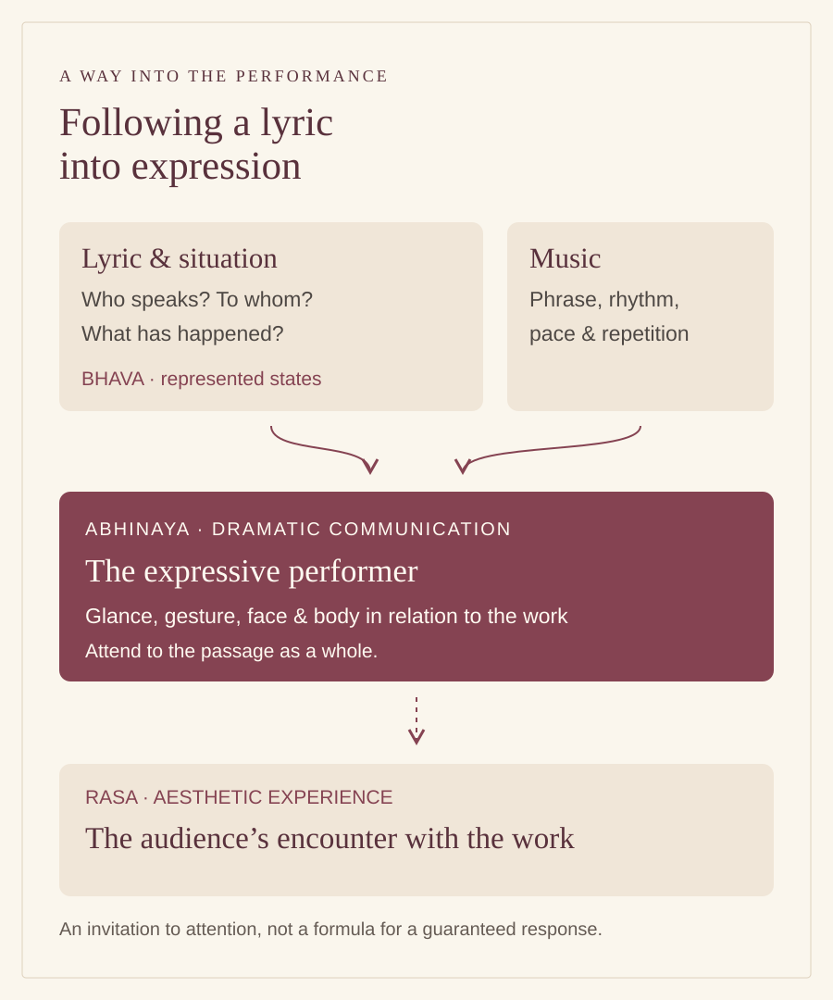

# Odissi abhinaya: following a lyric into performance

By Ahimanikya Satapathy

A translated lyric can tell us what a sentence means. Watching it performed asks us to follow how that meaning takes shape: who speaks, whom the speaker addresses, and what becomes difficult to say. For a first encounter with Odissi abhinaya, those questions can be more helpful than a long list of technical terms.

Srjan describes **abhinaya** as the expressive treatment of feeling in a song or lyric, using glance, gesture, bodily movement and facial expression. Its repertoire account names Jayadeva’s Sanskrit *Gita Govinda* alongside Odia lyrics by Kavisurya Baladeva Rath, Gopal Krishna Pattnaik and Banamali Das, among others.[^srjan-odissi-repertoire] The poem and its language therefore belong in the story we tell about the dance.

*Original explanatory diagram prepared for Project Odisha, 2026. This is a reading aid, not traditional notation or a claim that performance produces a guaranteed response. The introductory distinctions are discussed below.*

## Bhava, rasa and abhinaya

Three related terms help organise a first reading. **Bhava** concerns the represented states or feelings. **Abhinaya** concerns their dramatic communication. **Rasa** concerns the aesthetic experience made available through that representation. These are working distinctions, not interchangeable translations of “emotion.”

Chapter VI of the *Natyashastra* describes rasa arising through the combination of determinants (*vibhava*), consequent expressions (*anubhava*) and accompanying states (*vyabhicari-bhava*). Its comparison with tasting prepared food emphasises the experience of a composition. Its four modes of representation make the scope of abhinaya clearer.[^natyashastra-ch6-ghosh]

| Mode | What to attend to |
| --- | --- |
| **Angika** | Bodily expression and gesture. |
| **Vachika** | Words and their delivery. |
| **Aharya** | Costume and makeup as part of representation. |
| **Sattvika** | The expression of inner states; the text includes tears and trembling among its examples. |

These introductory glosses follow chapter VI, verses 22–23. They describe a broader theatrical vocabulary, not four separate items that every Odissi programme must contain.[^natyashastra-ch6-ghosh]

For a viewer, this offers a practical change of attention. Instead of searching for a single expression that proves the dancer is “sad,” follow the situation that makes a passage affecting. Attend to the words and music, the actions around a moment, and the relation between one moment and the next. Your response is worth noticing without assuming that every member of the audience must experience precisely the same thing.

## Waiting becomes an action

The *Natyashastra* does not leave anticipation as an abstract feeling. In chapter XXIV, verses 243–248, it describes an expectant heroine listening for a time signal, moving towards the doorway and looking along the path of the person she hopes to meet. When he does not appear, her behaviour changes. This is a historical account of dramatic representation, not a movement sequence prescribed for every Odissi dancer.[^natyashastra-ch24-ghosh]

It nevertheless reveals something important about expressive storytelling. The situation becomes visible through actions directed towards a possible event. The doorway matters because someone might enter. The path matters because someone might arrive along it. When neither possibility is fulfilled, the same place acquires a different emotional weight. A performer need not physically build a doorway to establish those relationships for an audience.

The distinction between a feeling and its representation is useful here. “She is anxious” gives us an interpretation. Listening, looking and waiting give that interpretation a course through time. Music and repeated language can extend the interval in which an arrival still seems possible. That last observation is a way to listen to a particular performance, not a rule that all compositions must follow.

## A lyric has more than one life

IGNCA’s *Gita Govinda* project follows the poem through music, dance and painting. Its account reads Radha and Krishna’s union, separation and reunion on human and divine levels.[^ignca-gita-govinda] This makes room for a richer encounter than choosing between “a love poem” and “a devotional work” before listening to a particular interpretation.

Ask what the programme or artist says about the chosen passage. Is the speaker addressing a beloved, speaking to a companion, or being described by another voice? If a translation is supplied, keep its translator’s credit. If it is only a prose summary, recognise what it leaves open: the wording, repetition and musical treatment may still need explanation.

## The musicians are part of the encounter

In a post about singing live for Odissi dance, Soumya Biswajit argues that interaction between dancers and musicians matters to the art. He criticises reliance on recordings and connects the issue with rehearsal, responsiveness and the relationship between lyric and audience. This is a practitioner’s position, not evidence that all recorded accompaniment lacks artistic value.[^odb-live-accompaniment]

His separate account of learning from Pandit Harmohan Khuntia adds another distinction: patterns retained from a teacher can coexist with improvisation. Soumya describes remembering taught swara-tanas over many years while also valuing adaptation.[^odb-guru-transmission] The interesting question is therefore not simply whether a performance is “fixed” or “free.” Which part is inherited? Which decision is made during rehearsal? What can change in response to another performer?

These questions make credits useful rather than ceremonial. The singer gives a lyric its phrasing; the percussionist and other musicians participate in its timing and shape. A programme that names only the dancer leaves much of that work invisible. Preserve the actual ensemble credits when discussing a rendition, and distinguish the poet’s words from the composer’s setting and the choreographer’s interpretation.

## Where abhinaya sits in a programme

Srjan distinguishes the lyric-based abhinaya item from **Batu** and **Pallavi**, which it describes as pure dance. In its account, Pallavi develops a raga through movement and rhythm; abhinaya gives particular scope to the feeling and situation carried by a lyric.[^srjan-odissi-repertoire]

This distinction can help a newcomer change listening habits between items. In a Pallavi, attend to how musical and movement patterns unfold. When a lyric becomes central, also ask who speaks and what the words set in motion. “Pure dance” does not mean that a viewer feels nothing, just as expressive dance does not make rhythm unimportant. The distinction concerns the organisation of the work. Follow the actual programme and the artist’s introduction rather than assuming that every recital has an identical sequence.

## A thoughtful first viewing

Before the performance, read a short introduction and then put it aside. Let it help you recognise the situation without making it a script you must check against each movement. If you cannot follow the language, it is still possible to attend carefully; simply leave the unverified details open.

During the performance, choose one question rather than trying to solve everything. Follow the direction of address. Notice whether a repeated line changes your understanding. Listen for how a musical phrase and an action meet. These are invitations to observation, not claims that every choreography uses the same devices.

Afterwards, separate observation from interpretation. You might record a repeated phrase and then write what it suggested to you. If an artist discussion is available, ask about that particular moment. A concrete question gives the performer something to explain; an assumed universal meaning may close the conversation too early.

A second viewing can be especially useful. Return after reading the lyric, or after hearing an explanation, and notice what becomes clearer and what remains ambiguous. Learning does not require the first response to have been wrong. It can mean becoming able to describe more precisely what held your attention.

## Following the story further

The [Ashta Nayika guide](ashta-nayika.md) introduces one framework for distinguishing dramatic situations. Use it when the work or teaching context makes it relevant. The framework is neither a checklist for every abhinaya nor a replacement for a particular poem.

The [Champu and sakhi article](champu-and-sakhi.md) takes the enquiry into dialogue: a beloved’s situation may be revealed through the words of a friend. Following who speaks, who listens and who persuades can change how we hear even a familiar song.

## Footnotes & Sources

[^srjan-odissi-repertoire]: [Srjan, Odissi Repertoire](https://www.srjan.com/odissirepertoire.php), Abhinaya section. Repertoire and expressive means described by the institution; inspected 23 October 2026.
[^natyashastra-ch6-ghosh]: [*Natyashastra*, chapter VI, “Sentiments”](https://www.wisdomlib.org/hinduism/book/the-natyashastra/d/doc209700.html), Manomohan Ghosh’s English translation, hosted by Wisdomlib; verses 22–23 and the “Sentiments explained” discussion with verses 32–36. Introductory distinctions, not a comprehensive account of subsequent rasa theory. Inspected 23 October 2026.
[^ignca-gita-govinda]: [IGNCA, Gita Govinda](https://ignca.gov.in/divisionss/cultural-informatics/gita-govinda/), multimedia-project description, including the 27 May 2015 release account. Interpretive framework attributed to this project; no recording was watched for this article. Page inspected 23 October 2026.

## Further reading

- [Bhanita and literary signatures](bhanita-and-poet-signatures.md) — distinguish the poet’s name from the character and performer.

- [Ashta Nayika: eight situations, many ways to tell a love story](ashta-nayika.md)
- [Odissi](odissi.md)
- [Mardala](mardala.md)

**[Suggest an update](https://projectodisha.org/contribute/?page=kb%2Fresearch%2Fculture%2Fodissi-abhinaya.md):** identify the lyric or credited performance and the passage needing correction. Obtain permission before sharing recordings or quoting a practitioner. GitHub submissions are public; omit private contact details and consent documents.

[^odb-live-accompaniment]: Soumya Biswajit / Odissi & Beyond, [reflections on live accompaniment](https://www.instagram.com/odissiandbeyond/p/DM79Aq_z8en/), caption inspected 23 October 2026. Attributed argument; no claim of a survey of all Odissi performance practice.
[^odb-guru-transmission]: Soumya Biswajit / Odissi & Beyond, [guru transmission, remembered patterns and improvisation](https://www.instagram.com/odissiandbeyond/reel/DNxC59YZgv9/), caption inspected 23 October 2026. Personal account of learning, not an independent verification of the entire lineage.
[^natyashastra-ch24-ghosh]: [*Natyashastra*, chapter XXIV](https://www.wisdomlib.org/hinduism/book/the-natyashastra/d/doc210156.html), Manomohan Ghosh translation, verses 243–248. Historical acting description, not a reconstruction of a particular modern Odissi choreography.
