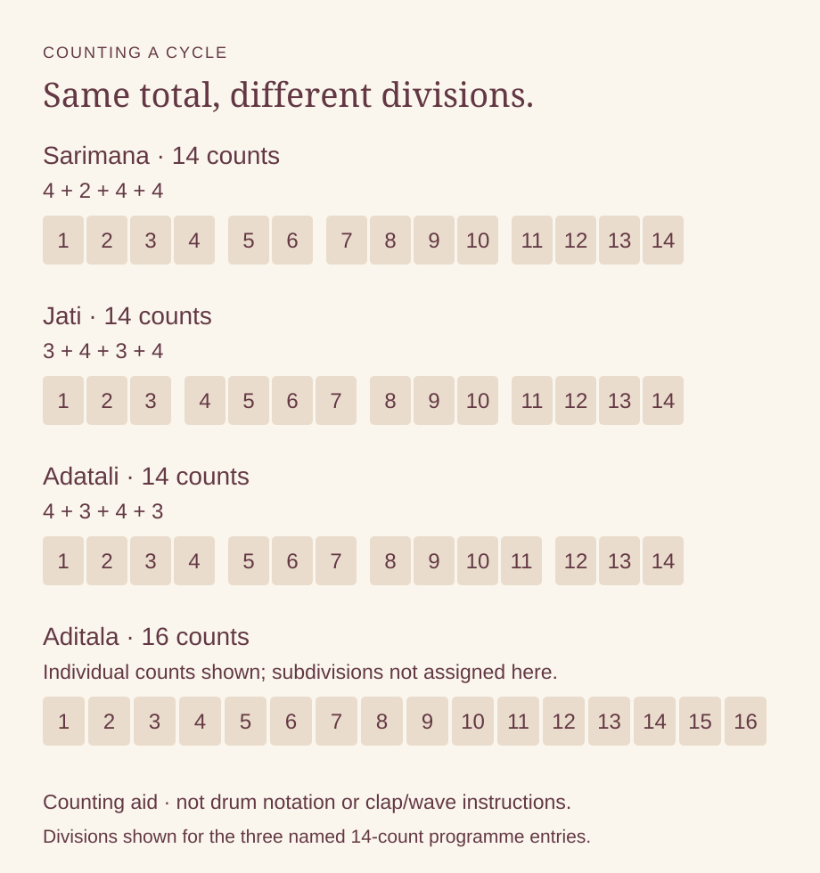

# Odissi tala: why the grouping matters

By Ahimanikya Satapathy

In *Sabda Swara Pallavi*, three talas have fourteen matras each, arranged in different divisions. The total alone cannot describe their structure.[^charlotte-odissi2026]

*Original counting aid prepared for Project Odisha, 2026. The three fourteen-matra groupings follow the cited Sabda Swara Pallavi programme; the sixteen-matra Aditala total follows the teaching syllabus. This is not drum notation or a guide to claps and waves.*[^charlotte-odissi2026][^abgmvm-odissi]

## Adatali and Aditala are different entries

The Odissi Music database gives **Adatali — ଆଡ଼ତାଳି** as **14 matras**, with four divisions arranged **4+3+4+3**. It also records spelling variants including Aadatali and Adtali. Here, a matra is the unit being counted within the cycle.[^ada-database]

This grouping is independently listed as Adataali in Sushil Kumar Patnaik’s 2019 account in *Odisha Review*. His next entry, Aditaala, has **16 matras**, divided **4+4+4+4**.[^patnaik-rhythm2019] The Odissi dance syllabus of Akhil Bharatiya Gandharva Mahavidyalaya Mandal likewise lists Adtali with 14 matras and Aditala with 16.[^abgmvm-odissi]

The similar Roman spellings are easy to overlook. Preserve the exact name alongside the count and the source’s divisions. The collaborative Ga Champu caption that prompted this question gives Ada Tali as 4+3+4+3; the database and teaching sources now provide evidence beyond that caption.[^odb-ga-champu]

## Three talas within one composition

UNC Charlotte’s May 2026 programme describes the sequence **Sarimana → Jati → Adatali**, with the divisions shown above. Each tala begins with a sabda phrase from Pala. The raga is Krushna Kedara.[^charlotte-odissi2026]

The programme credits **Gopala Panda and Ramesh Chandra Das** for music, **Soumya Mohanty** for rhythm, and **Ileana Citaristi** for choreography. These are programme credits; the recording has not been analysed.[^charlotte-odissi2026]

To follow the performed transitions, take the programme’s divisions to a recording and a knowledgeable teacher.

## Jhula is not a festival label

The Odissi Music database has a separate **Jhula — ଝୁଲା** entry, with a list of songs assigned to it. The page inspected here does not give a matra count or a complete notation pattern.[^jhula-database] A catalogue label is useful, but it does not supply all the information needed to demonstrate a tala.

A notated account supplies a more specific example. Manisha Misra’s comparative study presents **Khemata/Jhula as six units divided 3 + 3**, marking unit **1 with a stroke** and unit **4 as vacant**. The study cites Akhila Kumar Lenka’s *Odisi Svaralipi*, p.120.[^misra-jhula2012] This describes that source’s notation; it is not a claim that every teacher or repertoire uses the two names interchangeably. Count two groups of three, while keeping the contrasting marks at their beginnings. This counting exercise does not reproduce the full drum pattern.

Nor does a Jhulana festival song necessarily use Jhula. In Prateek Pattanaik’s documentation of **Chandramani Lenka of Puri**, *Jhulibe Ta Aja Kunje Barajaraja* is catalogued as a Jhulana Jatra song in **Raga Kamodi and Tala Adatali**.[^odissi-project] The occasion, raga and tala are separate pieces of information.

This distinction also matters for the original changing-tala post: its caption explicitly says the song is not primarily a Jhulana song. Its precise sequence still needs a recording-based analysis; the Charlotte example should not be substituted as an explanation of that different performance.[^odb-ada]

## Counting is a beginning

Try the three fourteen-count rows slowly, speaking each group separately. Notice that the total remains constant while the points at which you begin a new group move. This arithmetic exercise helps make the written divisions visible; it does not reproduce a traditional drum phrase, stress pattern or hand gesture.

The teaching syllabus asks for more than totals: notation of the sthayi ukuta, division structure, and recitation with the hands. It places knowledge of the cycle alongside the ability to demonstrate it.[^abgmvm-odissi] Our [Mardala article](mardala.md) follows that passage from spoken syllables to playing and coordination with another artist.

When listening, record the work’s title, performer, tala name and the teacher or notation supporting your identification. Then ask where the divisions fall and how the phrase meets them. Those details turn a number into a musical question worth pursuing.

## Footnotes & Sources

[^charlotte-odissi2026]: University of North Carolina at Charlotte, [*Odissi Odyssey*, May 2–3, 2026 programme](https://coaa.charlotte.edu/wp-content/uploads/sites/807/2026/04/Odissi26_FINAL-2.pdf), PDF page 4, “Sabda Swara Pallavi.” Text inspected 23 October 2026. The groupings and credits describe this composition; no audiovisual performance review is claimed.
[^abgmvm-odissi]: Akhil Bharatiya Gandharva Mahavidyalaya Mandal, [Odissi dance syllabus](https://abgmvm.org/wp-content/uploads/2024/12/ओडिसी-नृत्य.pdf), PDF pages 6–7, Madhyama Pratham, theory item 6 and practical item 6. Inspected 23 October 2026. The syllabus lists Adtali 14 and Aditala 16, and requires notation, division structure and recitation.
[^ada-database]: [“Adatali,” Odissi Music](https://odissimusic.co.in/index.php/tala/adatali-aadtali-ada-tali-aadatali/), “Details”: matra 14, bhaga 4, chhanda 4+3+4+3. Inspected 23 October 2026. The page lists spelling variants; its empty Dharana, Bistara and Mana headings are not treated as supplied notation.
[^patnaik-rhythm2019]: Sushil Kumar Patnaik, [“The Role of Rhythm, Rhythmic Instrument and the Instrumentalist in the realm of Music: Hindustani Classical etc.”](https://magazines.odisha.gov.in/Orissareview/2019/Feb-Mar/engpdf/35-41.pdf), *Odisha Review*, February–March 2019, pp.35–41, especially entries 6–7 on pp.39–40. The two independently corroborated cycle counts are used here; other entries are not reproduced as an authoritative table.
[^odb-ga-champu]: [Collaborative Ga Champu / Ada Tali post](https://www.instagram.com/tulika_tripathy/reel/DXt09PvjD-I/), hosted by Tulika Tripathy and included in the Odissi & Beyond archive survey, caption inspected 23 October 2026. Credit for the 14 = 4+3+4+3 research lead; the full rendition was not analysed.
[^jhula-database]: [“Jhula,” Odissi Music](https://odissimusic.co.in/index.php/tala/jhula-jhulaa/), title and song list, inspected 23 October 2026. No count is inferred from this page.
[^odissi-project]: Prateek Pattanaik, [*The Odissi Project*](https://pattaprateek.com/the-odissi-project/), section 2, Chandramani Lenka, “Songs recorded,” item 6. Catalogue inspected; recording not auditioned for this article.
[^odb-ada]: Soumya Biswajit / Odissi & Beyond, [changing-tala post](https://www.instagram.com/odissiandbeyond/reel/DNLMAFUTQny/), caption inspected in the 23 October 2026 survey. Credit for the inquiry; its song and transitions remain distinct from the independently documented pallavi discussed here.

[^misra-jhula2012]: Manisha Misra, comparative study of *Gita-Govinda*, chapter 6, [printed p.220](https://www.wisdomlib.org/uploads/ocr/essays/gitagovinda/15-chapter-7.pdf), PDF p.19, “Khemata/Jhula”; footnote 57 cites Akhila Kumar Lenka, *Odisi Svaralipi*, p.120. Scanned page visually inspected. The mirror identifies Misra and 2012; original thesis-record metadata could not be checked. The scan says chapter 6 although the mirror filename says chapter 7. Lenka’s book was not independently consulted.

## Further reading

- [Mardala](mardala.md)
- [Jhulana in Odisha](jhulana-in-odisha.md)
- [Champu and the sakhi](champu-and-sakhi.md)
- [Rhythm and transmission research guide](rhythm-and-transmission-research-guide.md)

**[Suggest an update](https://projectodisha.org/contribute/?page=kb%2Fresearch%2Fculture%2Fodissi-tala-and-changing-cycles.md):** identify the notation, teacher, recording and passage. GitHub submissions are public; omit private contact details and consent documents.
