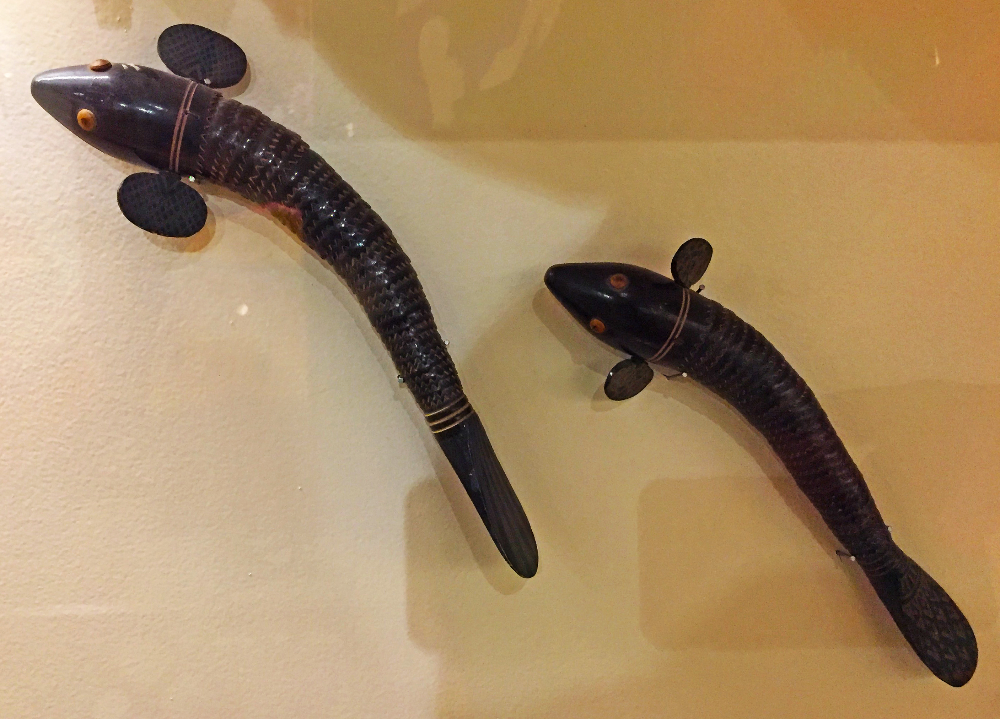

Combs, cranes, prawns and peacocks belong to the same craft repertoire in Paralakhemundi. The Gajapati district administration’s account of horn work includes both everyday implements and animal figures.[^1] A line of comb teeth and a bird’s spreading wings ask for different forms, even when the material belongs to the same craft.

Horn fish photographed at the Odisha Crafts Museum, Bhubaneswar, in 2018. The source record does not identify their maker or place of manufacture.[^2]

## Making an animal from parts

A documented workshop in Cuttack offers a closer look at horn working elsewhere in Odisha. In their D’source study, Bibhudutta Baral and Bhargava A. J. describe selecting a horn for the intended object, shaping it with files, and smoothing the carved surface. Their account distinguishes carving a form from assembling one: separate components can be finished individually and then glued together. Flattened pieces from hollow horn provide thin, translucent elements such as wings.[^3]

## The orders behind the objects

Horn work also has a history of orders and finance. Writing in *Orissa Review* in 2009, N. P. Panigrahi describes early twentieth-century Paralakhemundi production that included combs, boxes and animal models. His historical account identifies K. Apparao Chetti of Home Stores as a merchant who financed work and placed orders with craftspeople.[^4]

That relationship adds another layer to the finished object. Making required access to material; selling depended on people who could commission and move the work. Panigrahi’s account concerns an earlier trading arrangement.

The district administration also records the Paralakhemundi Biswakarma (Horn) Cooperative Society alongside artisans working individually.[^1] The cooperative gives this craft a named organisational history as well as a place on a map.

Look at a horn animal’s curve, the edge of a fin or wing, and the meeting of its parts. Each brings the maker’s choices about material and form into view.

## Footnotes & Sources

[^1]: Gajapati district administration, [“District industries”](https://gajapati.odisha.gov.in/en/departments/district-industries), “Horn Craft” and “Cooperative Societies” sections. The account’s workforce figures are undated and are not used here.

[^2]: Subhashish Panigrahi, [horn-fish photograph](https://commons.wikimedia.org/wiki/File:Decorative_ishes_made_of_animal_horn_at_Odisha_Crafts_Museum,_Bhubaneswar,_Odisha,_India.jpg), 10 June 2018, Wikimedia Commons. [CC BY-SA 4.0](https://creativecommons.org/licenses/by-sa/4.0/). Resized and compressed.

[^3]: Bibhudutta Baral and Bhargava A. J., NID Bengaluru, [*Horn Craft — Cuttack, Orissa*](https://dsource.in/sites/default/files/resource/horn-craft-cuttack-orissa/downloads/file/184_horn_craft_cuttack_orissa.pdf), D’source, p. 9, “Making Process”.

[^4]: N. P. Panigrahi, [“Crafts and Industries in Parlakhemundi Zamindari, Some Reflections”](https://magazines.odisha.gov.in/Orissareview/2009/Feb-Mar/engpdf/49-52.pdf), *Orissa Review*, February–March 2009, pp. 51–52. Historical synthesis drawing on earlier surveys and gazetteer material.
