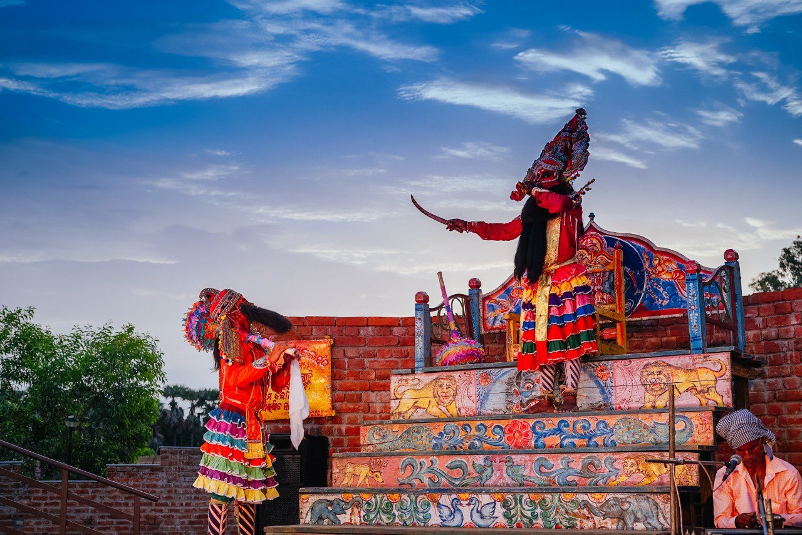

# Prahallad Nataka: the king, the child and the work of keeping a theatre alive

By Ahimanikya Satapathy

A father demands obedience. His son refuses to surrender his faith. In Prahallad Nataka, the struggle between Hiranyakashipu and Prahallad becomes a musical drama whose resolution arrives with Narasimha, Vishnu’s man-lion incarnation. The story is familiar across India. In Ganjam, it has acquired a particular theatrical life: a repertoire, a way of moving, a community of teachers and performers, and the alternative name **Raja Nata**.[^prahallad-pattanaik-profile]

*Prahallad Nataka at the Crafts Museum, 24 June 2018. Photograph: Government of Odisha, via [Wikimedia Commons](https://commons.wikimedia.org/wiki/File:Prahlada_Nataka_at_Crafts_Museum.jpg), [CC BY 4.0](https://creativecommons.org/licenses/by/4.0/). Image unaltered. The source does not name these performers; this is not a photograph of the forthcoming Baithak programme.*

An audience may know how the story ends and still have much to discover. How does a performer make the king’s authority felt? How does the child answer him? What happens when a narrative already known through worship and storytelling becomes an encounter among living voices?

Those questions offer a better entrance than treating Prahallad Nataka as a surviving curiosity. Its subject is devotion, but its continued existence also asks something of us: whether we can give an unfamiliar performance the time it needs.

## A courtly history and disputed authorship

The historical trail leads to nineteenth-century Jalantara, now in Andhra Pradesh, and the court of Ramakrishna Deva Chhotaraya. The precise chronology is unsettled. Sitakant Mahapatra’s study places the composition around 1860; John Emigh places it between 1870 and 1880. A broad nineteenth-century description is more defensible than an exact birthday for the form.[^prahallad-mahapatra1985][^prahallad-emigh2001]

The king’s association is not the same as proof that he wrote every line. Mahapatra discusses Gourhari Parichha’s possible contribution and considers a text formed through several hands. The question matters because patronage, composition and performance are different kinds of work. Naming a ruler should not make the poet disappear; naming a poet should not erase what later teachers and village companies contributed.[^prahallad-mahapatra1985]

## Music carries the action

Prahallad Nataka asks a listener to follow music as part of the drama itself. The Impart encyclopedia describes songs joined by prose dialogue, with a lead vocalist, the **gahaka**, guiding the chorus and commenting on the action. It lists accompaniment including mardal, mukhaveena and gini. Its account gives 126 songs, around 35 ragas and six talas; these are figures from that account, not a count independently established for every troupe.[^prahallad-impart2022]

For a first listening, a catalogue of raga names is less useful than noticing what a song does. Does it introduce someone, make a demand, explain an emotion or delay a confrontation? Follow the shift between the character’s voice and the voices around it. The accompaniment is worth attending to even when the words are unfamiliar.

The language used to describe the music also needs care. Impart emphasises traditional Odissi music, while Emigh discusses Carnatic raga connections. These descriptions deserve comparison with actual renditions and teachers’ explanations, rather than being turned into a contest of labels.[^prahallad-emigh2001][^prahallad-impart2022]

## A stage that makes power visible

Emigh describes a stepped **mancha**, demanding movement and ritual attention to the Narasimha mask. Space and objects contribute to the drama alongside its words.[^prahallad-emigh2001]

The theatre practitioner’s account preserved by Heritage Odisha makes a related point about space. It describes Prahallad Nataka’s musicians and ceremonial character entrances, and argues that forcing arena traditions into a conventional theatre can change how they work.[^theatre-heritageodisha]

For a viewer, this suggests a simple habit: watch the journey into the acting area, not only what happens after an entrance. Notice where musicians sit or stand, where characters address the audience, and whether the spectators are arranged on one side or several. At an unfamiliar venue, ask the organisers how they have adapted the staging. An adaptation can be thoughtful without being identical to a village performance.

Ritual elements should likewise be understood through the people responsible for them. An audience member’s access to a performance does not automatically include access to every preparation or permission to handle and photograph sacred objects.

## The people who carry the knowledge

The 2026 Padma Awards records recognise **Simanchal Patro**, also rendered Simanchal Patra. His official citation traces training from childhood, his development as a performer of Hiranyakashipu, and his work establishing akhadas and teaching younger artists. It also records his 1990 Sangeet Natak Akademi recognition. His career brings the discussion back to the patient work of learning and teaching.[^prahallad-pib2026]

Another valuable record is Prateek Pattanaik’s documentation of Sri Lakshmi Nrusingha Natya Sansada of Burupada, Ganjam. It credits A. Rajendra Patro as Raja, Santosh Satpathy as Lilabati, Sanyasi Maharana as sutradhara, and musicians including Kalia Gouda on mukhabina and Tukuna Swain on mardala.[^prahallad-pattanaik-profile] These are credits for the documented ensemble, not an announced cast for a future event.

Keeping such names with recordings changes the archive. A viewer can begin to recognise artistic work rather than encountering an anonymous image labelled “folk culture.” Teachers, accompanists, supporting performers and documentarians all become discoverable.

## Learning through the child’s role

The child’s role also mattered to the transmission of the theatre. In his 2001 study, Emigh describes playing Prahallad as a route through which performers could later take on Hiranyakashipu, serve as gahakas and become teachers. He also reports difficulty recruiting boys for the demanding role as schooling and working lives changed.[^prahallad-emigh2001]

This is a historical observation, not a survey of recruitment today. It nevertheless makes the work of preservation more concrete. A troupe needs opportunities for a newcomer to learn a part and gain experience alongside others. Supporting a performance and supporting the next generation of performers are connected tasks. A useful question for a company is how it creates that path now—and what helps a learner remain involved.

## Recording a performance, sustaining a practice

Pattanaik’s account of a 2018 documentation effort describes community fundraising and work with Debendra Pattanayak and Arjun Samantaray. A planned twelve-hour recording expanded to two performances. He credits Emigh’s help with research and describes plans for subtitling and contextual material.[^prahallad-pattanaik-documentation2018]

This is a useful example of what documentation can demand: coordination, equipment, time, language work and knowledge of the performance. The account also recalls longer versions of the play. That recollection should remain attached to its source; it cannot establish an unchanging original duration for every lineage.

An archive and a living practice need different kinds of support. A recording preserves something that happened. A student needs opportunities to learn, rehearse and perform again. A useful cultural programme should ask about both. What can be recorded with permission? Who will explain the words? Who is learning the difficult roles? What would help a teacher continue teaching? These are practical questions for future collaboration, not outcomes that can be inferred from a festival poster.

## An invitation in Bhubaneswar

Odissi & Beyond’s **Baithak, 17th Edition**, lists Prahallad Nataka at The Jalsa in Bhubaneswar on **1 November 2026**. The booking page gives **9:30 am–9:30 pm**, while the organiser’s 20 October Instagram caption gives **9 am–9 pm**. Confirm the time with the organiser before travelling; the [dated event record](../events/baithak-17-2026.md) preserves this discrepancy. The booking page also mentions a possible opening-segment appearance by Simanchal Patra; it remains conditional. These sources were checked on 23 October, and the event is still upcoming.[^baithak17-organiser2026][^ig-DeuJ1Ivk_32]

The day offers a concrete reason to begin learning about the form now. Before attending, read the story, learn a few character names and check the organiser’s latest arrangements. During the performance, allow time for a voice or a musical phrase to become familiar. Afterwards, keep the artists’ credits with anything you share.

Prahallad Nataka also opens onto a wider theatrical Odisha. Bharata Lila, Danda Nata, Desia Nata, Mughal Tamasha, Suanga, Jatra and other traditions deserve their own accounts. Pala and Daskathia bring related questions of poetry, explanation and audience response, while puppet and dance traditions use other means to make a story present. The [companion guide](odisha-theatre-traditions.md) distinguishes these forms instead of treating them as interchangeable names.

One good performance can begin a longer relationship with that world. Let the next question be specific: whose voice was that, who taught them, and where can their work be heard again?

## Footnotes & Sources

[^prahallad-pattanaik-profile]: Prateek Pattanaik, [Prahallada Nataka](https://pattaprateek.com/folk-arts-of-odisha/prahallada-nataka/), form profile and credited Burupada ensemble. Web text inspected 23 October 2026; linked films not watched in full. Its early nineteenth-century origin claim differs from the scholarly dates discussed above.
[^prahallad-mahapatra1985]: Sitakant Mahapatra, [Prahlada Nataka—A Window on a Syncretic Performative Tradition](https://www.sahapedia.org/prahlada-nataka%E2%80%94-window-syncretic-performative-tradition), NCPA journal article, catalogued by Sahapedia as 1985, volume 14, issue 1. Catalogue and indexed PDF passages inspected; full PDF retrieval failed. The indexed opening and printed p.16 support the dating and authorship discussion.
[^prahallad-emigh2001]: John Emigh, [Use of Adversity: Embodiments of culture and crisis in the Prahlada nataka of Orissa](https://www.seagullindia.com/stq/pdf/stq31.pdf), *Seagull Theatre Quarterly* 31, September 2001. Relevant PDF pages 32–39 and p.49 (zero-based page 48), the recruitment and training paragraph; the digitised page numerals and contents pagination differ. Historical field research, not a current troupe census.
[^prahallad-impart2022]: Impart, formerly MAP Academy, [Prahlad Natak](https://imp-art.org/articles/prahlad-natak/), 21 April 2022. Performance description inspected 23 October 2026. Figures and terminology remain attributed to this account.
[^theatre-heritageodisha]: [Traditional Peoples Theatre of Odisha](https://heritageodisha.com/traditional-people/), Heritage Odisha, opening discussion of performance spaces. Undated web presentation of an older theatre essay; its historical troupe totals are not used here.
[^prahallad-pib2026]: Government of India, [Padma Awards 2026 notification](https://www.padmaawards.gov.in/Document/pdf/notifications/PadmaAwards/PadmaAwards2026.pdf), entry 118, and [Investiture Ceremony II citation booklet](https://static.pib.gov.in/WriteReadData/specificdocs/documents/2026/jun/doc2026623901101.pdf), 23 June 2026, PDF p.93, Simanchal Patra. Award evidence and attributed career account.
[^prahallad-pattanaik-documentation2018]: Prateek Pattanaik, [How we documented the Prahallada Nataka of Ganjam](https://pattaprateek.com/how-we-documented-the-dying-prahallada-nataka-of-ganjam/), first-person account discussing the 2018 recording project. Recording plans are not proof that every intended episode or subtitle was released. Photographs are credited and permission-restricted; none is reproduced here.
[^baithak17-organiser2026]: Soumya Biswajit / Odissi & Beyond, [Baithak, 17th Edition](https://www.odissiandbeyond.com/event-details/baithak-17th-edition), organiser’s listing, checked 23 October 2026. [Dated event record](../events/baithak-17-2026.md).

[^ig-DeuJ1Ivk_32]: Odissi & Beyond, [20 October 2026 programme caption](https://www.instagram.com/odissiandbeyond/p/DeuJ1Ivk_32/), advertising 9 am–9 pm. Original caption inspected 23 October; conflicts with the booking page’s half-hour-later times.

Further reading

- [Odisha’s theatre traditions](odisha-theatre-traditions.md)
- [Pala](pala.md) and [Daskathia](daskathia.md)
- [Mardala](mardala.md) and [Mayurbhanj Chhau](mayurbhanj-chhau.md)
- [Research dossier and unresolved questions](../sources/prahallad-nataka-research.md)

**[Suggest an update](https://projectodisha.org/contribute/?page=kb%2Fresearch%2Fculture%2Fprahallad-nataka.md):** identify the passage, source or performance you would like added. Practitioner explanations, dated programmes and text editions are especially useful. Obtain permission before supplying recordings or photographs. GitHub submissions are public; omit private contact details and consent documents.
