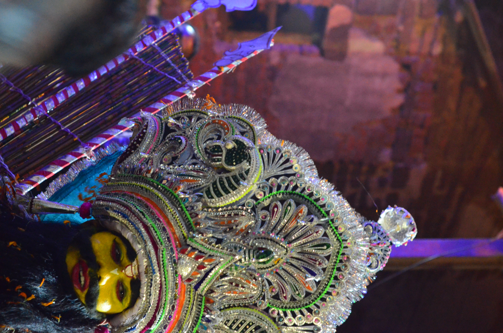

# Sahi Jatra: Puri’s neighbourhoods in performance

By Ahimanikya Satapathy

In Sahi Jatra, a street crossing can become a performing space. The IGNCA and Sangeet Natak Akademi’s *Akhyan* account describes a procession moving through Puri, with dancers, acrobats and costumed figures turning crossings into arenas. The neighbourhood is part of how the performance takes shape.[^ignca-akhyan2010]

*Parasurama in Sahi Jata, identified in the source file as Harachandi Sahi, Puri. Photograph by Prateek Pattanaik, 2018, [Wikimedia Commons](https://commons.wikimedia.org/wiki/File:Parsurama_in_Sahi_Jata.jpg), [CC BY-SA 4.0](https://creativecommons.org/licenses/by-sa/4.0/); reproduced without alteration.*[^sahi-photo]

## A story moves through the streets

The same account places Sahi Jatra in Chaitra around Ramnavami and names **Rama, Ravana, Parasurama, Hanuman, Sugrib and Angad** among its characters. It distinguishes **nagas**, associated with valour, from **medhas**, which represent deities and demons.[^ignca-akhyan2010]

A useful way to approach this theatre is to follow both the figure and the space around it. How does a performer enter a crossing? Where does the audience gather? What changes when a procession pauses for a display? These questions draw attention to the organisation of a moving event, beyond the appearance of a costume in a photograph.

## Characters have neighbourhood associations

Prabhat Kumar Nanda’s 2007 account connects particular figures with particular sahis: **Parasurama with Harachandi Sahi**, **Ravana with Balisahi**, and **Maya Ravana with Dola Mandap Sahi**. He describes Chaitra processions over fifteen days.[^nanda-ram2007]

These are associations recorded in that account, not a complete allocation of roles or a current timetable. They make a larger point tangible: a familiar Ramayana character can also carry a local connection. Naming the sahi helps preserve that connection instead of treating the performance as an interchangeable presentation of the epic.

The Ramnavami association and the longer festive period describe different aspects of the occasion. Neither source supplies dates, routes or start times for a future visit; those need a dated local programme.

## The institutions behind the appearance

In *Physical Culture in Jagannath Consciousness*, Bimal Prasad Mohanty describes Puri’s **akhadas** as principal neighbourhood institutions and **jagas** as associated, smaller institutions. His account joins physical training with the social and cultural life of the sahi, including activities during festivals such as Ramanabami.[^mohanty-physical2015]

Mohanty also describes wrestling and stick practice alongside evening music and drama. Physical preparation and performing culture share institutional space in his account.[^mohanty-physical2015]

This gives us a way to think about preparation before a public appearance. A striking figure is supported by institutions where skills and responsibilities are maintained. The account is historical and interpretive; it should not become a claim that every present-day group has identical membership, administration or training.

A fuller record would follow a named group: who trains the performers, who prepares the costume, who supplies the music, and how the neighbourhood organises its participation. Those questions recognise work that a short video may leave outside the frame.

## Keep the text and the performance connected carefully

The *Suchitra Ramayana* lead raises a further question: which text, song and rendition belong to a particular Sahi Jatra performance? The post that prompted this inquiry connects the subjects, but a caption alone cannot establish the repertoire of all neighbourhoods.[^odb-sahi]

Debendra K. Dash and Dipti R. Pattanaik’s bibliography identifies an edition to pursue: **Banamali’s Suchitra Ramayana, edited by Pramila Mishra**, published by the Directorate of Cultural Affairs, Bhubaneswar, in **1972**.[^dash-pattanaik2006] The edition itself has not been inspected here. Comparing it with a transcribed performance passage would help establish words, attribution and musical treatment. Until that work is done, this article does not name *Suchitra Ramayana* as the universal script of Sahi Jatra. The question belongs beside the performance history, with its evidence still to be assembled.

## Seeing the neighbourhood as well as the character

The 2010 *Akhyan* programme names **Jitendra Muduli** as coordinator and supplies a cast list for its Sahi Jatra presentation. Such credits preserve people behind a tradition’s name. They document that programme’s participants, not a permanent leadership structure for the whole festival.[^ignca-akhyan2010]

When returning to a photograph or recording, keep three details together: the character, the performer or group when known, and the neighbourhood or occasion. Each adds something the others cannot supply. For a comparison with other regional performance settings, continue to [Prahallad Nataka](prahallad-nataka.md) and the [Odisha theatre guide](odisha-theatre-traditions.md).

## Footnotes & Sources

[^ignca-akhyan2010]: IGNCA and Sangeet Natak Akademi, [*Akhyan: A Celebration of Masks, Puppets and Picture Showmen Traditions of India*](https://ignca.gov.in/PDF_data/aakhyan_brochure.pdf), 20 October–20 November 2010, printed pp.82–83 (PDF page 43), “Sahi Jatra.” Text inspected 23 October 2026. The coordinator and cast belong to the documented presentation; no current booking or performance review is implied.
[^nanda-ram2007]: Prabhat Kumar Nanda, [“Shree Jagannath and Shree Ram”](https://magazines.odisha.gov.in/Orissareview/june_july-2007/engpdf/Pages110-111.pdf), *Orissa Review*, June–July 2007, p.111, paragraph beginning “During the birth month.” Only the local procession and neighbourhood associations are used here; the essay’s wider theological claims are not treated as historical proof.
[^mohanty-physical2015]: Bimal Prasad Mohanty, [“Physical Culture in Jagannath Consciousness”](https://magazines.odisha.gov.in/Orissareview/2015/July/engpdf/146-148.pdf), *Odisha Review*, July 2015, pp.146–148, especially p.147 on akhadas, jagas and festival activities. Read 23 October 2026. Its uncertain origins and etymological speculation are not adopted.
[^odb-sahi]: Soumya Biswajit / Odissi & Beyond, [Suchitra Ramayana and Sahi Jatra post](https://www.instagram.com/odissiandbeyond/reel/DWlxjNKk1wz/), caption screened in the 23 October 2026 archive survey. Credit for the research lead; performance not transcribed and a specific edition-to-performance connection remains unverified.
[^sahi-photo]: [*Parsurama in Sahi Jata*](https://commons.wikimedia.org/wiki/File:Parsurama_in_Sahi_Jata.jpg), Wikimedia Commons. Own-work photograph by Prateek Pattanaik, dated 27 March 2018 in the file metadata; CC BY-SA 4.0. Source description and licence verified 23 October 2026. Performer identity is not inferred.

[^dash-pattanaik2006]: Debendra K. Dash and Dipti R. Pattanaik, [“Translating Medieval Orissa”](https://ntm.org.in/download/ttvol/volume3/ARTICLES/02%20-%20Translating%20Medieval%20Orissa1%20%E2%80%93%20Debendra%20K.%20Dash%2C%20Dipti%20R.%20Pattanaik.pdf), *Translation Today* 3, nos.1–2 (2006), bibliography p.66. Bibliographic reference inspected 23 October 2026; it establishes an edition to consult, not its use in a specific Sahi Jatra performance.

## Further reading

- [Prahallad Nataka](prahallad-nataka.md)
- [Odisha’s theatre traditions](odisha-theatre-traditions.md)
- [Sakhi Nata and Sakhi Pila](sakhi-nata-and-sakhi-pila.md)
- [Jhulana in Odisha](jhulana-in-odisha.md)

**[Suggest an update](https://projectodisha.org/contribute/?page=kb%2Fresearch%2Fculture%2Fsahi-jatra.md):** identify the neighbourhood, performer, text or dated programme. GitHub submissions are public; omit private contact details and consent documents.
