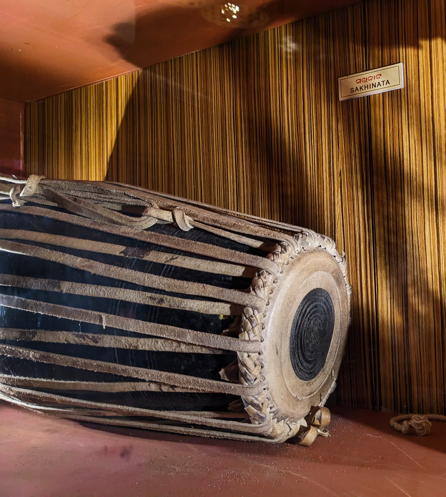

# Sakhi Nata and Sakhi Pila: song, dancer and companion

By Ahimanikya Satapathy

In Sakhi Nata, watch the dancer who is responding as well as the dancer taking the lead. Dinanath Pathy’s account describes an exchange: one performer expresses a feeling, a companion answers, and their roles can change. Song and gesture acquire meaning through that relationship.[^pathy-sakhinata]

*Mardala used in Sakhi Nata, photographed by Prateek Pattanaik, 10 October 2023. [Source photograph](https://commons.wikimedia.org/wiki/File:Mardala_used_in_Sakhi_Nata.jpg), [CC BY-SA 4.0](https://creativecommons.org/licenses/by-sa/4.0/); reproduced without alteration. The image documents an instrument, not a particular troupe’s performance.*[^sakhi-mardala]

## A companion who performs

Pathy describes sakhipilas as boy performers dressed in female attire and places Sakhi Nata in southern Odisha. His account emphasises duet and group interaction. The companion is an active part of the presentation, helping make the song’s feeling legible through a response.[^pathy-sakhinata]

He also describes dancers singing, with an ensemble of Mardala, gini and harmonium. This makes the voice central to his account of the form. It offers a useful viewing question: how do the sung phrase, gesture and partner’s response work together?[^pathy-sakhinata]

The word *sakhi* also appears in poetry as a friend or confidante. Our [Champu article](champu-and-sakhi.md) follows that literary role. Here the subject is a performance practice and the people who carry it; a shared word is a starting point for comparison, not a complete definition.

## A musician and a place

Prateek Pattanaik’s *The Odissi Project* identifies **Balaram Gouda of Naikanipalli, Khallikote, Ganjam**, as a musician trained in Sakhi Nata. Its record of a session with him gives the subject a named voice and a specific place.[^odissi-project]

The catalogue lists *Malli Mala Syamaku Debi* by **Upendra Bhanja**, *Chhaila Bara Chhamure Padili* by **Gopalakrusna Pattanayaka**, and *Nua-nata-patali-mukuta He*, the **ଙ** song from **Kabisurjya Baladeba Ratha’s Kisora-Chandrananda Champu**. The last entry identifies Raga Kumbhakamodi.[^odissi-project]

The session credits also name **Bhimasen Mahankud and Praphulla Swain** for Mardala and Khola, and **Gaurahari Khuntia and Jagannath Dora** for gini and other accompaniment. These are credits for this documented session, not a prescribed ensemble for every Sakhi Nata troupe.[^odissi-project]

Following the repertoire makes several of our earlier subjects meet: Bhanja’s poetry, Champu’s organised sequence of songs, and the skill of a singer who carries them into performance. A poet’s name alone cannot explain a rendition. Keeping the performer and accompanists in view gives the song a fuller history.

## Sakhi Nata in the history of Odissi

In her account of Odissi’s development, **Ileana Citaristi** identifies Dakhina Nata or Sakhi Nata from southern Odisha among the traditions that entered the theatre movement of the early 1940s. She discusses it alongside other streams, including Gotipua, rasleela and Chhau Nata.[^citaristi-theatre]

This is a more useful historical route than treating modern Odissi as the unchanged continuation of one older form. Theatre brought artists and practices into contact. Naming those contributing traditions helps us see the work of transmission without reducing Sakhi Nata to a preliminary stage whose only significance lies elsewhere.

Sakhi Nata and [Gotipua](gotipua.md) should therefore be read in relation, with attention to the author, locality and period in which each name is used. A rigid rule based only on whether one dancer or several dancers appear would obscure the actual practices.

## The film called Sakhi Pila

The **JD Centre of Art’s February 2020 festival programme** lists *Sakhi Pila (Boy Odissi Dancer)* as a 1999 Indian film by **Santosh Gour**, with a running time of 18 minutes. Its synopsis describes young boys performing devotional dances and places the film under Gotipua.[^jdca-sakhipila]

The Films Division catalogue independently supplies a production record: entry 6236, film NM0401, credits **Santosh Gour as both director and scriptwriter**, with the year 1999 and a duration field of **17.30**. This is stronger evidence for the production credit than a social caption, although it does not establish which film an unidentified excerpt comes from.[^films-division-sakhipila]

That catalogue usage matters: the name *Sakhi Pila* does not automatically identify every source as a study of the southern Sakhi Nata tradition. The programme gives us a film to seek and a director to credit, but its short description cannot stand in for watching the film.

The post that prompted this inquiry credits “Santosh Kumar.” Whether its excerpt comes from the film catalogued under Santosh Gour remains unconfirmed. The person called “Kelu sir” in the caption also needs to be identified from the film’s credits or another reliable record.[^odb-sakhipila]

## Listening to the whole exchange

For a first encounter, begin with a named performance or recording. Follow one phrase through the voice, the movement and the companion’s answer. Then return to the lyric and its poet. This keeps the interest of the tradition where it belongs: in the work of performers making words and music intelligible together.

## Footnotes & Sources

[^pathy-sakhinata]: Dinanath Pathy, [“Sakhinata”](https://ketakifoundation.org/sakhinata/), March 2016, published by Ketaki Foundation Trust; opening and paragraphs beginning “Sakhipila may dance solo,” “Sakhipilas do not start,” and “The orchestra comprising.” Read 23 October 2026. Performance descriptions are attributed to this account, not presented as a current survey of every troupe. Its contested origin narratives are not adopted here.
[^sakhi-mardala]: Prateek Pattanaik, [*Mardala used in Sakhi Nata*](https://commons.wikimedia.org/wiki/File:Mardala_used_in_Sakhi_Nata.jpg), own-work photograph dated 10 October 2023, Wikimedia Commons. Photographer’s description and CC BY-SA 4.0 licence checked 23 October 2026.
[^odissi-project]: Prateek Pattanaik, [*The Odissi Project*](https://pattaprateek.com/the-odissi-project/), section 1, “Balaram Gouda,” locality, song list and session credits. Catalogue inspected 23 October 2026; linked recordings were not auditioned for this article. Names and musical labels follow the catalogue.
[^citaristi-theatre]: Ileana Citaristi, [“History of Evolution of Odissi Dance after Independence”](https://narthaki.com/info/prism/prism28.html), *Narthaki*, 5 June 2024, “Odia Theatre,” especially the paragraph beginning “Apart from the gotipua and rasleela traditions.” Read 23 October 2026.
[^jdca-sakhipila]: JD Centre of Art, [Festival Programme](https://www.jdcentreofart.org/program), Saturday 8 February 2020, Black Box, 2:30 PM. The title, director, year, duration and Gotipua description are the organiser’s catalogue information. Programme inspected 23 October 2026; the film has not been reviewed here.
[^odb-sakhipila]: Soumya Biswajit / Odissi & Beyond, [Sakhi Pila post](https://www.instagram.com/odissiandbeyond/p/DcfmhbDCPGB/), caption inspected in the 23 October 2026 archive survey. Credit for the research lead. The caption’s documentary attribution is preserved as a discrepancy to resolve, not silently substituted for the festival catalogue’s credit.

[^films-division-sakhipila]: Films Division, [*Film Library Catalogue*](https://bpb-us-w2.wpmucdn.com/web.sas.upenn.edu/dist/4/705/files/2020/09/Films-Division-Catalogue.pdf), PDF p.2560, entry 6236, unique number 008432, NM0401. University-hosted copy; full PDF text and rendered row inspected 23 October 2026. No film viewing or identification of “Kelu sir” follows from this record.

Further reading

- [Champu and the sakhi](champu-and-sakhi.md)
- [Gotipua](gotipua.md)
- [Mardala](mardala.md)
- [Jhulana in Odisha](jhulana-in-odisha.md)
- [Prahallad Nataka](prahallad-nataka.md)

**[Suggest an update](https://projectodisha.org/contribute/?page=kb%2Fresearch%2Fculture%2Fsakhi-nata-and-sakhi-pila.md):** identify the performer, locality, recording or source passage. GitHub submissions are public; omit private contact details and consent documents.
