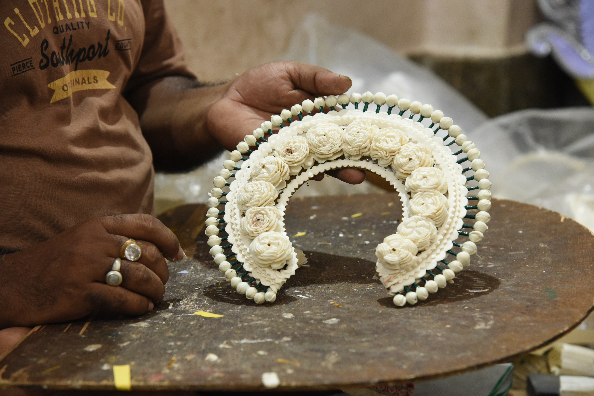

A white flower in an Odissi dancer’s headpiece may begin as the pale inner material of a plant. Sola craft uses this soft pith, cut into shapes and assembled into ornament.[^1]

A finished tahia, photographed in 2022.[^2]

## A flower made in parts

The steps become clearer in a 2016 account of Nityananda Moharana’s work in Puri. Thin strips, separated from the plant’s brown outer covering, are rolled, cut and secured at one end with wire to make a flower. Moharana names kadamba, rose, chrysanthemum and jasmine buds among the forms used in a tahia.[^3]

The finished headpiece has its own arrangement. In Moharana’s description, the *ghoba* surrounds the dancer’s hair bun; the *Krushna chuda* rises from its centre. He connects that upright element with the spire of Puri’s Jagannath temple.[^3] A small carved flower thus belongs to a larger structure, with a position as well as a shape.

## The work behind the white flowers

Upendra Kumar Purohit’s account, recorded by Anushka Ray for the People’s Archive of Rural India in 2023, brings the supporting materials into view. Alongside sholapith, he uses stiff cloth, wire, adhesive, thread and paper. He describes a division of tasks that can involve six or seven people. Jasmine-like buds form the headpiece’s spokes; shaping their tips is delicate work that he says women usually undertake.[^4]

## One material, several occasions

Sola’s uses connect dance costume with other kinds of ceremonial making, but the objects need not be treated as interchangeable. The state craft institute lists wedding crowns, festival tahia and dancers’ flowers separately.[^1] Keeping those uses distinct lets us notice what a maker is designing for: a particular wearer, arrangement and occasion.

## Footnotes & Sources

[^1]: State Institute for Development of Arts & Crafts, Odisha, [“Crafts of Odisha”](https://sidac.odisha.gov.in/en/crafts-of-odisha), “Solapith” section. Institutional overview of material and uses.

[^2]: Prakriti Panda, [“A fully-made Tahia”](https://commons.wikimedia.org/wiki/File:A_fully-made_Tahia.jpg), 23 May 2022, Wikimedia Commons. [CC BY-SA 4.0](https://creativecommons.org/licenses/by-sa/4.0/). Original photograph, unaltered.

[^3]: [“His Crowning Story”](https://www.newindianexpress.com/magazine/2016/Mar/05/his-crowning-story-900278.html), *The New Indian Express*, 5 March 2016. Workshop account and explanations attributed to Nityananda Moharana.

[^4]: Anushka Ray, [“The tahia maker of Puri”](https://ruralindiaonline.org/article/the-tahia-maker-of-puri), People’s Archive of Rural India, 7 May 2023; photographs by Prakriti Panda. Purohit’s account of materials and work organisation.
