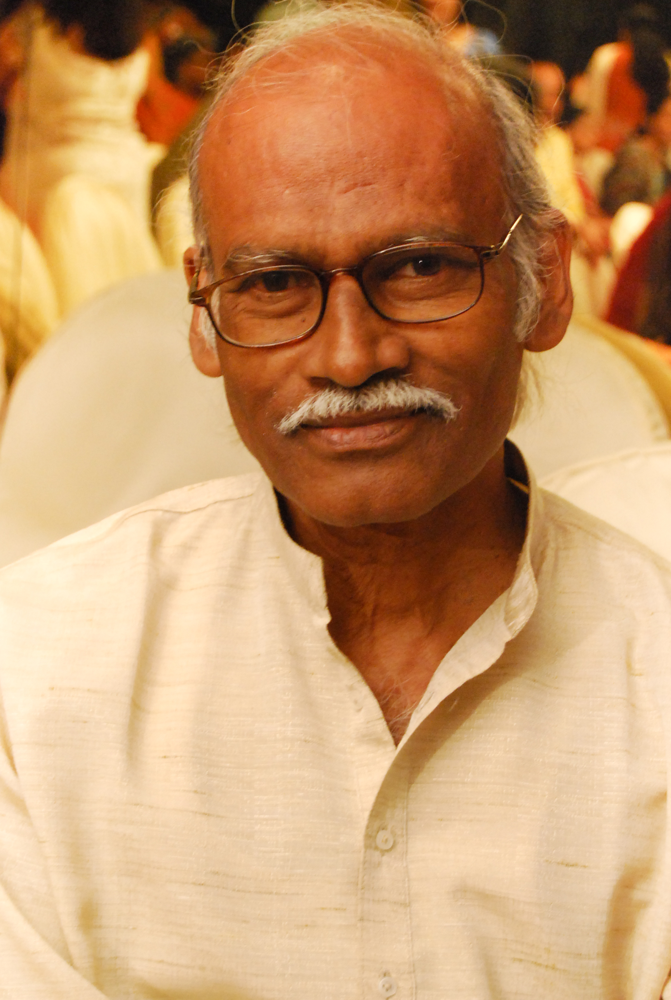

# Nirad Mohapatra: making a film, making room for others

By Ahimanikya Satapathy

Nirad Mohapatra left postgraduate political-science study for film training at FTII. By 1972 he was teaching there; from 1974 to 1983 he ran **Cinexstasy**, a Bhubaneswar film society pairing world-cinema screenings with analysis.[^life] Before following the filmmaker to *ମାୟା ମିରିଗ (Maya Miriga)*, it is worth stopping with the teacher and organiser.

A film could be something to make, but also something to gather around and discuss. Those encounters belong to Mohapatra’s working life alongside his own production.

*Nirad Mohapatra, 2010. Photo: Raj Sampad, [Wikimedia Commons](https://commons.wikimedia.org/wiki/File:Nirad_Mohapatra_-_Filmmaker.jpg), [CC BY-SA 4.0](https://creativecommons.org/licenses/by-sa/4.0/).*

## A place to encounter cinema

The same account connects his film-appreciation courses at Utkal University with his work on the film section of the literary journal *Mana Phasal*.[^life] A journal page, a university course and a film-society screening offered different ways to encounter cinema. Editing brought it into a literary publication; teaching made time for sustained attention; a screening allowed viewers to meet a work together.

## A household at the centre

The extended family at the centre of *ମାୟା ମିରିଗ (Maya Miriga)* provides the subject of our [companion film article](../culture/cinema-series/maya-miriga.md), which follows its collaborators and later restoration. Here, the film sits alongside the director’s work in teaching and organising screenings.

## Recognition, and the work after recognition

The film received **Second Best Feature Film** at the 31st National Film Awards, covering films of 1983 and presented in 1984. Cannes Critics’ Week records its **1984 selection**. The award and the festival selection mark distinct forms of recognition.[^national][^cannes]

## What can be carried forward?

The film society, the classroom and *Mana Phasal* leave us with a different picture of a filmmaker’s work. The screen was also a place around which he brought other people together.

What might remain with a viewer after such a screening—a question, an unfamiliar image, the wish to make something? His biography cannot tell us every answer. It does show the sustained work of creating those occasions.

## Footnotes & Sources

[^life]: [Nirad Mohapatra’s official memorial biography](https://niradmohapatra.com/about-me/), education, teaching, Cinexstasy and *Mana Phasal*. Retrospective account.
[^national]: Directorate of Film Festivals, [31st National Film Awards catalogue](https://www.dff.nic.in/images/Documents/86_31stNfacatalogue.pdf), Second Best Feature Film. Award year distinguished from presentation and festival dates.
[^cannes]: Cannes Critics’ Week, [Maya Miriga, 1984](https://www.semainedelacritique.com/en/edition/1984/movie/maya-miriga), selection record.

## Further reading

- [Maya Miriga: a family, a fragile film, a second life](../culture/cinema-series/maya-miriga.md)
- [Manmohan Mahapatra: households under pressure](../culture/cinema-series/manmohan-mahapatra.md)
- [What Makes the Next Film Possible](../culture/cinema-series/cinema-economics.md)

**[Suggest an update](https://projectodisha.org/contribute/?page=/people/nirad-mohapatra/):** share a credit, publication record or precise correction. GitHub submissions are public; omit private contact details and consent documents.
