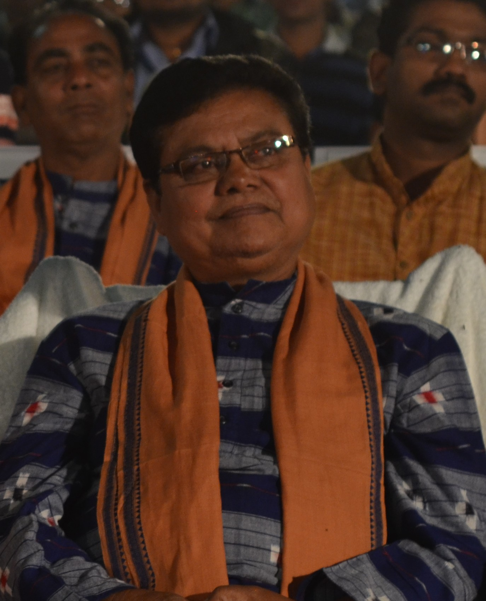

# Sabyasachi Mohapatra: stories rooted in western Odisha

By Ahimanikya Satapathy

In a 2022 interview, **Sabyasachi Mohapatra** described learning through discussions with his cinematographer son, even when their ideas about an image differed.[^interview] The exchange offers a way into his career: a director rooted in western Odisha’s stories, still working out how to tell them with another generation.

Our [article on ଭୂଖା (Bhukha)](../culture/cinema-series/bhukha.md) follows its performers’ livelihoods and musical world. The National Film Awards retrospective identifies it as a 1989 Sambalpuri film and records an International Jury Award at Gijón, without establishing the prize’s exact year.[^career] The director’s wider profile follows the collaborations around such films.

*Sabyasachi Mohapatra, photographed at the Odisha State Film Awards in Bhubaneswar, 21 November 2014. Photo: Subhashish Panigrahi; existing crop by MKar. [Wikimedia Commons](https://commons.wikimedia.org/wiki/File:Sabyasachi_Mohapatra.jpg), [CC BY-SA 4.0](https://creativecommons.org/licenses/by-sa/4.0/).*

## A film must also travel

In a 2022 interview, Mohapatra recalled *Bhukha* reaching audiences across western and coastal Odisha. He also described promotion as a separate expense.[^interview] Making a film and bringing it to viewers are connected undertakings.

That problem belongs beside the creative achievement. A local story does not reach viewers merely because it has been made. Distribution, publicity and the places where people can watch it help determine whether the conversation continues.

Mohapatra also argued that art films and mainstream films could coexist.[^interview] His account leaves room for different audiences and ambitions within the same film culture.

## The names beside the director

*ଆଦିମ ବିଚାର (Aadim Vichar)* offers a later point of entry. Its Indian Panorama credits name **Kapileswar Prasad Mohapatra** for the story, **Kumar C. Dev Mohapatra** for cinematography, **Rajendra Mohapatra** for editing, and **Pankaj Jal and Ghasiram Mishra** for music. Sabyasachi wrote the screenplay and directed.[^panorama]

A director’s profile can make those relationships visible. Writing supplies a story; performance gives it people; photography, editing and music give it duration, space and rhythm. Recognition of the director need not hide the work around him.

## What the national award recognises

*Aadim Vichar* received **Best Odiya Film** at the 62nd National Film Awards, announced on 24 March 2015 for films of 2014. The result names Mohapatra Movie Magic Pvt Ltd and Sabyasachi Mohapatra as producer and director recipients. It was recognition in the language-category film award.[^award]

Our [film companion](../culture/cinema-series/aadim-vichar.md) considers its encounter between a community’s understanding of justice and outside authority. Its credited writer and performers give that discussion particular voices.

## A regional world, with room for difference

These films invite a more particular way of reading Odisha’s cinema. Language, location and collaborators matter; “regional cinema” need not mean one uniform experience. Viewers can follow a filmmaker across works while still asking whose voice leads each story, who performs it and who gets to see it.

## Footnotes & Sources

[^career]: [70th National Film Awards catalogue](https://nfaindia.org/images/pdf/70th%20National%20Film%20Award%20Catalogue.pdf), printed p. 036, retrospective director biography. Original Gijón award register remains unverified.
[^interview]: OdishaPlus, [Tete-e-tete with Sabyasachi Mohapatra](https://odisha.plus/2022/07/tete-e-tete-with-sabyasachi-mohapatra/), July 2022. Retrospective testimony, not audited box-office data.
[^panorama]: Directorate of Film Festivals, [Indian Panorama 2014 catalogue](https://dff.nic.in/images/Documents/20_IPCatalogue2014.pdf), printed p. 031, *Adim Vichar* credits.
[^award]: Press Information Bureau, [62nd National Film Awards results](https://www.pib.gov.in/newsite/erelcontent.aspx?lang=2&reg=48&relid=117636), 24 March 2015, Best Odiya Film.

## Further reading

- [Aadim Vichar: whose understanding of justice?](../culture/cinema-series/aadim-vichar.md)
- [Bhukha: when a tradition must also feed a family](../culture/cinema-series/bhukha.md)
- [What Makes the Next Film Possible](../culture/cinema-series/cinema-economics.md)

**[Suggest an update](https://projectodisha.org/contribute/?page=/people/sabyasachi-mohapatra/):** share a credit, publication record or precise correction. GitHub submissions are public; omit private contact details and consent documents.
