# Images for Odisha articles

Images for all 27 articles, grouped by subject. Captions distinguish documentary photographs from illustrations and diagrams. Source, creator, licence and modification details accompany every image.

[Article library](index.md) · [Live collection](https://projectodisha.org/stories/odisha/) · [Image metadata](images.json)

## Nature and environment

### Mandasaru and the smaller lives of a forest gorge

[Read article](nature/mandasaru.md) · [Live article](https://projectodisha.org/stories/odisha/mandasaru/)

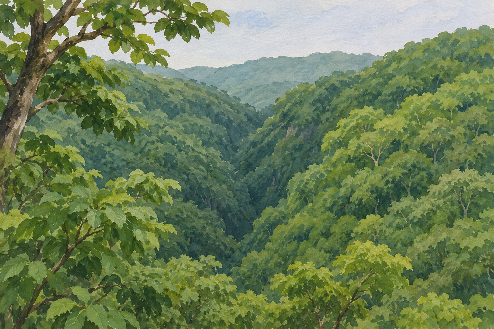

An interpretive illustration of Mandasaru’s forest and gorge.

[Mandasaru forest illustration](/destinations/mandasaru/) — Project Odisha. Original Project Odisha artwork; no third-party licence applies.

Existing interpretive illustration reused unchanged; not a documented viewpoint.

### Pentha and the unfinished work of coastal protection

[Read article](nature/pentha.md) · [Live article](https://projectodisha.org/stories/odisha/pentha/)

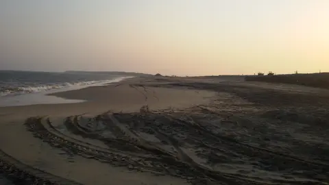

Pentha beach in February 2015; a historical coastal view, not evidence of present protection works.

[Sea beach at Pentha in Kendrapara district 754225, India - panoramio (1).jpg](https://commons.wikimedia.org/wiki/File:Sea_beach_at_Pentha_in_Kendrapara_district_754225,_India_-_panoramio_(1).jpg) — Deepak das. [CC BY 3.0](https://creativecommons.org/licenses/by/3.0/).

Resized and converted to WebP; full downloaded framing retained.

### Patrapada’s garden of named plants

[Read article](nature/patrapada.md) · [Live article](https://projectodisha.org/stories/odisha/patrapada/)

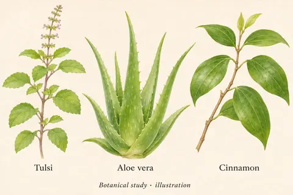

Tulsi, aloe vera and cinnamon in an original botanical study, not a record of particular specimens at Patrapada.

[Three named plants](https://github.com/ahimanikya/project-odisha/blob/main/outputs/independent-article-images-20261126/original-art/patrapada-v1.png) — Project Odisha. Original Project Odisha artwork; no third-party licence applies.

Resized and converted to WebP; full composition retained.

### The rivers beyond Similipal’s waterfalls

[Read article](nature/similipal-waterfalls.md) · [Live article](https://projectodisha.org/stories/odisha/similipal-waterfalls/)

Barehipani waterfall in Similipal, photographed in 2013.

[Similipal (2).jpg](https://commons.wikimedia.org/wiki/File:Similipal_(2).jpg) — Wiki GSD. [CC BY-SA 4.0](https://creativecommons.org/licenses/by-sa/4.0/).

Original file retained. Full image shown; adaptation, if any, remains CC BY-SA 4.0.

### Cyclone Dana and the layers of coastal protection

[Read article](nature/cyclone-dana.md) · [Live article](https://projectodisha.org/stories/odisha/cyclone-dana/)

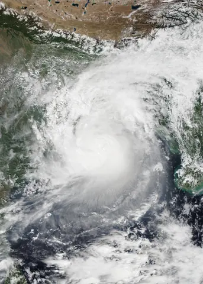

Cyclone Dana over the Bay of Bengal on 24 October 2024, seen by NOAA-20.

[Dana 2024-10-24 0800Z.jpg](https://commons.wikimedia.org/wiki/File:Dana_2024-10-24_0800Z.jpg) — NOAA-20 Satellite / NOAA. [Public domain — NOAA work](https://commons.wikimedia.org/wiki/Template:PD-USGov-NOAA).

Commons version cropped by TCFHK in March 2025; resized and converted to WebP without further cropping.

## Food and farming

### Odisha Rasagola from the kneading board to Niladri Bije

[Read article](food/odisha-rasagola.md) · [Live article](https://projectodisha.org/stories/odisha/odisha-rasagola/)

Pahala rasagola on a plate.

[Rasagolla.JPG](https://commons.wikimedia.org/wiki/File:Rasagolla.JPG) — Archbik. [Public domain (author release)](https://commons.wikimedia.org/wiki/File:Rasagolla.JPG#Licensing).

Existing aspect-preserving resize and WebP conversion; no new crop.

### The work behind a cup of Koraput coffee

[Read article](food/koraput-coffee.md) · [Live article](https://projectodisha.org/stories/odisha/koraput-coffee/)

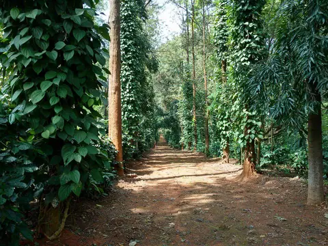

Pepper-clad trees in a coffee-growing landscape in Koraput, photographed in 2016.

[Coffee shots.jpg](https://commons.wikimedia.org/wiki/File:Coffee_shots.jpg) — Rishita Bhattacharya. [CC BY-SA 4.0](https://creativecommons.org/licenses/by-sa/4.0/).

Resized and converted to WebP; full downloaded framing retained. Displayed adaptation retains CC BY-SA 4.0.

### Sakhigopal’s coconut trade after the storm

[Read article](food/sakhigopal-coconuts.md) · [Live article](https://projectodisha.org/stories/odisha/sakhigopal-coconuts/)

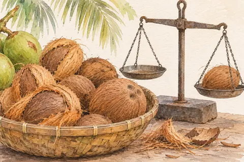

An illustration of harvested coconuts and a market balance, not a documented Sakhigopal auction.

[Coconuts and trade](https://github.com/ahimanikya/project-odisha/blob/main/outputs/independent-article-images-20261126/original-art/sakhigopal-coconuts-v1.png) — Project Odisha. Original Project Odisha artwork; no third-party licence applies.

Resized and converted to WebP; full composition retained.

### Pakhala and the many ways to build a meal

[Read article](food/pakhala.md) · [Live article](https://projectodisha.org/stories/odisha/pakhala/)

Pakhala with vegetable accompaniments, photographed in 2019.

[Pakhala with assorted side dishes 03.jpg](https://commons.wikimedia.org/wiki/File:Pakhala_with_assorted_side_dishes_03.jpg) — Subhashish Panigrahi. [CC BY-SA 4.0](https://creativecommons.org/licenses/by-sa/4.0/).

Resized and converted to WebP; displayed adaptation remains CC BY-SA 4.0.

### Chhatia’s chhena kakara and the roadside economy

[Read article](food/chhatia-kakara.md) · [Live article](https://projectodisha.org/stories/odisha/chhatia-kakara/)

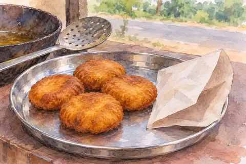

An imagined illustration of fried sweets at a roadside counter, not a record of a particular Chhatia shop or recipe.

[Roadside sweets](https://github.com/ahimanikya/project-odisha/blob/main/outputs/independent-article-images-20261126/original-art/chhatia-kakara-v1.png) — Project Odisha. Original Project Odisha artwork; no third-party licence applies.

Resized and converted to WebP; full composition retained.

## History and heritage

### A royal procession survives beneath Sitabinji’s rock

[Read article](history/sitabinji.md) · [Live article](https://projectodisha.org/stories/odisha/sitabinji/)

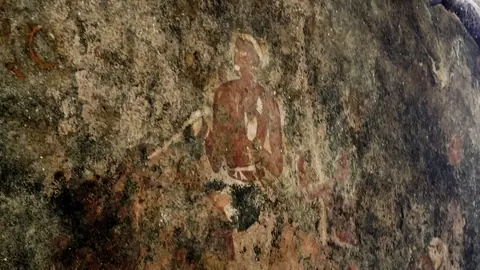

The surviving mural at Sitabinji, photographed in October 2019.

[Sitabinji Fresco Painting, Keonjhar, Odisha 01.jpg](https://commons.wikimedia.org/wiki/File:Sitabinji_Fresco_Painting,_Keonjhar,_Odisha_01.jpg) — Paramanu Sarkar. [CC BY-SA 4.0](https://creativecommons.org/licenses/by-sa/4.0/).

Resized and converted to WebP; full downloaded framing retained. Displayed adaptation retains CC BY-SA 4.0.

### Kharaldhas and the forts along the Jonk

[Read article](history/kharaldhas-jonk.md) · [Live article](https://projectodisha.org/stories/odisha/kharaldhas-jonk/)

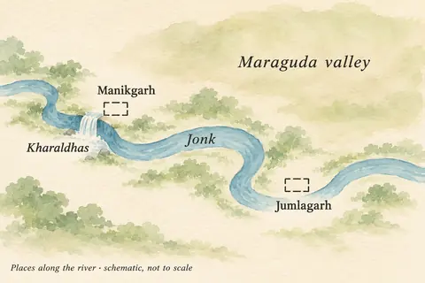

A schematic of places discussed along the Jonk, not a surveyed map or reconstruction of the forts.

[Places along the Jonk](https://github.com/ahimanikya/project-odisha/blob/main/outputs/independent-article-images-20261126/original-art/kharaldhas-jonk-v1.png) — Project Odisha. Original Project Odisha artwork; no third-party licence applies.

Resized and converted to WebP; full composition retained.

### What Ashoka’s inscriptions at Dhauli ask of government

[Read article](history/dhauli.md) · [Live article](https://projectodisha.org/stories/odisha/dhauli/)

The elephant carved from rock at Dhauli · AmlanTheTramp, January 2017.

[Dhauli Elephant Statue.jpg](https://commons.wikimedia.org/wiki/File:Dhauli_Elephant_Statue.jpg) — AmlanTheTramp. [CC BY-SA 4.0](https://creativecommons.org/licenses/by-sa/4.0/).

Wikimedia thumbnail retained unmodified; displayed without cropping. The source photograph may include the photographer’s own processing.

### Bali Jatra and the seasonal knowledge of sailors

[Read article](history/bali-jatra.md) · [Live article](https://projectodisha.org/stories/odisha/bali-jatra/)

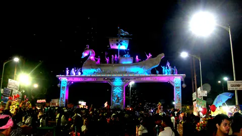

The boat-topped entrance at Bali Jatra, Cuttack, photographed in 2012.

[Balijatra cuttack.JPG](https://commons.wikimedia.org/wiki/File:Balijatra_cuttack.JPG) — Kamalakanta777. [CC BY-SA 3.0](https://creativecommons.org/licenses/by-sa/3.0/).

Resized and converted to WebP; full downloaded framing retained. Displayed adaptation retains CC BY-SA 3.0.

### What shell offcuts reveal about Odisha’s coastal craft

[Read article](history/coastal-shell-craft.md) · [Live article](https://projectodisha.org/stories/odisha/coastal-shell-craft/)

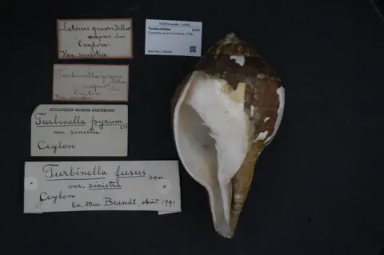

A museum specimen of Turbinella pyrum, the conch species discussed in the shell-working study. This is not an excavated object from Manikapatana.

[Naturalis Biodiversity Center - ZMA.MOLL.356504 - Turbinella pyrum (Linnaeus, 1758) - Turbinellidae - Mollusc shell.jpeg](https://commons.wikimedia.org/wiki/File:Naturalis_Biodiversity_Center_-_ZMA.MOLL.356504_-_Turbinella_pyrum_(Linnaeus,_1758)_-_Turbinellidae_-_Mollusc_shell.jpeg) — Naturalis Biodiversity Center. [CC0 1.0](https://creativecommons.org/publicdomain/zero/1.0/).

Resized and converted to WebP; specimen and historical collection labels retained.

## Arts and living traditions

### Dhemsa and the movement of a shared rhythm

[Read article](arts/dhemsa.md) · [Live article](https://projectodisha.org/stories/odisha/dhemsa/)

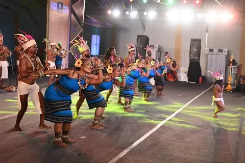

Odisha’s Dhemsa contingent at the National Tribal Festival, 2022.

[Dhemsa dance.png](https://commons.wikimedia.org/wiki/File:Dhemsa_dance.png) — Government of Odisha. [CC BY 4.0](https://creativecommons.org/licenses/by/4.0/).

Resized and converted to WebP; full downloaded framing retained.

### Toshali’s temporary market for continuing craft

[Read article](arts/toshali.md) · [Live article](https://projectodisha.org/stories/odisha/toshali/)

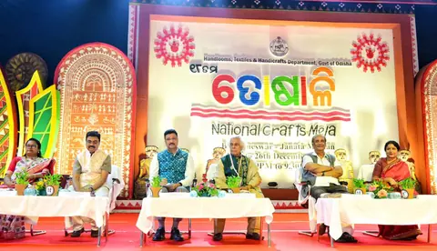

The opening ceremony of the eighteenth Toshali Crafts Mela in Bhubaneswar, December 2023.

[18th Toshali Craft Festival 2023.jpg](https://commons.wikimedia.org/wiki/File:18th_Toshali_Craft_Festival_2023.jpg) — Government of Odisha. [CC BY 4.0](https://creativecommons.org/licenses/by/4.0/).

Converted to WebP; full framing retained.

### Raja’s days of rest, swings and renewal

[Read article](arts/raja.md) · [Live article](https://projectodisha.org/stories/odisha/raja/)

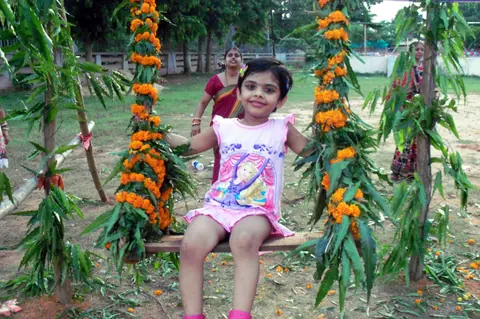

Raja swing play, photographed in June 2011.

[Raja doli.jpg](https://commons.wikimedia.org/wiki/File:Raja_doli.jpg) — ଜଗଦୀଶ ଉତ୍ତରକବାଟ. [CC BY-SA 3.0](https://creativecommons.org/licenses/by-sa/3.0/).

Resized and converted to WebP; full downloaded framing retained. Displayed adaptation retains CC BY-SA 3.0.

### Bande Utkala Janani from poem to public ceremony

[Read article](arts/bande-utkala-janani.md) · [Live article](https://projectodisha.org/stories/odisha/bande-utkala-janani/)

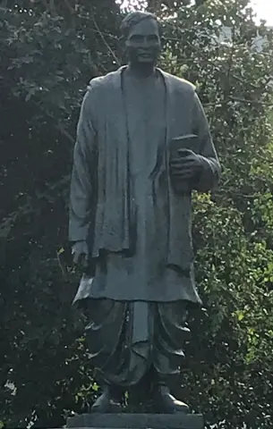

A statue of Kantakabi Laxmikanta Mohapatra, the poet of Bande Utkala Janani, in Bhubaneswar. Photograph from 2022.

[Laxmikanta Mohapatra Statue.jpg](https://commons.wikimedia.org/wiki/File:Laxmikanta_Mohapatra_Statue.jpg) — Subhrasingh. [CC BY-SA 4.0](https://creativecommons.org/licenses/by-sa/4.0/).

Resized and converted to WebP; full downloaded framing retained. Displayed adaptation retains CC BY-SA 4.0.

## Places and geography

### Motu where a confluence connects three states

[Read article](places/motu-mugi-point.md) · [Live article](https://projectodisha.org/stories/odisha/motu-mugi-point/)

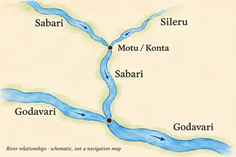

The Sileru joins the Sabari near Motu and Konta; the Sabari meets the Godavari farther downstream. River relationships shown schematically, not as a navigation map.

[Two river junctions](https://github.com/ahimanikya/project-odisha/blob/main/outputs/independent-article-images-20261126/original-art/motu-mugi-point-v1.png) — Project Odisha. Original Project Odisha artwork; no third-party licence applies.

Resized and converted to WebP; full composition retained.

### Sonapur where beach management meets a river mouth

[Read article](places/sonapur.md) · [Live article](https://projectodisha.org/stories/odisha/sonapur/)

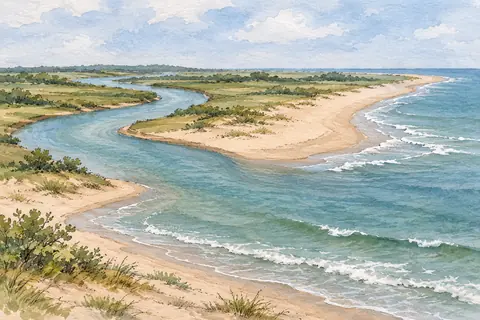

A conceptual illustration of a river mouth and sandy coast, not a surveyed or documentary view of Sonapur.

[A river meeting the sea](https://github.com/ahimanikya/project-odisha/blob/main/outputs/independent-article-images-20261126/original-art/sonapur-v1.png) — Project Odisha. Original Project Odisha artwork; no third-party licence applies.

Resized and converted to WebP; full composition retained.

### Gundichaghagi and Ghatagaon’s river landscape

[Read article](places/gundichaghagi.md) · [Live article](https://projectodisha.org/stories/odisha/gundichaghagi/)

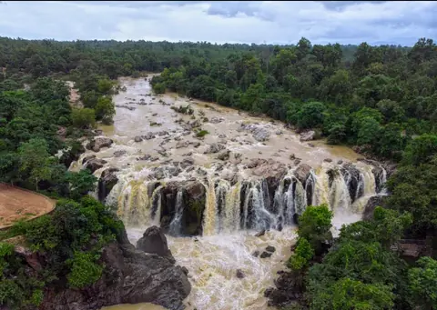

Gundichaghagi waterfall during the monsoon, photographed in 2019.

[Gundichaghagi Waterfall, Keonjhar During monsoons.png](https://commons.wikimedia.org/wiki/File:Gundichaghagi_Waterfall,_Keonjhar_During_monsoons.png) — Bikashkumargiri1997. [CC BY-SA 4.0](https://creativecommons.org/licenses/by-sa/4.0/).

Resized and converted to WebP; full downloaded framing retained. Displayed adaptation retains CC BY-SA 4.0.

### Galigabdar beyond the waterfall view

[Read article](places/galigabdar.md) · [Live article](https://projectodisha.org/stories/odisha/galigabdar/)

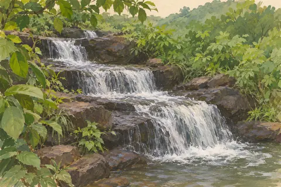

An illustration of water descending successive rock shelves, not a reconstruction of the exact Galigabdar falls.

[Water over rock steps](https://github.com/ahimanikya/project-odisha/blob/main/outputs/independent-article-images-20261126/original-art/galigabdar-v1.png) — Project Odisha. Original Project Odisha artwork; no third-party licence applies.

Resized and converted to WebP; full composition retained.

### Chandoori Sai and the craft within its walls

[Read article](places/chandoori-sai.md) · [Live article](https://projectodisha.org/stories/odisha/chandoori-sai/)

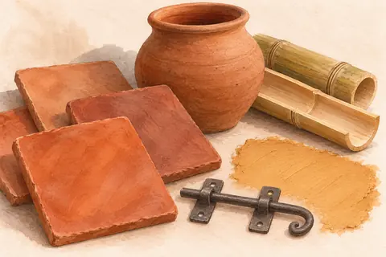

An illustrated material study of terracotta, earthen plaster, bamboo and ironwork discussed in the article; not a depiction of the guesthouse.

[Clay, earth, bamboo and iron](https://github.com/ahimanikya/project-odisha/blob/main/outputs/independent-article-images-20261126/original-art/chandoori-sai-v1.png) — Project Odisha. Original Project Odisha artwork; no third-party licence applies.

Resized and converted to WebP; full composition retained.

### Rabandhara from a seasonal gorge to a nature camp

[Read article](places/rabandhara.md) · [Live article](https://projectodisha.org/stories/odisha/rabandhara/)

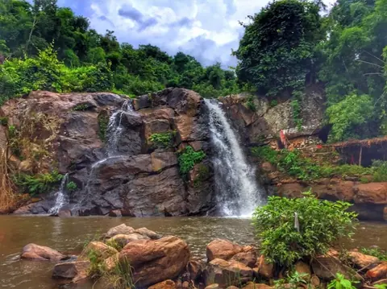

Rabandhara waterfall in Kalahandi, photographed in 2018.

[Rabandhara Waterfall, Kalahandi.jpg](https://commons.wikimedia.org/wiki/File:Rabandhara_Waterfall,_Kalahandi.jpg) — Debasish Rout. [CC BY-SA 4.0](https://creativecommons.org/licenses/by-sa/4.0/).

Commons version cropped vertically by Featous in 2021; converted to WebP without further cropping. Displayed adaptation retains CC BY-SA 4.0.

## Economy, livelihoods and infrastructure

### Lower Indra and the two promises of a reservoir

[Read article](economy/lower-indra.md) · [Live article](https://projectodisha.org/stories/odisha/lower-indra/)

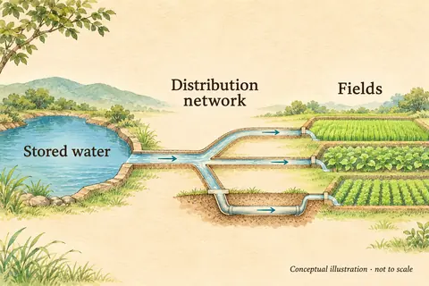

Stored water reaches fields through a distribution network. This conceptual illustration is not a plan of Lower Indra or evidence of actual water delivery.

[From stored water to fields](https://github.com/ahimanikya/project-odisha/blob/main/outputs/independent-article-images-20261126/original-art/lower-indra-v1.png) — Project Odisha. Original Project Odisha artwork; no third-party licence applies.

Resized and converted to WebP; full composition retained.

### Following Jalaput’s water towards electricity

[Read article](economy/jalaput-machkund.md) · [Live article](https://projectodisha.org/stories/odisha/jalaput-machkund/)

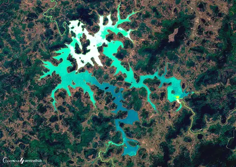

Jalaput Reservoir in an enhanced-colour Sentinel-2 view from December 2021; colours reflect image processing.

[Jalaput Reservoir, India (52233761286).png](https://commons.wikimedia.org/wiki/File:Jalaput_Reservoir,_India_(52233761286).png) — Monja Šebela / Sentinel Hub. [CC BY 2.0; Copernicus Sentinel attribution](https://creativecommons.org/licenses/by/2.0/).

Contains modified Copernicus Sentinel data [2021], processed by Sentinel Hub using the Ulyssys script. Official thumbnail converted to WebP; full framing and embedded attribution retained.
