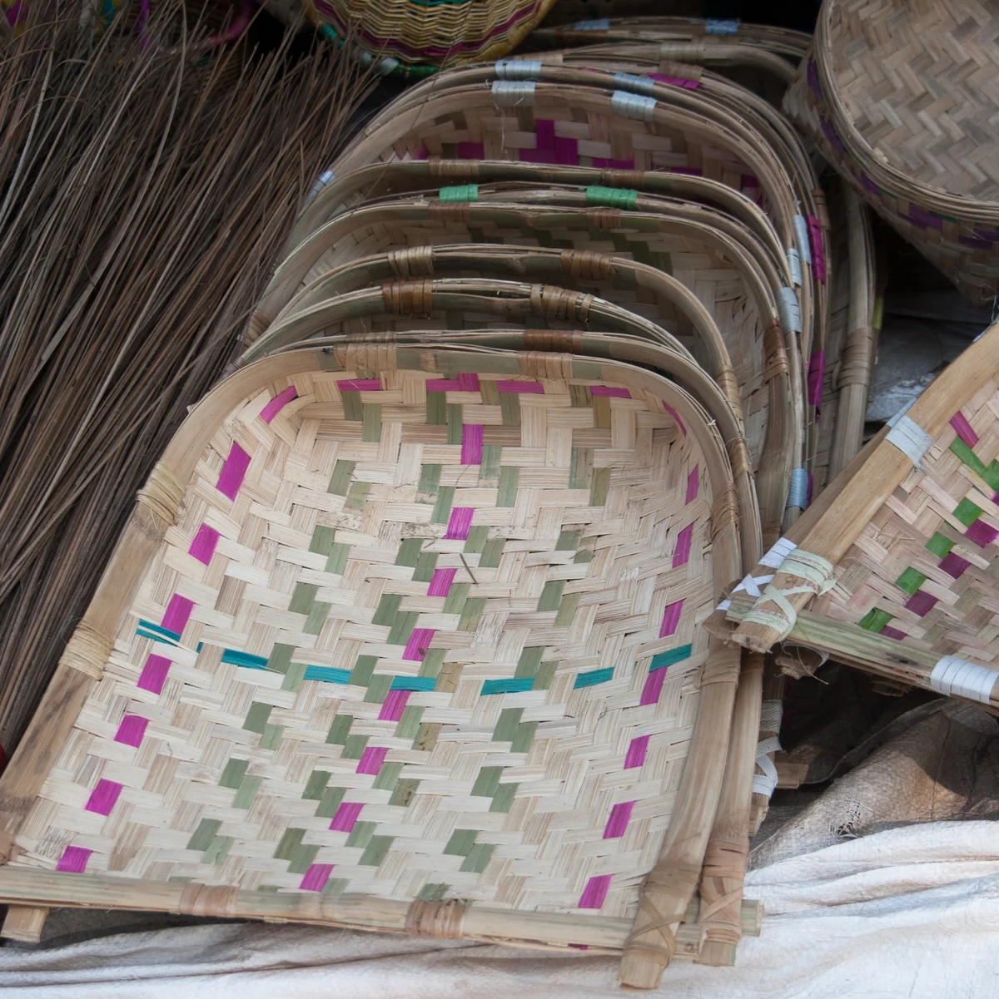

# Kula and the Work of Winnowing

By Ahimanikya Satapathy

The kula (କୁଲା) belongs to the work of cleaning grain. An agricultural survey in ICAR’s 2014–15 annual report records it as a winnower in selected Odisha villages, listing a sieve and a basket separately. The distinction matters: woven objects can look related while doing different jobs.[^1]

*Winnowing trays photographed by Debiprasad Sahoo in 2013.*[^2]

## Reading the weave

Sahoo’s photograph makes the structure easy to follow. Broad strips cross over and under one another across the tray. Along the curved sides, thicker lengths form a rim held together by repeated bindings. Pink, green and blue strips interrupt the pale weave. The stacked trays let us compare their faces and edges rather than see only a single flat surface.[^2]

The photograph does not identify their maker. A separate account from Malkangiri gives names to the work: in December 2018, reporter Deba Prasad Das described Gurumurthy and Sridevi making bamboo kula, pachiya baskets and binchana hand fans in Maderi Street. A kula and a binchana belonged to the same makers’ range, but one cleaned grain while the other was a hand fan.[^3]

## What the air separates

In winnowing, grain is tossed into moving air so that lighter impurities are carried away. FAO’s account of grain cleaning explains both the method and its limit: heavier impurities can remain. A clean-looking heap after winnowing is not proof that stones and other unwanted material have all been removed.[^4]

Air and a sieve separate in different ways. In the mechanical winnower described by FAO, a fan removes light material and sieves then sort by size. That combination helps explain why a winnowing tray and a sieve are distinct implements. The kula is part of a sequence of cleaning work, not a substitute for every step.[^4]

Seen beside the dhinki, the difference is equally useful. The dhinki pounds; winnowing separates loose material. One object cannot tell the whole story of the work between a harvest and a meal.

## The people behind the tray

Das’s 2018 Malkangiri report also records the makers’ difficulties. They described competition from plastic goods, rising bamboo costs and weak access to markets. Gurumurthy wanted a better place to show their work. These are the concerns of named artisans at a particular time, not a measure of the craft’s condition everywhere today.[^3]

Looking at a kula can begin with its weave, but it need not end there. Who made it, who uses it, and who repairs a loose rim? Those questions connect the finished object to the people whose work gives it a place in daily life.

## Further reading

[The Dhinki and the Work Behind Rice](https://projectodisha.org/stories/dhinki-and-the-work-behind-rice/) · [Binchana and the Handmade Breeze](https://projectodisha.org/stories/binchana-and-the-handmade-breeze/) · [Listening to Craft](https://projectodisha.org/stories/craft-listening/)

## Footnotes & Sources

[^1]: ICAR Research Complex for Eastern Region, [*Annual Report 2014–15*](https://icarrcer.org.in/wp-content/uploads/2014/01/AnnualReport2014-15.pdf#page=62), p.57, Table 55. The table reports selected villages in Odisha and West Bengal, not a statewide inventory.

[^2]: Debiprasad Sahoo, [“Winnowing Fan1.jpg”](https://commons.wikimedia.org/wiki/File:Winnowing_Fan1.jpg), photograph dated 23 November 2013, [CC BY-SA 3.0](https://creativecommons.org/licenses/by-sa/3.0/). Commons identifies this image as an extract from “କୁଲା.jpg”. This article’s version preserves the downloaded frame, resized and compressed under the same licence; the maker and location are not established by the file record.

[^3]: Deba Prasad Das, [“Despite not having market, Malkangiri artisans struggle to keep bamboo craft alive”](https://www.newindianexpress.com/states/odisha/2018/Dec/04/no-market-artisans-struggle-to-keep-bamboo-craft-alive-1907057.html), *The New Indian Express*, 4 December 2018. The report’s separate description of dyeing strips concerns a dala basket, not a step-by-step account of making a kula.

[^4]: M. de Lucia and D. Assennato, [“Grain cleaning and insecticide treatments”](https://www.fao.org/4/T0522E/T0522E0B.HTM), in *Agricultural Engineering in Development: Post-harvest Operations and Management of Foodgrains*, FAO Agricultural Services Bulletin 93, 1994, “Traditional methods” and “Winnowers”. Used here for the general cleaning principle, not an Odisha-specific workshop account.
