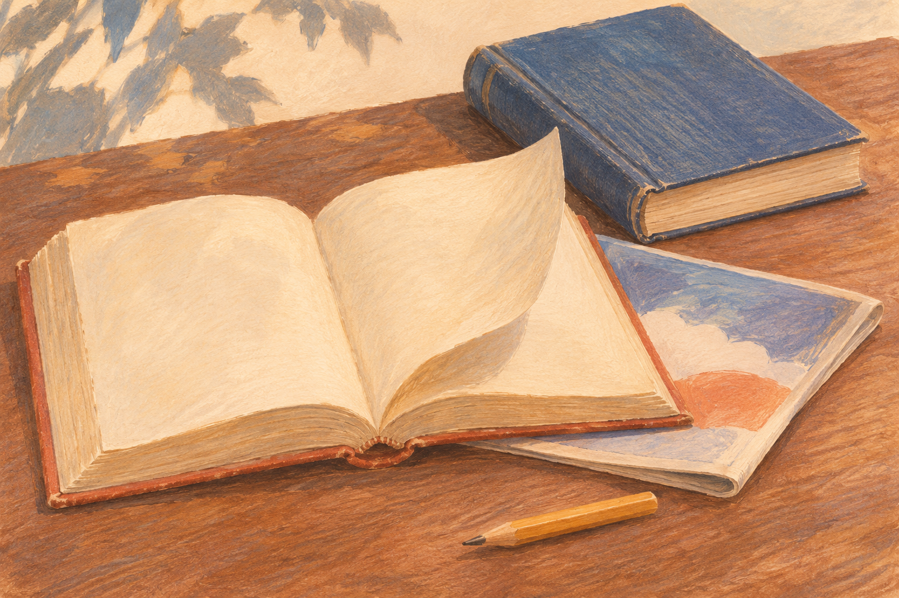

# Birakishore Das: Poems, Schoolbooks and the Young Reader

By Ahimanikya Satapathy

*Poetry collection, school reader and periodical: a symbolic reading-table illustration. Illustration: Project Odisha.*

On a surviving cover of *Mo Desa*, a child rides a rocking horse and holds three balloons carrying the magazine’s name. Near the bottom is another important piece of lettering: editor, Birakishore Das. Inside that issue, his poem *Mo Gaon* turns towards the village—its dust, river, crops, birds and neighbours. A reader encounters the poet through familiar places and the pleasure of an illustrated magazine.[^1]

## A poem in print

Birakishore’s account of publishing *Mohanabansi* brings the risks of print into view. In a recollection preserved in his collected works, he describes taking the manuscript around Cuttack before it was printed at Mukura Press. He says he used another name because putting his own on the book could expose him to arrest. The account makes the printer, the name on the cover and the author’s circumstances part of the work’s history.[^2]

The collection’s opening poem addresses Utkal as a mother and draws writers and public figures into its appeal. Names accumulate across the lines. Read alongside the publishing recollection, this is poetry seeking a public audience, with all the practical difficulty of getting words into circulation.[^2]

## Making room for young readers

The work of producing schoolbooks belongs within that history. In his 1994 biography *Kavi Birakishore*, published by the Orissa Sahitya Akademi, Pathani Patnaik describes the Odisha government entrusting Birakishore with responsibilities for the nationalisation of textbooks and arrangements for their publication. Patnaik also places children’s literature within this institutional work.[^3]

That role involved more than an individual poem appearing in a reader. It concerned the means by which books reached children. Authorship, editing and publication are distinct contributions; the biography supports his work in textbook production without establishing that he wrote every lesson or reader associated with it.

In *Mo Gaon*, remembered surroundings lead towards neighbours and shared life. Affection for place takes a scale a young reader can recognise. A children’s periodical could bring this writing into a recurring encounter with print.[^1]

## A voice in the classroom

His poetry continues to have a schoolbook life. The 2026 experimental edition of Odisha’s Class VIII *Sahitya Surabhi* opens its numbered lessons with *Asa Utkaliya*. Its note identifies *Bira Gitika* as the source collection. The poem calls listeners together and invokes figures including Buxi Jagabandhu, Gopabandhu and Baji Rout. Its questions and appeals ask readers to make memory an active responsibility.[^4]

The exercises following it turn that address into classroom reading: pupils are asked to interpret the references and ideas. Here the poet’s voice passes through another set of hands—textbook editors, teachers and students.

## Further reading

[Preserving Odia literature](https://projectodisha.org/stories/odia-literature-preservation/)

[A Morning with Odia Bibhaba](https://projectodisha.org/stories/odia-bibhaba-visit/)

## Footnotes & Sources

[^1]: *Mo Desa*, second year, fourth issue, in the [bound scan preserved by Srujanika’s Odia Bibhaba](https://odiabibhaba.in/api/magazines/mo-desa/stream), PDF pp. 31–34: cover editor credit, contents and *Mo Gaon*, signed Birakishore Das. No calendar year is assigned here from conflicting catalogue descriptions. The cover and poem are discussed, not reproduced.

[^2]: Birakishore Das, recollection “Chhadma namare bahiti lekhili,” printed pp. 7–8, and the opening poem of *Mohanabansi*, printed p. 9, in *Jatiya Kabi Birakishore Granthabali*, edited by Dolagobinda Pradhan (1996), [Odia Bibhaba scan](https://odiabibhaba.in/api/books/jatiya-kabi-birakishore-granthabali/stream), PDF pp. 66–68. The publishing account is the author’s retrospective testimony.

[^3]: Pathani Patnaik, *Kavi Birakishore* (Orissa Sahitya Akademi, first edition, 1994), printed p. 33, [Odia Bibhaba scan](https://odiabibhaba.in/api/books/kabi-birakisor/stream), PDF p. 40; publication details at PDF p. 4. This supports the stated institutional responsibilities, not an itemised bibliography of books he personally authored.

[^4]: *Sahitya Surabhi*, Class VIII, experimental edition 2026, School and Mass Education Department, Government of Odisha, [official OSEPA edition](https://osepa.odisha.gov.in/upload/ebooks/CLASS-VIII/Sahitya_Suravi-192_Web.pdf), printed pp. 1–3 (PDF pp. 19–21); edition details at PDF p. 4. This is evidence of inclusion in this edition, not a claim about every school’s current use.
